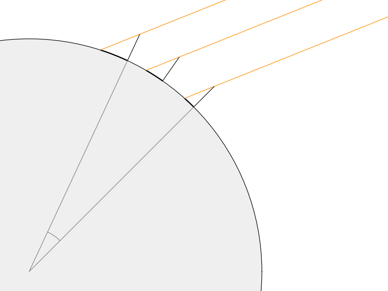
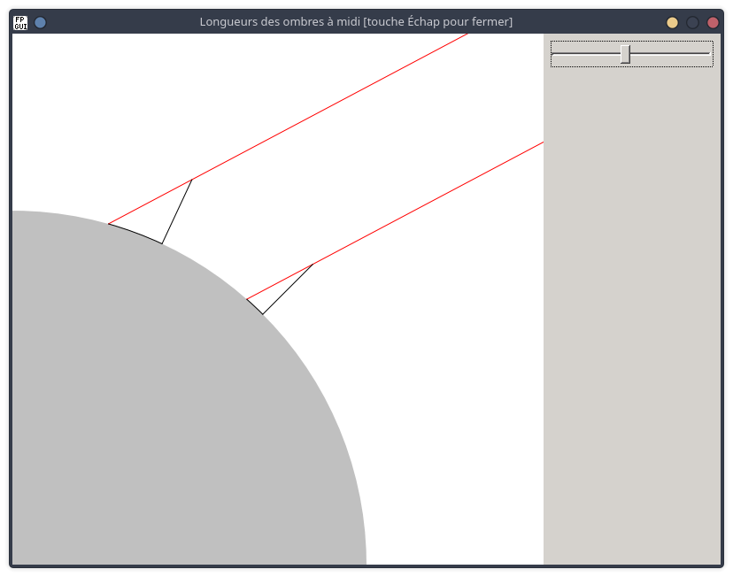
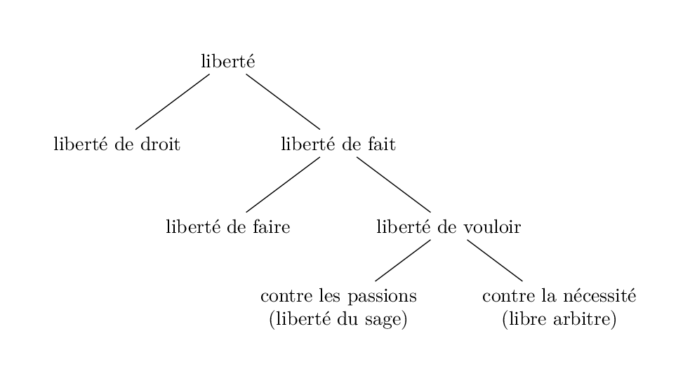

# Cours de philosophie

# Chapitre 1. Socrate et la sagesse

Platon, *Apologie de Socrate*.

## I. Introduction

### A. Le plus sage des hommes

On a dit de Socrate qu'il était **le plus sage des hommes**. Plus exactement, c'est **l'oracle de Delphes** qui a dit qu'il n'y avait pas dans le monde d'homme plus sage que Socrate.

C'est un ami de Socrate (Chéréphon, ou Khairéphon) qui avait demandé à la prêtresse d'Apollon s'il y avait dans le monde un homme plus sage que Socrate, et l'oracle avait répondu qu'il n'y en avait pas.

Le dieu Apollon répond aux questions qu'on lui pose par la bouche de la Pythie. Voilà ce qu'est un oracle : la réponse de la Divinité par la bouche d'un humain.

Vocabulaire :

- **Oracle :** Chez les païens, réponse de la divinité à ceux qui la consultaient.
- **Paganisme :** l'ensemble des religions antérieures au christianisme (de *paganus*, le paysan). Les païens : les anciens Grecs, les anciens Romains, les Gaulois...

### B. Le procès de Socrate

Socrate fut condamné à mort (à boire du poison) par un tribunal d'Athènes en 399 av. J.-C. C'est ce procès qui est raconté dans le livre de Platon intitulé *Apologie de Socrate*, c'est-à-dire défense de Socrate.

Une apologie est un discours qui défend un accusé. Les *Pensées* de Pascal sont une apologie du christianisme (une défense de la religion chrétienne).

Socrate fut condamné pour **impiété** ou athéisme. On lui reprochait d'enseigner que les dieux n'existent pas. L'athéisme est la doctrine selon laquelle les dieux n'existent pas. Un athée (et non pas un athéiste) est une personne qui croit qu'il n'y a pas de Dieu.

Vocabulaire : piété, impiété, pieux, impie. Un **impie** : un homme sans **piété**.

Socrate prétend que cette accusation est mensongère, que c'est une **calomnie** venant de gens qui le **haïssent**. Calomnie : accusation mensongère.

Socrate était le fils d'un tailleur de pierre et d'une sage-femme. Quand on lui demandait quel était l'art qu'il pratiquait, il répondait que c'était la *maïeutique* : l'art des accouchements.

### C. Le mot de philosophie

**Philosophe :** celui qui cherche la vérité. Le mot *philosophie* est un mot grec qui signifie littéralement amour de la sagesse (ou de la science). Un philosophe, c'est littéralement celui qui cherche la sagesse, qui cherche à savoir.

On dit que c'est Pythagore qui a inventé le mot de *philosophie*. Quelqu'un louait la sagesse de Pythagore. Ce dernier aurait répondu : Hélas, je ne crois pas mériter ce nom de sage ; je suis seulement un ami de la sagesse (en grec, un *philosophe*).

## II. Le sens de l'oracle

### Extrait n°1

Lorsqu'il apprend ce que l'oracle a dit de lui, Socrate est étonné, parce qu'il ne croit pas être plus sage qu'un autre. Il ne croit pas savoir plus de choses que les autres. Cependant, il ne doute pas de la vérité de l'oracle : car « la Divinité ne saurait mentir ». Il croit à la véracité divine. (L'Être suprême est l'expression dont se servent les *déistes*, expression qu'on retrouve dans la Déclaration des droits de l'homme.)

De tout cela il conclut que l'oracle doit avoir **un sens caché**, qu'il va essayer de découvrir, comme si c'était une énigme.

Afin de découvrir le sens caché de l'oracle, Socrate se met en quête d'un homme plus sage que lui. Il espère, en se comparant avec ce dernier, comprendre ce que le dieu a voulu dire. Il **s'entretient** avec l'un de ses concitoyens, un politique qui a une grande réputation de sagesse.

Socrate **interroge** cet homme, il l'**examine** (un peu comme le ferait un médecin ou une sage-femme), et il découvre que cet homme n'est pas aussi sage ni aussi savant qu'on le croit et qu'il le croit lui-même. Il essaie alors de « faire voir et sentir » à cet homme « qu'il n'est nullement ce qu'il croit être », et ce faisant il se fait **haïr**, par cet homme et par ceux qui assistent à la conversation. Il se fait haïr en faisant sentir aux autres leur ignorance : il blesse leur orgueil, ou leur amour-propre.

Finalement Socrate croit comprendre le sens de l'oracle. Il a eu affaire à quelqu'un qui croit savoir quelque chose, qui croit s'y connaître (en politique), et qui en réalité ne s'y connaît pas. Socrate lui non plus n'y connaît rien : il est aussi ignorant que lui. La différence entre ces deux hommes est que Socrate ne se prend pas pour ce qu'il n'est pas. Il a conscience de son ignorance. Il est plus sage parce qu'il ne se fait pas une idée exagérée de sa propre science. Il est plus sage parce qu'il est plus humble.

Une personne sage est une personne qui ne se croit pas plus savante qu'elle n'est en réalité.

### Extrait n°2

C'est ainsi que Socrate se fait haïr, et c'est de là que viennent les **calomnies** à son encontre, comme l'accusation d'athéisme.

Comme Socrate a le pouvoir de « découvrir et faire sentir l'ignorance des autres », on le soupçonne d'avoir plus de connaissances que les autres et de les dissimuler. On le soupçonne de faire l'ignorant pour le plaisir de mettre les autres en difficulté : raison de plus pour le haïr.

Or, il n'en est rien, si l'on en croit Socrate. Il y a, dit-il, une différence entre la sagesse divine et la sagesse humaine. « Il n'y a que Dieu seul qui soit véritablement sage. » Quant à la sagesse humaine, elle n'est rien ou pas grand chose. Pour l'homme, la sagesse consiste à avoir conscience qu'on ne sait pas grand chose. « Le plus sage des hommes est celui qui reconnaît, comme Socrate, qu'il n'y a aucune sagesse en lui. » Voilà le message que le dieu Apollon adresse aux humains, en se servant de Socrate comme messager.

Socrate n'est pas plus savant que les autres, mais il a l'art de « découvrir et faire sentir l'ignorance des autres ». Il y a chez lui une aptitude, un art de discerner la vraie science d'avec la fausse science. Cet art que Socrate pratique peut être appelé *dialectique* (art du dialogue) ou **maïeutique** (art des accouchements) : Socrate se compare à une sage-femme.

## III. Socrate et Achille

### Extrait n°3. Sur la justice

Socrate, le plus sage des hommes, est aussi le champion de la justice. Il soutient que le pire malheur qui puisse nous arriver est de faire des injustices.

Qui est Achille ? Achille est un **héros** grec, un demi-dieu (le fils d'un mortel et d'une déesse). Achille fait partie de l'armée grecque qui assiège Troie. La guerre de Troie est racontée par Homère dans l'*Iliade*.

Socrate prétend être innocent de ce dont on l'accuse. Mais quelqu'un pourrait se dire que Socrate a été imprudent, qu'il a cherché les ennuis : qu'il s'est mis en danger de mort par sa propre faute, en examinant ses concitoyens et **en leur faisant sentir leur ignorance**. C'est à ce reproche que répond Socrate, en comparant sa situation à celle d'Achille.

Patrocle, l'ami d'Achille, a été tué par Hector. Achille veut **punir le meurtrier de Patrocle** : il veut **faire justice**. En tant qu'ami de Patrocle, il se croit obligé de punir son meurtrier.

Or sa mère, la déesse Thétis, qui voit l'avenir, le prévient qu'il perdra lui-même la vie dans son combat contre Hector. La certitude d'être tué ne change pas la résolution d'Achille. Il craint moins la mort que « la honte de vivre comme un lâche sans venger ses amis » et d'être « un poids inutile sur la terre ». **Il craint la honte plus que la mort.** Achille n'est pas inconscient du danger, mais il le méprise.

Si la prudence consistait à toujours éviter le danger, alors il faudrait dire qu'Achille, ainsi que tous « les demi-dieux qui moururent au siège de Troie », ont été imprudents : ce qu'aucun Grec ne voudra soutenir.

« L'unique chose qu'un homme qui a quelque vertu doit regarder dans toutes ses démarches, c'est de voir si ce qu'il fait est juste ou injuste. » Un homme bien élevé ne cherche pas à tout prix à sauver sa vie et à éviter le danger ; il se soucie plutôt de **faire ce qui est juste**, de faire son devoir. Ce qui est important, c'est de **rester à son poste** quel que soit le danger.

En quoi la situation d'Achille et celle de Socrate sont-elles semblables ? L'un et l'autre vont trouver la mort en faisant **leur devoir**, en faisant ce qui est **juste**.

En quoi ce que fait Socrate est-il juste ? Rappel : Socrate interroge ceux qui se croient sages ; il les examine ; et il leur fait sentir leur ignorance. Ce que fait Socrate est juste, car 1° il rétablit la vérité ; et 2° il accomplit la mission que le dieu Apollon lui a confiée lorsque, par la voix de l'oracle, il l'a désigné comme le plus sage des hommes. En accomplissant cette mission, Socrate obéit à un supérieur, et donc il agit avec justice. Apollon se sert de Socrate pour apprendre aux hommes que la sagesse humaine n'est rien, ou pas grand chose. Socrate ne veut pas qu'on dise de lui que, par peur de la mort, il a désobéi à un oracle.

## IV. Ne pas craindre la mort

### Extrait n°4

Socrate compare deux moments de sa vie : son service militaire, et l'étude de la philosophie. Il rappelle qu'il a servi dans l'armée grecque, qu'il a pris part à plusieurs batailles, et qu'il a gardé fidèlement les postes où les généraux l'avaient placé.

De la même façon, il estime devoir garder le poste où le dieu Apollon l'a placé. Car Socrate considère que c'est Apollon qui lui a donné comme mission de s'examiner lui-même et d'examiner les autres (d'examiner leurs pensées, et aussi leur façon de vivre).

Par conséquent, si Socrate, pour sauver sa vie, renonçait à l'étude de la philosophie, c'est alors qu'il mériterait d'être accusé d'impiété ou d'athéisme, puisqu'il désobéirait à un dieu.

D'ailleurs, faut-il craindre la mort ?

La plupart des hommes craignent la mort. Ils la regardent comme la pire chose qui puisse leur arriver, comme « le plus grand des maux » (un mal, des maux). Par conséquent, ils sont prêts à tout pour sauver leur vie, y compris à commettre des injustices.

Socrate voit dans cette crainte de la mort un manque de sagesse. Les hommes croient savoir ce qu'est la mort ; ils croient savoir « ce qui se passe dans les enfers ». Or nous ne savons pas ce qu'est la mort. Donc nous ne pouvons pas savoir non plus si elle est un bien ou un mal. Craindre la mort, c'est manquer de sagesse, puisque c'est **croire qu'on sait ce qu'en réalité on ne sait pas**. Pascal dirait : nous ne savons pas si notre âme est mortelle ou immortelle.

Socrate n'a pas plus de lumières que les autres sur ce sujet : lui non plus « ne sait pas bien ce qui se passe dans les enfers ». Mais à la différence des autres, il ne croit pas savoir ce qu'il ne sait pas.

**Les enfers** (à ne pas confondre avec l'enfer) : le séjour des morts. Les chrétiens croient que Jésus-Christ *est descendu aux enfers*. Les poètes racontent qu'Orphée *est descendu aux enfers* pour en ramener sa fiancée Eurydice.

### Le plus grand mal : l'injustice

Il y a malgré tout une chose que Socrate prétend savoir : c'est « qu'il n'y a rien de plus honteux que de **commettre des injustices** et de désobéir à ce qui est **au-dessus de nous et meilleur que nous**, soit dieu, soit homme ».

Le plus grand mal n'est pas la mort, mais l'injustice. Ce qui est redoutable, ce n'est pas la mort en elle-même, c'est de mourir coupable.

Une anecdote rapportée au sujet d'Apollodore, disciple de Socrate, illustre cette idée. « Cet Apollodore était aussi présent ; il aimait extrêmement Socrate. Quand Socrate fut condamné, comme on le menait en prison, Apollodore se mit à crier : “Socrate, ce qui m'afflige le plus, c'est de vous voir mourir innocent.” Socrate lui passant doucement la main sur la tête, lui dit en riant : “Mon ami, aimerais-tu mieux me voir mourir coupable ?” » (À rapprocher du discours de Céphale au début de *La République* : voir le chapitre sur la justice.)

Socrate nous donne aussi une idée de ce qu'est la justice en elle-même : pour Socrate, **l'injustice** a quelque chose à voir avec **la désobéissance**. La justice est liée à l'obéissance « à ce qui est au-dessus de nous et meilleur que nous ». Vision aristocratique.

**Aristocratie :** le gouvernement des meilleurs, des plus sages, des plus vertueux.

## V. Avoir soin de son âme

### Extrait n°5

Socrate imagine dans ce passage ce qu'il répondrait si le tribunal lui proposait de l'absoudre (de lui pardonner) à condition qu'il renonce à philosopher, c'est-à-dire à chercher la sagesse, à chercher la vérité. Absoudre : pardonner. Absolution : action d'absoudre ; le pardon.

Socrate refuserait cette offre. « Athéniens, je vous honore et je vous aime, mais j'obéirai à Dieu plutôt qu'à vous. » (« À Dieu » : à la Divinité, au dieu.) On peut voir dans *La République* de Platon que Socrate a un jugement assez sévère sur la démocratie. Socrate est un admirateur de Sparte.

Dans le texte, Socrate parle d'Athènes comme de « la plus fameuse cité du monde, pour la sagesse et pour la valeur ». Valeur : ici dans le sens de valeur guerrière, ou de courage.

Socrate ne cessera pas d'**exhorter** ses concitoyens (il les appelle) à « avoir soin de leur âme », c'est-à-dire à la rendre aussi bonne qu'elle puisse être, au lieu de ne penser qu'à « accumuler des richesses et des honneurs » et de n'être préoccupés que des biens extérieurs. Il continuera d'**interroger** ses concitoyens (et aussi les étrangers), de les **examiner**, afin de savoir s'ils sont vertueux ou s'ils « font semblant de l'être ».

La richesse, les honneurs, sont des choses périssables : ce sont des biens que la mort nous enlèvera. Les biens de l'âme, au contraire (par opposition aux biens du corps), « ne nous quitteront jamais ». Socrate exprime ici sa croyance à **l'immortalité de l'âme** : il croit, autrement dit, qu'il y a une autre vie après celle-ci.

Précédemment, Socrate avait dit qu'il ne **savait** pas ce qui se passe dans les enfers. Cela ne l'empêche pas de **croire**, non seulement à l'immortalité de l'âme, mais aussi à la justice divine, comme on le voit à la fin du *Gorgias* : c'est-à-dire à l'idée qu'il y a une autre vie après celle-ci, heureuse ou malheureuse suivant la façon dont on a vécu, et que ceux qui auront commis des injustices ici-bas et n'auront pas été punis le seront dans l'autre vie.

Avoir soin de son âme, c'est ne pas commettre d'injustices ; c'est chercher à devenir aussi sage que possible, chercher à bien se conduire, chercher à acquérir des vertus : la sagesse, le courage, la tempérance...

Théorie des vertus cardinales (d'après *La République* de Platon) : la sagesse, le courage, la tempérance, la justice. La tempérance, c'est la vertu qui consiste à se maîtriser, à maîtriser ses désirs.

## VI. Lectures complémentaires sur le courage

### A. Le *Lachès*

Le *Lachès* est un dialogue philosophique de Platon. Les dialogues de Platon ont généralement pour titre le nom d'un personnage avec qui Socrate s'entretient. Lachès est un général athénien.

Ce sont des pères de famille qui discutent de **l'éducation** des jeunes gens. Ils se demandent s'il est bon de leur faire apprendre le maniement des armes, ou les arts martiaux (martial : relatif à la guerre, au dieu Mars) ; plus précisément, ils se demandent comment rendre les jeunes gens courageux. On ne peut pas répondre à cette question si on ne commence par dire ce qu'est le courage. On en vient donc à parler du courage, et on en cherche **la définition**.

Socrate, comme à son habitude, pose des questions. Il désire s'instruire (il est *philosophe*). Il demande à Lachès **ce qu'est le courage**. Autrement dit, Socrate pose à Lachès la question de **l'essence** du courage (la question de savoir ce que c'est). Il attend donc une **définition**.

Lachès **croit savoir** ce qu'est le courage. Il juge facile de répondre à la question : « ce n'est pas difficile à dire ». Est courageux, dit-il, l'homme qui fait face à l'ennemi sans reculer.

(Remarque : celui qui n'a pas peur est intrépide plutôt que courageux.)

Cette réponse n'est pas fausse : il est effectivement courageux de faire face à l'ennemi sans reculer. Mais c'est plutôt un **exemple** qu'une **définition**. D'ailleurs on peut opposer à cette réponse des contre-exemples. Que dire, demande Socrate, « de celui qui combat l'ennemi en fuyant » ?

- C'est ainsi que combattent les cavaliers scythes.
- Homère loue Énée pour son habileté à fuir. (Énée est un héros troyen. Il est le personnage principal du poème de Virgile, l'*Énéide*.)
- Combattre en reculant, c'est aussi ce que firent les Lacédémoniens (ou Spartiates) à la bataille de Platées, où l'armée grecque fut victorieuse d'une armée perse très supérieure en nombre. Les Spartiates décidèrent de fuir, non pas par lâcheté, mais par stratégie : ils forcèrent les Perses à les poursuivre, afin de les obliger à s'éparpiller.

Donc la réponse de Lachès n'est pas satisfaisante. Le courage ne consiste pas nécessairement à faire face à l'ennemi. Ce que Socrate désire connaître, c'est l'essence du courage, une définition qui s'applique à tout le monde : non seulement aux fantassins (à ceux qui combattent à pied), mais à tous les combattants ; non seulement aux combattants, mais à tous ceux qui affrontent un danger quel qu'il soit, comme les marins dans une tempête ; plus généralement encore, à ceux qui « sont courageux contre la maladie et contre la pauvreté », ou qui sont courageux « contre la douleur » ; et enfin à ceux qui sont courageux face au plaisir, qui « résistent fermement aux **passions** et aux plaisirs ». Il faut du courage pour ne pas céder à l'attrait du plaisir, le plaisir de boire ou de manger par exemple.

Socrate interroge, comme quelqu'un qui désire s'instruire. Il n'enseigne pas. Mais il aide son interlocuteur à se rendre compte de la différence qu'il y a entre un exemple et une définition. Il lui fait remarquer que la vertu de courage ne se rencontre pas uniquement chez les guerriers, et qu'on peut se montrer courageux non seulement face à la douleur, mais aussi face au plaisir.

Finalement Lachès se rend compte qu'il n'est pas si facile de dire ce qu'est le courage. Ce n'est pas la même chose de donner **un exemple** et de donner **une définition**.

Cet art de conduire les autres vers la vérité en les interrogeant, Socrate l'appelle **maïeutique**. Socrate n'enseigne pas à Lachès la nature du courage, mais il le rend curieux de la connaître.

Une discussion devient philosophique à partir du moment où on pose la question de savoir **ce que sont** les choses dont on parle.

### B. Le courage politique (*La République*, livre IV)

La question qui est examinée dans ce texte, c'est **la nature du courage**. On désire savoir **ce qu'est le courage** : c'est la question que pose Socrate à Lachès dans le dialogue homonyme.

Plus précisément, on se demande ce qui fait qu'une cité (une république, un État) est courageuse. C'est pourquoi Socrate parle de « courage politique » : il considère le courage, non pas dans l'individu, mais dans une cité, dans un peuple. L'adjectif *politique* est ici à prendre dans son sens étymologique : relatif à la cité (en grec πόλις). C'est aussi le sens qu'a ce mot dans la phrase d'Aristote disant que « l'homme est par nature **un animal politique** ».

La constitution de la cité d'après Platon dans *La République*. Une cité, réduite au strict minimum, ce sont des hommes qui ont des besoins (nourriture, logement, vêtement...) et qui travaillent pour produire les choses dont ils ont besoin. La cité est essentiellement une association d'**artisans** (laboureur, maçon, forgeron...). Du fait des guerres, la cité a également besoin de combattants. Enfin, cette armée de combattants a besoin de chefs : et c'est là l'origine des gouvernements. Il y a donc trois classes de citoyens parce qu'il y a essentiellement trois fonctions à remplir : produire, défendre, commander.

Pour qu'une cité soit courageuse, faut-il que tous les citoyens le soient ? Il n'est pas nécessaire que tous les citoyens le soient. Il faut et il suffit que ceux « qui font la guerre et qui portent les armes » le soient. Une cité est courageuse par ses guerriers. Le courage est par excellence la vertu des combattants.

Le courage, dit Platon, est la force de garder constamment intacte une opinion. Laquelle ? L'opinion « que la loi fait naître en nous, par le moyen de l'éducation, au sujet des choses à craindre ».

Ainsi Achille croit que la honte est plus à craindre que la mort (la honte de ne rien faire pour punir le meurtrier de son ami).

Cette opinion, on risque d'en changer face au danger, face à la peine ou... au plaisir. Le courage est cette force qui fait que nous ne changeons pas d'opinion au sujet de ce qui est à craindre.

Cette définition, Platon l'illustre au moyen d'une comparaison entre l'éducation et la teinture de la laine. Le teinturier donne une couleur à la laine, mais si l'opération est mal faite, la couleur ne tiendra pas au lavage. Le plaisir, la douleur, la crainte et le désir agissent sur nous comme des dissolvants, c'est-à-dire nous font changer d'opinion sur ce qui est à craindre.

### C. La *Chanson de Roland*

La *Chanson de Roland* est pour les Français ce qu'est l'*Iliade* pour les Grecs : c'est l'épopée nationale.

Les Sarrasins : les musulmans qui occupent l'Espagne au temps de Charlemagne. Durandal, c'est l'épée de Roland.

« Roland est preux, mais Olivier est sage. » Olivier est sage parce qu'il se rend à l'évidence que les Français seront vaincus. Preux : courageux. Roland est un bon guerrier, mais ce n'est pas un bon chef.

# Chapitre 2. Socrate et l'enseignement

Platon, *Ménon*.

Socrate n'enseigne pas. Il soutient qu'il n'y a pas d'enseignement. L'art qu'il pratique, c'est la **maïeutique**.

Qu'est-ce qu'apprendre ? C'est se ressouvenir.

## I. La maïeutique

La maïeutique, au sens propre, c'est l'art des accouchements : c'est l'art qu'exerce la sage-femme.

Quant à Socrate, il aide ceux avec qui il s'entretient à accoucher de beaux discours.

Comment ? Par sa façon de les interroger.

Socrate interroge ceux qui passent, à tort ou à raison, pour savants, sur ce qu'ils croient savoir le mieux.

La sagesse de Socrate consiste dans son aptitude à reconnaître la vraie science, et dans la conscience qu'il a de sa propre ignorance.

Socrate s'oppose aux sophistes, aux « marchands de science », qui distribuent la science comme une marchandise et prétendent « l'introduire dans l'âme, où elle n'est pas, comme on donnerait la vue à des yeux aveugles ». Socrate prétend au contraire qu'il n'y a pas d'enseignement au sens où l'entendent les sophistes. Apprendre, dit-il (de façon un peu mystérieuse), n'est autre chose que se ressouvenir. La science est **réminiscence**.

## II. Le carré deux fois plus grand

### A. Résumé

Ménon demande à Socrate de lui prouver ce que ce dernier avance, à savoir qu'il n'y a pas d'enseignement.

Socrate propose une **expérience** qui consiste à proposer un problème de géométrie à un jeune serviteur. Le problème consiste, à partir d'un carré donné, à construire un carré deux fois plus grand : comment doubler la surface d'un carré ?

Le serviteur répond avec assurance, en homme qui sait. Il croit savoir que pour doubler la surface il faut doubler le côté. Or, en doublant le côté d'un carré, on quadruple sa surface.

Finalement le serviteur se rend compte qu'il ne sait pas. Il est embarrassé, il ne sait plus quoi dire. Il se sent moins bien qu'au début, mais son état présent vaut mieux.

En ne faisant que poser des questions, Socrate amène le serviteur à trouver de lui-même la solution. Il lui **fait voir** que le carré deux fois plus grand est celui qui a pour côté la diagonale du carré. Le serviteur le **sait** parce qu'il l'a **vu** : non pas avec les yeux, mais au moyen d'un raisonnement.

### B. Lecture d'un fragment du *Ménon*

Ménon demande à Socrate une explication au sujet d'une chose que Socrate soutient, à savoir qu'il n'y a pas d'enseignement ; que nous n'apprenons pas ; ou encore qu'apprendre n'est autre chose que se ressouvenir ; que la science est une réminiscence.

Afin de montrer à Ménon qu'il en est ainsi, Socrate soumet à un serviteur un problème de géométrie. Il s'agit de savoir comment construire un carré deux fois plus grand qu'un carré donné. Il s'agit de savoir comment doubler la surface d'un carré. En supposant que le carré initial ait un côté long de deux pieds, quelle sera la longueur du côté du carré deux fois plus grand ? C'est ce qu'on cherche à savoir. Socrate, en interrogeant le serviteur et sans jamais rien lui enseigner, va le conduire à trouver la solution du problème.

**Premier essai de réponse.** Le serviteur de Ménon pense d'abord que le carré deux fois plus grand aura un côté d'une longueur de quatre pieds. Il lui paraît **évident** que pour doubler la surface il faut doubler la longueur du côté. La question lui paraît facile ; il **croit savoir** comment construire le carré deux fois plus grand.

Or, en doublant le côté, on obtient un carré, non pas deux fois plus grand, mais quatre fois.

**Deuxième essai de réponse.** La longueur recherchée est donc comprise entre deux et quatre. D'où le serviteur conclut que c'est trois : nouvelle erreur, puisqu'on obtient ainsi un carré de neuf pieds de surface, au lieu de huit. L'erreur du serviteur est de ne considérer que les nombres entiers.

**Embarras.** Le serviteur ne sait plus quoi dire : il se rend compte qu'il **ne sait pas** comment construire le carré deux fois plus grand. Il a perdu **l'assurance** qu'il avait au début. Cet embarras de celui qui ne sait quoi répondre, la langue grecque l'appelle *aporie*.

L'état dans lequel se trouve à présent le serviteur est moins agréable, mais il vaut mieux. Socrate ne lui a fait aucun tort, mais lui a plutôt rendu service. Socrate a mis le serviteur dans l'embarras. Il se compare lui-même à la torpille, ce poisson qui engourdit celui qui le touche. Maintenant que le serviteur a conscience de ne pas connaître la solution, il n'ira pas se ridiculiser en prétendant qu'il la connaît. En outre, il est maintenant disposé à chercher : il **aimerait savoir** quelle est la longueur du côté de ce carré.

**Solution.** Le carré deux fois plus grand a pour côté la *diagonale* (comme disent les experts). C'est la diagonale qui engendre l'espace double. Pour le voir, il faut remarquer que la diagonale coupe le carré en deux triangles égaux. C'est une chose dont tout le monde convient, ou un axiome, c'est-à-dire une chose que nous connaissons naturellement, une notion commune.

Le serviteur sait à présent ce qu'il ignorait au départ, sans cependant l'avoir appris de Socrate. C'est comme s'il s'en était ressouvenu ; comme une réminiscence.

## III. Conclusion

Socrate a de l'éducation et de la science une conception opposée à celle des sophistes.

Savoir, c'est comprendre ; et comprendre, c'est voir. Le serviteur finit par **voir** le carré deux fois plus grand : mais il ne le voit pas avec ses yeux ; il le voit par la pensée.

On retrouvera cette méthode et cette conception de la science plus loin dans le cours : dans l'allégorie de la caverne (chapitre sur la justice), où l'éducation est présentée comme une conversion de l'âme vers la lumière ; et dans le dialogue de saint Augustin *Du libre arbitre* (chapitre sur la liberté), où Évodius, comme le serviteur du *Ménon*, se rend compte qu'il ne sait pas ce qu'il croyait savoir.

# Chapitre 3. Le bonheur : la morale de Socrate

Étude du *Gorgias* de Platon.

Notions du programme : le bonheur, la justice, le langage, la vérité, l'art.

## I. Socrate et la morale

La science que Socrate met au-dessus de toutes les autres, c'est la morale. Il n'y a pas d'ignorance plus honteuse, dit Socrate dans le *Gorgias*, que celle de la façon dont il faut vivre.

Logique et morale, deux sciences nécessaires à la vie humaine, d'après Bossuet (dans la *Logique*). L'homme a besoin d'être averti de ce qu'il faut savoir pour être en état de bien choisir. La science qui nous en avertit s'appelle Morale ou Éthique.

## II. Présentation du *Gorgias*

### A. La rhétorique

La question initiale est celle de **la nature et de l'utilité de la rhétorique**.

Gorgias est un **orateur** contemporain de Socrate. Lors d'une conférence, il se vante de pouvoir répondre à n'importe quelle question qu'on lui posera. Socrate l'interroge sur la rhétorique.

La rhétorique, dit Gorgias, est **l'art de persuader par le discours** des citoyens réunis en assemblée, au sujet de **ce qui est juste** et de ce qui ne l'est pas. L'orateur, continue Gorgias, est l'homme le plus puissant qui soit. Pour preuve, Gorgias raconte une **expérience**, une **chose vécue**. Il est arrivé à Gorgias d'accompagner son frère, qui est médecin, chez un patient qui refusait de se soumettre au traitement prescrit par le médecin. Gorgias est parvenu, grâce à son éloquence, à persuader le malade d'écouter le médecin.

Dans ce cas, on peut dire que l'orateur a fait un bon usage de son art, puisqu'il a aidé le médecin. Gorgias admet qu'il y a un bon et un mauvais usage de la rhétorique, comme des arts martiaux.

Socrate nie que la rhétorique soit un art. Il y voit un simple **savoir-faire**, comparable à la cuisine. La rhétorique, ajoute-t-il, est **la contrefaçon d'une partie de la politique** : c'est la contrefaçon de la justice, comme la cuisine est la contrefaçon de la médecine. Le nom qui convient à ce que le peuple appelle politique, c'est la rhétorique.

### B. Le pouvoir des orateurs

Polos, un jeune élève de Gorgias, s'insurge contre les propos de Socrate. Les orateurs, dit-il, sont les hommes les plus puissants de la cité. Leur pouvoir est comparable à celui des tyrans : ils peuvent faire tuer, exiler ou emprisonner qui ils veulent. Qui ne voudrait pas être à leur place ?

Socrate conteste qu'un tel pouvoir soit une chose enviable, et que ces hommes soient heureux. S'ils font un usage injuste de leur pouvoir, ils sont même à plaindre et à prendre en pitié. Commettre l'injustice est un plus grand mal que de la subir ; et la commettre impunément est la pire chose qui puisse nous arriver.

### C. Qui est heureux et qui ne l'est pas

La question principale du *Gorgias*, c'est la question de savoir **comment il faut vivre pour être heureux**. C'est un livre de **morale** ou d'**éthique**.

Il s'agit de savoir **qui est heureux et qui ne l'est pas**. Nous croyons le savoir, et Socrate prétend que nous ne le savons pas.

Que croyons-nous savoir ? Nous croyons 1° que l'homme qui **subit** une injustice est plus malheureux (plus à plaindre) que celui qui la **commet** ; et 2° que le coupable qui échappe au châtiment est plus heureux que s'il avait été puni. Quant à celui qui commet une injustice, nous ne le plaignons pas. Peut-être même l'envions-nous en secret, s'il a réussi à ne pas se faire prendre. Il nous semble que l'homme qui commet l'injustice et échappe à la punition est le plus heureux des hommes : histoire du tyran Archélaos. Socrate prétend que cet homme est au contraire aussi malheureux qu'on puisse être.

Sur ces deux points il y a une opposition diamétrale entre l'opinion commune et celle de Socrate.

Le jour où nous aurons à choisir entre subir une injustice et la commettre, nous choisirons de la commettre. Lorsque nous aurons commis une injustice, nous chercherons à échapper au châtiment, et nous nous estimerons heureux si nous y parvenons.

Socrate prétend que, si nous étions raisonnables, nous irions dans ce cas frapper à la porte du juge pour demander à être puni, comme un malade va frapper à la porte du médecin. Car **la justice** (dont la rhétorique est la contrefaçon) **est la médecine de l'âme**. Le juge est le médecin des âmes.

Calliclès est frappé par cette opposition diamétrale entre l'opinion de Socrate et celle de la plupart des hommes : « Si Socrate parle sérieusement, et si jamais il a raison, alors nous faisons tout le contraire de ce qu'il faudrait. »

Parallèle à faire entre le *Gorgias* et le sermon sur la montagne. Le fondateur du christianisme a tenu, lui aussi, des propos étranges, des propos renversants, sur le bonheur (*Évangile selon saint Matthieu*, chapitres 5 à 7).

## III. Lectures

On peut diviser le *Gorgias* en trois parties, correspondant aux trois interlocuteurs successifs de Socrate : Gorgias, Polos, Calliclès.

### Extrait 1 : De la différence entre croire et savoir

C'est Socrate qui interroge Gorgias.

Le sujet de la discussion, c'est la nature (ou l'essence) de la rhétorique. Gorgias a dit de la rhétorique qu'elle était un art de persuader. Cette définition est ambiguë, parce que persuader peut vouloir dire deux choses. Persuader peut vouloir dire 1° qu'on fait croire ; 2° qu'on apprend quelque chose à quelqu'un.

Qu'est-ce qui prouve que croire et savoir sont deux choses différentes ? C'est qu'il y a une croyance vraie et une fausse, tandis que la science, par définition, est vraie.

Reprise. L'homme le plus sage est celui qui reconnaît, comme Socrate, qu'il ne sait pas grand chose. Ainsi, nous croyons savoir **qui est heureux et qui ne l'est pas**. Or Socrate prétend que nous ne le savons pas. Or, dit Socrate dans le *Gorgias*, c'est **la question sur laquelle il est le plus beau de savoir la vérité** et le plus honteux de l'ignorer.

Nous croyons 1° que l'homme qui subit une injustice est plus malheureux que celui qui la commet. Plus malheureux, c'est-à-dire **plus à plaindre**. Nous croyons 2° que le coupable qui échappe au châtiment est plus heureux que celui qui est puni.

Nous vivons d'une manière conforme à cette opinion. S'il nous arrive d'avoir à choisir entre subir une injustice et la commettre, nous préférons la commettre. Si nous avons commis une injustice, nous préférons échapper au châtiment.

Socrate soutient tout le contraire. Il dit 1° qu'il vaut mieux subir une injustice que de la commettre ; et 2° qu'il vaut mieux (quand on est coupable) être puni que de ne pas être puni.

Similitude entre le *Gorgias* et le sermon sur la montagne, notamment le passage qu'on appelle les Béatitudes (*Évangile selon saint Matthieu*, chapitre 5). Cette similitude a été relevée y compris par les adversaires du christianisme, comme Nietzsche, qui voyait dans le christianisme « un platonisme pour le peuple ».

### Extrait 5 : Désirer et vouloir

Polos envie les orateurs qui font **tout ce qui leur plaît** dans la cité. Ils peuvent faire tuer, emprisonner ou exiler qui ils veulent. Ce sont des personnes puissantes, des personnes qui ont un grand pouvoir.

Socrate doute que les orateurs soient aussi puissants que le croit Polos. Car, de ce que quelqu'un fait **ce qui lui plaît**, il ne s'ensuit pas qu'il fasse **ce qu'il veut**.

Dans tout ce que nous faisons, voulons-nous la chose même que nous faisons, ou ce **en vue de quoi** nous le faisons ? Exemple d'un malade qui boit une potion amère prescrite par le médecin. Exemple des marins qui transportent des marchandises.

Ce que nous voulons, dans tout ce que nous faisons, c'est la fin de notre action, sa cause finale. Or, cette fin, c'est le bien. Si nous faisons une chose, quelle qu'elle soit, c'est parce que nous croyons bon de la faire. **Toute volonté est volonté du bien**. Quand un orateur fait tuer ou emprisonner quelqu'un, il le fait parce qu'il croit bon de le faire.

Maintenant, imaginons qu'un orateur fasse tuer ou emprisonner quelqu'un, croyant y trouver son avantage, et que cette action tourne à son préjudice : il aura fait ce qui lui plaisait, mais il n'aura pas fait ce qu'il voulait.

Si on part du principe que le pouvoir est un bien (comme le veut Polos), alors il faut reconnaître que les orateurs n'ont pas nécessairement un grand pouvoir.

Qu'est-ce qu'un grand pouvoir ? Peut-être le grand pouvoir est-il donné par la science ? Peut-être le grand pouvoir consiste-t-il à savoir qui est heureux et qui ne l'est pas ? Selon l'opinion commune, l'homme le plus heureux est celui qui commet l'injustice impunément. (C'est ce que la plupart des hommes croient sans l'avouer.)

### Extrait 6 : Une étrange théorie

L'étrange théorie de Socrate tient en deux points. 1° Commettre une injustice est un plus grand malheur que de subir une injustice. 2° Ne pas être puni, quand on a commis une injustice, est un malheur supplémentaire. Commettre une injustice et ne pas être puni est le plus grand malheur qui soit.

Cette théorie est étrange parce que c'est le contraire de ce que la plupart des hommes pensent. Il y a sur ces deux points une opposition diamétrale entre Polos et Socrate : Polos pense 1° que subir une injustice est pire que de la commettre ; et 2° que le coupable est plus heureux s'il échappe au châtiment.

Il y a encore un autre désaccord entre Polos et Socrate : c'est que Polos (qui est un orateur) estime facile de **réfuter** la théorie de Socrate, alors que Socrate l'estime impossible, parce que « la vérité est irréfutable ». La vérité peut être contredite, mais elle ne peut pas être réfutée. Réfuter une affirmation, c'est montrer qu'elle est fausse ; or, par définition, la vérité est vraie. Pour Polos, qui est un orateur, la réfutation consiste à l'emporter sur son adversaire.

Afin de réfuter Socrate, Polos va prendre un exemple. C'est l'exemple d'un homme qui tente de renverser un tyran et de prendre sa place. S'il réussit, il devient tyran. S'il échoue, on lui inflige un supplice horrible que Polos peint longuement. Le but du discours de Polos est d'effrayer. D'où la réponse de Socrate : « Tu me présentes un épouvantail, brave Polos, non une réfutation. »

Pourquoi n'est-ce pas une réfutation ? Parce que Polos enfonce une porte ouverte : il montre que le châtiment est douloureux, ce que personne ne nie. Le discours de Polos est effrayant, mais n'apporte rien à la discussion. Socrate n'a pas soutenu que le coupable qui échappe au châtiment souffrait plus, mais qu'il était plus à plaindre. Il n'a pas dit qu'il était **agréable** d'être puni, ce qui serait absurde, mais que cela **valait mieux**.

L'agréable et le bon sont deux choses différentes, que nous avons tendance à confondre. Le commun des mortels ne fait pas la différence entre le plaisir et le bien, entre la douleur et le malheur. Cette différence entre le bien et le plaisir va être le sujet de la discussion entre Socrate et Calliclès.

Il y a un philosophe qui a soutenu **que tout plaisir en soi est un bien et que toute douleur en soi est un mal** : c'est Épicure. Dans le *Gorgias*, c'est le personnage de Calliclès qui incarne avant l'heure l'épicurien.

### Extrait 7 : Éloge de l'intempérance

De quoi est-il question dans le *Gorgias* ? Il est question, dans un premier temps, de savoir **ce qu'est la rhétorique** et quelle est son utilité. Il est question, ensuite, de savoir **comment il faut vivre pour être heureux**. Il est question, autrement dit, de savoir **qui est heureux et qui ne l'est pas**.

Polos a concédé que commettre l'injustice était **plus laid** que de la subir. Calliclès estime que Polos a manqué de courage et de franchise.

Calliclès est le dernier interlocuteur de Socrate dans le *Gorgias*. C'est celui qui dit ce que les autres pensent mais n'osent pas dire. Calliclès est courageux et franc : il va faire l'éloge de l'intempérance.

Tempérance : vertu qui modère les passions et les désirs, particulièrement les désirs sensuels.

Socrate fait l'éloge de la tempérance, de la maîtrise de soi, de ce qu'il appelle la sagesse.

Or, Calliclès estime, et il ne craint pas de le dire, que **ceux que Socrate appelle les sages sont des imbéciles**.

Pour être heureux, dit Calliclès, il faut entretenir en soi les plus fortes passions, et se mettre en état de les satisfaire. La foule blâme l'intempérance uniquement par dépit et par impuissance.

Pour être heureux, il faut donc acquérir le plus de pouvoir possible dans la cité, et pour cela le meilleur moyen est la rhétorique.

### Extrait 8 : Contre l'hédonisme de Calliclès

Calliclès est hédoniste. Hédonisme : **système qui fait du plaisir le but de la vie**.

L'agréable et le bon sont-ils la même chose ? Y a-t-il des choses agréables qui ne sont pas bonnes ? Calliclès soutient que l'agréable et le bon sont la même chose, autrement dit **que tout plaisir est un bien**. Socrate prétend au contraire qu'il y a « des choses agréables qui ne sont pas bonnes ». La thèse de Calliclès, pour la formuler encore d'une autre manière, c'est **qu'une vie agréable est une vie heureuse**.

Gale : une maladie qui donne des démangeaisons. Est-ce une vie heureuse d'avoir la gale, d'avoir envie de se gratter et de passer son temps à se gratter ? Quand on a une démangeaison et qu'on se gratte, on éprouve une sorte de plaisir, plaisir d'autant plus grand que la démangeaison était plus vive.

La démangeaison est l'image du désir, et plus particulièrement du désir sensuel. Le désir en lui-même est pénible, mais il est la condition du plaisir. Plus on a soif, c'est-à-dire plus on souffre, plus on a de plaisir à boire.

Un galeux qui aurait tout loisir de se gratter aurait une vie agréable, et donc heureuse, d'après les principes de Calliclès. Il ressemblerait à cet homme dont parlait Calliclès, qui entretient en lui-même les plus fortes passions et se met en état de les satisfaire.

Socrate pousse Calliclès le brave dans ses retranchements et l'interroge avec malice sur certaines sortes de démangeaisons. Calliclès l'accuse alors d'être « un orateur populaire ». On pourrait dire effectivement que Socrate, à cet endroit de la discussion, cherche à intimider Calliclès en lui faisant voir les conséquences honteuses de son hédonisme.

Mais ce reproche de vulgarité, c'est à lui-même que Calliclès devrait le faire : c'est lui qui, en soutenant **que le plaisir et le bonheur sont la même chose**, a amené la conversation sur de pareils sujets.

On pourrait lire ce texte comme une réfutation par avance de la philosophie d'Épicure, telle qu'elle est exposée dans la *Lettre à Ménécée*. Épicure affirme, comme Calliclès, que tout plaisir en soi est un bien ; mais il ajoute que tout plaisir n'est pas pour autant à rechercher : car il y a des plaisirs qui ont pour suite des douleurs plus grandes en valeur absolue. Il y a dans la philosophie d'Épicure un principe de modération : c'est peut-être ce qui le distingue de Calliclès, qui fait l'éloge de l'intempérance.

Ce passage du *Gorgias* est à rapprocher d'un passage du *Phédon*, dialogue sur l'immortalité de l'âme. Le dialogue se passe dans la prison où Socrate est enfermé, le jour où il doit boire la ciguë. Quand le gardien enlève à Socrate les fers que ce dernier a portés pendant sa détention, Socrate en éprouve du soulagement, et il fait cette remarque que « dans cette vie, le plaisir et la douleur vont toujours ensemble ». C'est la preuve que le plaisir n'est pas le bonheur : car il serait absurde de dire que le bonheur et le malheur vont toujours ensemble. L'agréable et le bon sont deux choses différentes.

### Extrait 9 : Les arts qui sauvent de la mort

Calliclès estime que Socrate a tort de mépriser la rhétorique : si les ennemis de Socrate décidaient un jour de traîner ce dernier devant les tribunaux, il serait incapable de se défendre.

## IV. La philosophie d'Épicure

L'œuvre la plus connue d'Épicure est la *Lettre à Ménécée*.

Qu'est-ce qu'un épicurien, d'après Littré ? 1° Un sectateur d'Épicure. 2° Un voluptueux, un homme qui aime le plaisir et qui s'y connaît.

Trois points remarquables dans cette lettre : ce qu'Épicure pense des dieux ; ce qu'il pense de la mort ; ce qu'il pense du bonheur.

**Sur les dieux.** On appelle quelquefois *épicuriens* les athées. Pourtant Épicure n'est pas athée *stricto sensu*. Il tient l'existence des dieux pour une évidence. Nous avons une notion de la Divinité : ainsi nous concevons les dieux comme immortels. Mais Épicure rejette les opinions de la foule au sujet des dieux. L'opinion qu'Épicure rejette, c'est que la Divinité punirait les méchants et récompenserait les bons. Ce qu'Épicure rejette, c'est l'idée de la Providence ou de la justice divine : les dieux ne s'occupent pas de nos affaires. Il s'ensuit que les prières, les sacrifices, sont des choses vaines. Épicure est ce qu'on appelle un *déiste*. (L'usage a donné aux mots *déisme* et *théisme* un sens différent.) Il rejette toute religion révélée, et dans ce sens il est bel et bien athée. Sur ce point, on peut méditer cette parole de Bossuet disant que « le déisme n'est qu'un athéisme déguisé ».

**Sur la mort.** « La mort n'est rien pour nous. » Car il n'y a de bien et de mal que dans la sensation, et une fois morts, nous n'avons plus aucune sensation, puisque nous n'existons plus. Voilà le raisonnement par lequel Épicure entend nous délivrer de la peur de la mort. Épicure affirme que l'âme meurt avec le corps. Comment le sait-il ? Le sait-il, ou aimerait-il s'en persuader ? Qu'est-ce qui nous effraie dans la mort ? Socrate prétend que ce n'est pas de la mort qu'on a peur, mais des châtiments qui attendent, dit-on, ceux qui ont commis des injustices ici-bas. Épicure voit dans ces châtiments une opinion erronée de la foule.

**Sur le bonheur.** Épicure assimile le bien au plaisir : « le plaisir est le but de la vie ». Tout plaisir en soi est un bien, et toute douleur un mal. Une vie heureuse, c'est une vie agréable. Toutefois (et c'est là peut-être ce qui sépare Épicure de Calliclès), Épicure recommande la modération et la simplicité. Le plaisir dont il parle ne consiste pas dans une jouissance déréglée de la nourriture ni de la boisson. Épicure recommande une certaine frugalité ou une certaine sobriété. Pour lui, le bonheur, c'est l'absence de souffrance pour le corps, et l'absence de trouble pour l'âme. (Aux yeux d'Épicure, c'est le corps qui souffre. Là-dessus, on peut relire le beau fragment de Pascal : « Qu'est-ce qui sent du plaisir en nous ? »)

## V. La religion de Socrate

Les grandes questions de la philosophie d'après Kant. La troisième, c'est la question de savoir ce qu'il nous est permis d'espérer, et à cette question (dit Kant) répond **la religion**.

À la fin du *Gorgias*, Socrate raconte **une histoire** afin de prouver à Calliclès « que la mort en soi n'a rien d'effrayant ; que ce qui est effrayant, c'est l'injustice ». C'est mourir coupable qui est effrayant.

Cette histoire, Socrate s'attend à ce que Calliclès l'incrédule la prenne pour **une fable** ; mais pour sa part, il la **croit vraie**.

Il y a une loi qui ordonne que les hommes qui ont mené une vie juste et sainte soient envoyés après leur mort dans un lieu où ils seront heureux ; et que ceux qui ont commis des crimes soient envoyés dans un lieu d'expiation (le Tartare).

À l'origine des choses, les hommes étaient jugés de leur vivant, par des juges eux-mêmes vivants : si bien que la justice était mal rendue. Afin de corriger cette injustice, Zeus décide que les hommes seraient jugés après leur mort, par des hommes eux-mêmes morts.

La mort est la séparation de l'âme et du corps. Ni le corps ni l'âme ne sont anéantis. L'un et l'autre subsistent, et demeurent dans l'état où ils étaient avant la mort.

Les châtiments ont pour but le bien : il s'agit de rendre meilleurs ceux qu'on punit ; ou, si c'est impossible, de rendre meilleurs les autres par le spectacle d'un châtiment éternel. La souffrance, la peine, est le seul moyen de guérir de l'injustice.

Archélaos est un roi qui est parvenu au trône par des crimes. Socrate s'attend à ce qu'Archélaos soit du nombre de ceux qui subiront un châtiment éternel.

Les hommes qui n'ont pas un grand pouvoir sont plus heureux que ceux qui ont un grand pouvoir, parce qu'ils courent moins de risques de commettre de grandes injustices. Il est difficile, quand on a la liberté de mal faire, de rester juste toute sa vie. Exemple d'Aristide le Juste.

La question était de savoir comment il faut vivre pour être heureux. La réponse de Socrate à cette question est qu'il faut craindre de commettre l'injustice plus encore que de la subir ; et qu'il faut « s'appliquer, non pas à paraître bon, mais à l'être, dans la vie privée comme dans la vie publique ».

## VI. Conclusion

Nous ne **savons** pas ce qui se passe dans les enfers : nous ne savons pas ce que nous deviendrons après notre mort. Il y a des choses qu'on **raconte** à ce sujet. Socrate raconte que les hommes, après leur mort, sont jugés dans une prairie... Tradition, histoire qu'on se transmet. À ce récit, on peut ajouter foi, comme le fait Socrate. La foi, c'est croire quelque chose parce qu'on croit quelqu'un (quelqu'un à qui on se fie).

## Sujet de devoir

Devoir du 22 mai 2025.

- Sujet 1 : Platon.
- Sujet 2 : Batteux.

Indications sur le sujet 2. C'est un résumé de la philosophie d'Épicure par l'abbé Batteux, auteur du XVIIIe siècle.

Chercher dans Littré ce que c'est qu'un **épicurien**.

Il y a une certaine ironie dans le texte. On devine que l'auteur n'est pas vraiment convaincu par les idées d'Épicure.

Les idées d'Épicure sont-elles convaincantes ?

# Chapitre 4. La justice

Platon, *La République*.
D'Aguesseau, *Méditations métaphysiques*.

(Un résumé des deux premiers livres de *La République* se trouve dans l'annexe à ce chapitre.)

## I. Introduction

### A. La question

*La République* est un dialogue philosophique, c'est-à-dire un dialogue dans lequel on **cherche à savoir** quelque chose. On cherche à savoir **ce qu'est la justice** : on en cherche une définition. Le dialogue de Platon est un dialogue sur l'essence de la justice. On se demande aussi quel est le meilleur gouvernement : le meilleur gouvernement est le plus juste.

Il s'agit de savoir s'il existe **une loi naturelle**, une règle naturelle qui sépare le juste de l'injuste.

Il s'agit enfin de savoir s'il vaut mieux pratiquer la justice ou l'injustice pour être heureux.

Exemple de sujet tombé au baccalauréat : « Le juste et l'injuste ne sont-ils que des conventions ? »

La question posée est de savoir **ce que sont** le juste et l'injuste. C'est la question de la nature ou de **l'essence** du juste et de l'injuste : la question « qu'est-ce que ». L'essence d'une chose : sa nature, ce qu'elle est. Du latin *esse*, qui veut dire « être ».

On demande ce que sont le juste et l'injuste ; et on propose une réponse à cette question, une opinion à examiner : l'opinion selon laquelle le juste et l'injuste ne sont que des conventions.

La convention est l'action de **convenir de** quelque chose. Convenir à, convenir de. Comme convenu : conformément à notre accord. Ils se sont donné rendez-vous : ils sont convenus de se retrouver à la gare.

Si quelqu'un dit que le juste et l'injuste ne sont que des conventions, il veut dire qu'une chose n'est juste ou injuste que parce qu'**on** a décidé de la qualifier ainsi ; que parce qu'on s'est mis d'accord là-dessus. Remarquons que quand on dit « on », on parle de l'homme : *on* vient du latin *homo*, l'homme (comme dans le *Credo* : « Et homo factus est »). L'on, l'homme. En latin il y a deux mots, *homo* et *vir* ; en allemand, *der Mensch* et *der Mann*.

Or il se trouve que c'est peut-être ce que pense tout le monde. C'est ce que Platon nous montre dans *La République*. Pour savoir ce que quelqu'un croit, il ne faut pas écouter ce qu'il dit mais regarder ce qu'il fait.

Aperçu de la conclusion de ce chapitre. Il y a une loi qui n'a pas été faite, mais qui est. C'est ce que les philosophes appellent la **loi naturelle**. Par exemple la loi qui défend de voler. Qui a fait cette loi ? Elle n'a pas été faite. Elle est éternelle. Elle est « gravée dans le cœur ». C'est une loi que nous connaissons naturellement.

### B. D'Aguesseau et la loi naturelle

D'Aguesseau est un magistrat français du XVIIIe siècle. L'œuvre que nous étudions s'intitule *Méditations métaphysiques sur les vraies ou les fausses idées de la justice*. L'expression de méditations métaphysiques rappelle le titre d'un livre de Descartes.

Méditation : ce sont des pensées, ou des paroles (la pensée est une parole intérieure). C'est un dialogue avec soi-même. « La pensée est un dialogue silencieux de l'âme avec elle-même », dit Platon. Comparaison entre le dialogue socratique et la méditation cartésienne (cartésien : de Descartes) : c'est soit un dialogue avec les autres, soit un dialogue avec soi-même.

Résumé simpliste de l'histoire de la philosophie : Platon, la philosophie grecque, les Anciens, le dialogue ; Descartes, la philosophie moderne, la méditation.

**La question.** La question que l'auteur examine est de savoir « si l'homme peut trouver en lui des idées naturelles du juste ou de l'injuste ». Comment jugeons-nous de la justice ou de l'injustice de nos actions ? Est-ce par la conformité de ces actions à des idées naturelles que nous trouvons en nous, ou est-ce par la conformité à la volonté positive d'un supérieur ?

Positif : 1. Qui s'appuie sur les faits, l'expérience. Les sciences positives (par opposition à la métaphysique). Le positivisme (la philosophie d'Auguste Comte). 2. Se dit, par opposition à « naturel », de ce qui est écrit, observable. Droit positif et droit naturel.

Une accusation, par exemple, peut être juste ou injuste (une réponse juste). Une loi peut être juste ou injuste. Une action. Un jugement. Il est à noter que les mots « juste » et « injuste » sont employés ici comme adjectifs. Lorsqu'on juge qu'une chose est juste (ou injuste), sur quoi s'appuie-t-on ? Par qui a été faite la loi qui défend le meurtre ? Où est-elle écrite ? De quand date-t-elle ?

**Intérêt de la question.** Il n'y a pas, dit l'auteur, de question plus **intéressante** que celle qu'on entreprend ici d'examiner. Pourquoi ? Parce que « de là dépendent tous **les devoirs** qui lient les hommes entre eux ». « Tout devient flottant et incertain dans **la morale**, s'il n'y a pas **une règle naturelle, immuable**, qui sépare le juste de l'injuste. » Règle naturelle : qui existe sans avoir été faite. Immuable : qui ne peut pas changer.

La question que l'auteur examine est celle « du principe et du fondement de toute la morale ». La morale, c'est (d'après l'étymologie) la science des mœurs. Quand on dit que c'est un mal (une mauvaise action) de faire ceci ou cela, sur quoi s'appuie-t-on pour l'affirmer ? La justice « est blessée par tous les vices et entre dans toutes les vertus ». S'il n'y a pas une justice naturelle « antérieure à toutes les institutions positives », je ne peux pas connaître mes devoirs : car « il n'y a qu'une justice naturelle qui puisse nous donner une notion juste des vertus et des vices ».

**La loi naturelle.** De nombreux sages anciens et modernes ont soutenu **qu'il y avait une loi naturelle** : une loi dont les premiers principes sont connus par eux-mêmes de tous les hommes, comme les **axiomes** de la géométrie. Axiome : vérité évidente et non démontrable, par exemple que le tout est plus grand que la partie. On parle d'une loi éternelle (elle n'a pas été faite), universelle (pour le monde), une loi que tout le monde connaît.

C'est la loi (si elle existe) qui défend le meurtre, le vol ou le larcin, l'adultère... « Quel voleur accepte qu'on le vole ? » demande saint Augustin. Le voleur ne respecte pas la loi, mais il la reconnaît. La loi naturelle, dit le même saint Augustin, est « la loi qui est gravée dans le cœur de l'homme ». Si c'est gravé, c'est inaltérable, ineffaçable, immuable.

Dans une page de ses *Confessions*, saint Augustin raconte comment, avec ses amis, il a volé des poires sur l'arbre d'un voisin, **pour le seul plaisir de commettre un acte défendu**. Il remarque que la loi qui condamne le larcin est « gravée dans le cœur ». Cette loi, tous les hommes la connaissent. La preuve, c'est que le voleur n'accepte pas qu'on le vole. C'est cette loi naturelle qui condamne le vol, le meurtre, etc.

La loi naturelle s'oppose aux **lois positives**. Par exemple, la loi Bonald abolit le divorce en France (en 1816). Pourquoi ne pas s'en tenir aux lois positives ? Parce que (dit encore saint Augustin) « les hommes désirent, non seulement croire, mais aussi comprendre » (*Traité du libre arbitre*, exemple de l'adultère). Dans le même dialogue, saint Augustin propose une réflexion sur la légitime défense. Quelqu'un qui, pour sauver sa vie, tue son agresseur : la loi ne le condamnera pas. Pourtant, dit saint Augustin, c'est quand même un meurtre. Mais la loi temporelle permet ce meurtre parce que c'est **un moindre mal**.

**Doutes et objections.** La plupart des philosophes conviennent qu'il y a une loi naturelle. Seulement ils n'en donnent pas tous la même définition. Les uns appellent *loi naturelle* la loi qui serait commune à tous les animaux. Les autres appellent *loi naturelle* celle qui est commune à tous les hommes, la loi du genre humain.

Mettons que cette loi soit la loi commune à tous les hommes. En quoi consiste-t-elle ? Les uns condamnent ce que les autres approuvent. Ce qui est autorisé dans un pays est interdit dans un autre. Fragment des *Pensées* de Pascal : « Plaisante justice qu'une rivière borne. Vérité en deçà des Pyrénées, erreur au-delà. » Rivière : l'image de la frontière. Exemples : le droit de port des armes, la polygamie, le divorce, la manière de se vêtir, l'âge de la majorité, l'avortement, l'euthanasie.

Quelqu'un dira peut-être, comme Jean Domat (*Les lois civiles dans leur ordre naturel*), que le premier principe de toutes les lois civiles est le devoir d'aimer son prochain comme soi-même. Y a-t-il dans l'homme une pente naturelle à aimer son semblable ? Philanthropie. Altruisme. Quel est le philosophe qui a soutenu la thèse de la bonté naturelle de l'homme ? Rousseau.

Or, « ouvrons les yeux sur nous-mêmes et sur tous ceux qui nous environnent ». Si nous ouvrons les yeux sur le monde tel qu'il est, et sur les hommes tels qu'ils sont, que voyons-nous ? Nous voyons que les hommes se haïssent ; qu'ils ont de l'envie les uns des autres ; qu'ils sont enclins à se comporter de manière injuste les uns envers les autres, par exemple en s'emparant par la fraude ou par la violence de ce qui appartient aux autres. Ils sont injustes par inclination. S'ils évitent les grands crimes, c'est « par la crainte de la peine, et non par l'amour de la vertu ». Dès que les hommes croient pouvoir faire des choses injustes impunément, ils le font : c'est ce que montre l'histoire de l'anneau de Gygès, que nous lirons plus loin.

Autre opinion. Le juste et l'injuste ne sont que des conventions, qui ont pour principe le désir de conservation. On a peur d'être tué, donc on se met d'accord pour dire que le meurtre est une mauvaise action, et que le meurtrier mérite d'être puni. Telle est l'origine et la nature de la justice selon l'opinion commune (c'est ce que dit Platon dans *La République*). C'est aussi l'opinion de certains philosophes comme Hobbes.

L'état de nature. C'est une hypothèse qu'on trouve chez plusieurs philosophes, chez Hobbes, chez Rousseau : ces auteurs imaginent que les premiers hommes vivaient sans lois. Ce prétendu « état de nature », Hobbes l'imagine comme un état de guerre permanente de tous contre tous. Dans cet état de choses, il y a un droit naturel : c'est le droit du plus fort. (Les anciens Gaulois qui se rendirent maîtres de Rome : c'est un épisode de l'histoire romaine raconté par Tite-Live.) Afin de sortir de cet état de choses misérable, les hommes conviennent de tous obéir à un souverain : c'est la théorie du contrat social.

## II. Vieillesse, richesse, justice

Le livre I de *La République* fait un premier tour de la question. Au début du dialogue (dans le prologue), Socrate s'entretient avec son ami Céphale, qui est vieux et riche.

### A. De l'intérêt de converser avec les anciens

Socrate **se plaît** « à converser avec les vieillards ». La vie, dit Socrate, est une route qu'on parcourt. Les vieillards sont comme des gens « qui nous ont devancés sur une route que nous devrons peut-être aussi parcourir ». Ceux qui sont au milieu de la route peuvent se faire une idée de la suite du parcours en interrogeant ceux qui ont parcouru une plus grande distance. Plaisir de la conversation, plaisir de s'instruire. Les anciens : aussi dans le sens des hommes de l'Antiquité.

C'est ce que fait Socrate : il interroge Céphale, et souhaite apprendre de lui si la vieillesse est un moment difficile de la vie. Vieillesse et faiblesse : Céphale n'a plus la force d'aller en ville.

### B. Plaintes communes au sujet de la vieillesse

Sur ce sujet, il y a ce que disent la plupart des gens, et ce qu'en disent quelques autres.

La plupart des vieillards regrettent **les plaisirs de la jeunesse** : ils se rappellent avec regret « le souvenir des plaisirs de l'amour, de la table, et des autres plaisirs de cette nature » ; plaisirs de l'amour, du vin, de la bonne chère (faire bonne chère : bien manger). Ce sont des plaisirs sensuels. Ils estiment qu'une vie sans plaisir (sans les plaisirs du corps plus précisément) est une vie malheureuse. Ils sont **hédonistes** : ils font consister le bonheur dans le plaisir. Hédonisme : philosophie qui assimile le bonheur au plaisir. On pourrait l'appeler aussi *épicurisme*, à cause d'Épicure.

D'autres se plaignent « des outrages auxquels l'âge les expose de la part de leurs proches ». Outrages : insultes, mauvais traitements. L'âge, c'est la faiblesse ; et les faibles sont plus exposés à subir des injustices.

### C. Le mot de Sophocle

Il y a aussi de vieilles personnes qui ne se plaignent pas, et qui trouvent même des avantages à la vieillesse. Céphale rapporte un mot du poète Sophocle sur l'amour. Quelqu'un demande au vieux Sophocle « s'il est encore capable de posséder une femme » ; s'il n'est pas impuissant ; s'il a encore du désir pour les femmes. Sophocle fait une réponse inattendue : « À Dieu ne plaise, il y a longtemps que j'ai secoué le joug de ce maître furieux et brutal. » Loin de regretter les plaisirs de l'amour, il se félicite d'en être délivré. Il compare le désir amoureux à « un maître furieux et brutal » (ou, selon les traductions, « un maître rageur et sauvage »). Il s'estime **libéré** de la tyrannie du désir. Aux yeux de Céphale, la disparition du désir est synonyme de liberté.

Sophocle compare l'homme à un esclave qui subit la violence d'un maître tyrannique. L'âme humaine est comme une maison, ou comme une cité, dans laquelle le désir est comme un maître tyrannique : nous retrouverons cette idée plusieurs fois dans *La République*.

Mais peut-être Céphale supporte-t-il aisément la vieillesse parce qu'il est riche ? La discussion passe ensuite de la vieillesse à la richesse.

### D. Principale utilité de l'argent

Socrate demande à Céphale quel est, à ses yeux, le principal avantage de la richesse.

Si l'on demandait à la plupart des gens quelle est l'utilité de l'argent, ils répondraient sans doute que l'argent permet de s'offrir tout ce qu'on désire, de se faire plaisir. Mais la réponse de Céphale n'est pas la réponse de tout le monde.

Il y a une crainte que connaissent les vieillards et que ne connaissent pas les jeunes gens. À mesure qu'ils vieillissent, les hommes se mettent à craindre des choses dont ils se moquaient dans leur jeunesse. Il s'agit **de ce qu'on raconte** au sujet de l'enfer : au sujet des châtiments qui seraient réservés dans l'au-delà à ceux qui ont commis des injustices dans cette vie (et qui n'ont pas été punis). Les jeunes, en général, se moquent de ces histoires, qu'ils prennent pour des fables. Les vieux, au contraire, commencent à « redouter qu'elles ne soient vraies ».

Aussi ceux qui ont des injustices à se reprocher passent-ils leurs vieux jours dans l'angoisse, tourmentés par la crainte des châtiments. Ceux qui, au contraire, se savent innocents, sont consolés par l'espérance (d'une vie heureuse après la mort).

C'est là que le vrai avantage de la richesse apparaît. L'homme riche a par définition de quoi **payer ce qu'il doit**, « soit un sacrifice à un dieu, soit de l'argent à un homme ». Il lui est plus facile qu'au pauvre de payer ses dettes avant de mourir. L'homme pauvre, au contraire, est quelquefois contraint par la pauvreté de commettre des injustices : de voler, ou de ne pas payer ses dettes. Voilà donc **la plus grande utilité de l'argent** selon Céphale : on n'est pas contraint, faute de moyens, de commettre des injustices. Le riche peut payer tout ce qu'il doit, rendre à chacun ce qui lui appartient, et de cette façon passer ses vieux jours dans l'espérance.

Ce qui inquiète Céphale, c'est de mourir avec des dettes. (Il y a une similitude remarquable entre ce texte et la prière du *Notre Père*, où il est aussi question de dettes dans sa version latine : « remettez-nous nos dettes comme nous remettons à nos débiteurs ».)

### E. Insuffisance de la définition

Pour Céphale, la justice consiste à payer ce qu'on doit, et plus généralement à **rendre à chacun ce qui lui appartient**. L'homme juste serait celui qui paie ses dettes.

Mais la justice, demande Socrate, consiste-t-elle toujours à rendre à chacun ce qui lui appartient ? N'y a-t-il pas certaines circonstances où il est injuste de rendre à quelqu'un ce qui lui appartient ? Imaginons, dit Socrate, qu'un ami m'ait confié une arme, alors qu'il était sain d'esprit, et qu'étant devenu fou il vienne me la réclamer. Tout le monde conviendra que ce serait une mauvaise action de rendre l'arme : ce ne serait pas agir avec justice. Pourtant, c'est son épée. Donc la définition proposée par Céphale n'est pas toujours vraie.

Il n'est donc pas facile de dire ce qu'est en elle-même la justice. Voilà posée **la question de l'essence de la justice**.

Domat propose une solution à ce problème dans son livre *Les lois civiles dans leur ordre naturel* (ou *Traité des lois*). Le commandement de l'amour du prochain est le principe de toutes les lois civiles. Rendre l'arme à cet ami dans ces circonstances, « ce ne serait pas l'aimer » : ce serait contraire à « l'amour qu'on se doit réciproquement », ce serait enfreindre « le commandement d'aimer ». Aimer quelqu'un : vouloir son bien. Amour : bienveillance.

## III. L'opinion commune au sujet du juste et de l'injuste. L'anneau de Gygès

On se demande ce qu'est la justice, et on se demande aussi s'il vaut mieux pratiquer la justice ou l'injustice. Commençons par essayer de nous rendre compte de ce que nous pensons sur le sujet.

### A. L'opinion commune

La plupart des hommes ont une certaine opinion au sujet du juste et de l'injuste, opinion qu'ils n'expriment pas toujours clairement et sincèrement. Pour connaître l'opinion des hommes sur la question, il ne faut pas tant écouter ce qu'ils disent que regarder ce qu'ils font. Ils disent que le meurtre, le mensonge, l'adultère, par exemple, sont de mauvaises actions ; mais on peut se demander s'ils sont sincères en le disant.

Platon prétend que la véritable opinion des hommes sur le sujet, c'est « que, **par nature, il est bon de commettre l'injustice et mauvais de la subir**, mais qu'il y a plus de mal à la subir que de bien à la commettre ». « Tout homme pense que l'injustice est individuellement plus profitable que la justice. »

Ils estiment donc utile de **s'entendre** pour ne plus commettre ni subir l'injustice. Peut-être fut-il un temps où les hommes étaient libres de commettre l'injustice, un temps où il n'y avait pas encore de lois. Ils se sont donc entendus : « Punissons les injustices et appelons cela justice. » « L'on appela juste ce que prescrivait la loi. » On se met d'accord pour dire, par exemple, que prendre ce qui appartient à autrui, c'est mal, c'est injuste. Mais ce n'est pas ce qu'on pense : la vérité, c'est qu'on ne veut pas être volé, être tué, etc. Les hommes ne haïssent pas l'injustice comme ils le prétendent ; ils craignent seulement de la subir. On croit que le mal de l'injustice n'est que pour la victime.

Selon cette théorie, le juste et l'injuste ne sont que **des conventions**, pour ne pas dire des mensonges. Telle est l'essence et l'origine de la justice selon l'opinion commune.

### B. Histoire de Gygès le Lydien, ou de l'homme invisible

L'anneau de Gygès (ou Gigès) est une fable qui se trouve au livre II de *La République*.

C'est l'histoire d'un berger qui découvre, au cours d'un tremblement de terre, un anneau magique. Cet anneau donne à celui qui le porte le **pouvoir** de se rendre invisible à volonté. En jouant avec l'anneau, Gygès constate **par expérience** que l'anneau lui donne le pouvoir d'être invisible : les personnes qui sont à côté de lui se mettent à parler de lui comme s'il n'était pas là. (Pensée de Pascal sur le même sujet : « Si les hommes savaient ce qu'ils disent les uns des autres, il n'y aurait pas quatre amis dans le monde. »)

Invisibilité égale impunité (ou immunité). Dès qu'il découvre le pouvoir de l'anneau, Gygès s'en sert pour commettre des injustices : il s'introduit dans le palais du roi, séduit la reine, tue le roi avec la complicité de celle-ci et devient roi à sa place. Il devient roi au moyen d'une injustice. Meurtre (qui est un régicide), adultère, usurpation.

Qu'a voulu dire l'auteur de cette fable ? Dès qu'un homme a le pouvoir de commettre des injustices impunément, il ne se prive pas de le faire. Les hommes se comportent d'une manière différente lorsqu'ils ont l'assurance de l'impunité. Les hommes ont une espèce d'attirance pour les choses qu'ils appellent **injustes** et **mauvaises**. Comme dit le proverbe, **l'occasion fait le larron**. Le larron : le voleur. S'entendre comme larrons en foire. Un larcin : un vol.

Si vous voulez savoir ce que les hommes pensent, n'écoutez pas ce qu'ils disent ; donnez-leur l'anneau et regardez ce qu'ils feront. Si quelqu'un prétend qu'il n'a pas cette opinion, faisons **une expérience** : donnons-lui le pouvoir que reçut Gygès dans la fable, l'assurance de l'impunité.

« Donnons licence au juste et à l'injuste de faire ce qu'ils veulent. » S'il y avait deux anneaux pareils à celui de la fable, et qu'on donne l'un à un homme juste, et l'autre à un homme injuste, ces deux hommes se conduiraient de la même façon : ils pratiqueraient l'injustice impunément, et de cette façon ils seraient heureux. Ils auraient raison d'agir ainsi, si l'on en croit la manière commune de penser sur ce sujet.

Le pire est que s'il se trouvait un homme assez pur et incorruptible pour ne pas abuser d'un tel pouvoir, les autres penseraient de lui qu'il est fou. Ils ne le diraient pas en sa présence : en sa présence ils le loueraient, l'appelleraient « juste », de peur d'être ses victimes.

Ce que montre la fable, c'est que **personne n'est juste volontairement**, mais seulement par contrainte. Les hommes ne s'abstiennent de tuer, de voler, que par crainte des châtiments.

Tout cela prouve, si l'on en croit Platon, que les hommes ne sont pas sincères lorsqu'ils disent que le meurtre, le vol, l'adultère, etc. sont de mauvaises actions. Si les hommes étaient sincères en disant cela, ils s'abstiendraient volontairement de commettre des injustices.

Pourquoi les hommes pensent-ils de cette façon ? Peut-être parce qu'ils jugent des choses par la sensation : ils assimilent le plaisir au bien, et la douleur au mal. Ils croient que ce qui est agréable est bon. (Voir le chapitre précédent sur le *Gorgias*.)

Il y a des exceptions, comme Socrate, qui refuse de s'échapper de prison alors que son ami Criton lui en offre la possibilité. Aux yeux du commun des mortels, cette décision de Socrate est insensée. Socrate prétend, lui, que l'injustice est le plus grand des maux ; et que celui qui commet l'injustice est plus à plaindre que celui qui la subit.

Les hommes ont-ils tort ou raison de voir les choses de cette façon ? Les amis de Socrate prient ce dernier, lui le champion de la justice, de leur montrer que la justice, contrairement à l'opinion commune, est **un vrai bien** pour celui qui la pratique ; qu'elle est en elle-même plus avantageuse que l'injustice, même indépendamment des conséquences ; et qu'il faut la pratiquer pour être heureux.

### C. La parabole des pirates

Socrate répond d'abord par un exemple, ou par une parabole : celle des pirates. Ce sont des gens qui s'associent en vue de commettre des injustices. Entre eux, ils doivent être justes, autrement leurs entreprises échoueront. D'où Socrate conclut que la justice donne la force, et qu'elle est, par conséquent, un vrai bien.

## IV. La naissance d'une cité

### A. La méthode de Socrate

Où y a-t-il, demande Socrate, de la justice ou de l'injustice ? Il y en a dans l'homme d'une part, et dans la cité d'autre part. Socrate choisit de considérer d'abord la nature de la justice dans le cadre le plus grand, à savoir la cité.

La méthode que Socrate propose de suivre pour mettre en évidence la nature de la justice est d'**observer la naissance d'une cité**, afin d'y voir apparaître la justice et l'injustice. **Imaginons**, dit-il, **la naissance d'une cité**, ou d'une république (d'où le titre du livre). Bâtissons une cité par la pensée.

La cité : par exemple Athènes, non pas seulement la ville d'Athènes, mais la république d'Athènes. *Res publica* : la chose publique. (En français, le mot « république » ne désigne pas une forme particulière de gouvernement.)

### B. Les besoins et le travail

Qu'est-ce qu'une cité, réduite à sa plus simple expression ? Ce sont des **hommes** qui ont **besoin**, **pour vivre**, d'une foule de choses qu'ils sont incapables de se procurer par eux-mêmes. Ce qui pousserait les hommes à vivre en société, si ce n'était pas le cas, c'est ce besoin.

De quoi ont-ils besoin ? De nourriture, de logement, de vêtements, de chaussures (pour commencer, et pour ne parler que des besoins du corps).

Ces choses ne tombent pas du ciel : il faut **travailler** pour les **produire**. Il faut labourer la terre, construire des maisons... La plus petite cité qu'on puisse imaginer sera composée d'un laboureur, d'un maçon, d'un tisserand et d'un cordonnier (ou savetier).

Une cité, ce sont donc des hommes qui ont des besoins et qui doivent travailler pour satisfaire leurs besoins.

Sur le mot de laboureur. Le premier de tous les travaux, c'est le travail de la terre, le labour. Le laboureur est celui qui *laboure*, c'est-à-dire qui remue la terre. *Labour* est le même mot que *labeur* : l'un et l'autre viennent du latin *labor*, qui veut dire travail.

Sur le mot d'ouvrier. L'ouvrier, c'est celui qui *ouvre*, non pas du verbe *ouvrir*, mais du verbe *ouvrer* (travailler). Un jour ouvrable.

### C. À chacun son travail

Comment travailleront-ils ? On pourrait imaginer que chacun fasse tour à tour tous les travaux, ne produisant que pour lui-même : qu'il soit à la fois laboureur, maçon... L'autre possibilité serait que chacun fasse un seul travail, et produise pour toute la communauté. Par exemple le laboureur produit du blé pour toute la cité, blé qu'il échange (grâce à la monnaie) contre ce que produisent les autres.

Il est évident que c'est cette dernière possibilité qui est la plus avantageuse (et par conséquent **la plus naturelle**). Un homme seul ne peut pas produire toutes ces choses. On produit toutes choses en plus grand nombre, de meilleure qualité et plus facilement quand chacun ne fait qu'un travail, le sien.

Il y a trois principales raisons à cela :

1. La nature ne nous a pas faits tous semblables, mais avec des aptitudes différentes. L'un est apte à un travail, l'autre à un autre.
2. On apprend un métier en le faisant, en le pratiquant ; et cela demande du temps. On travaille mieux quand on fait un seul travail.
3. Il y a un temps pour faire chaque chose, et ce temps est imposé par l'ouvrage : « l'ouvrage n'attend pas le loisir de l'ouvrier ». Il faut que l'artisan soit disponible pour faire la chose au moment voulu. Il ne peut pas être à la fois « au four et au moulin ».

Toutes ces raisons font qu'il est plus avantageux que chacun fasse un seul travail : **le sien**, celui qui correspond à ses aptitudes, celui pour lequel il est fait, parce que c'est ce qu'il sait faire. Celui qui sait faire des chaussures sera cordonnier.

En vertu de ce principe, le laboureur ne fera pas lui-même ses outils : il y aura donc aussi dans la cité des forgerons. Le laboureur n'ira pas s'asseoir sur la place du marché pour vendre ses produits : c'est le travail des commerçants. Chacun ne faisant qu'un seul travail, il faudra des échanges. Il faudra donc aussi dans la cité des commerçants, un marché, une monnaie (comme moyen d'échange).

Voilà ce qu'est essentiellement une cité, une république : une association d'artisans. **À chacun son travail, à chacun ses affaires** : telle est la loi fondamentale de la cité. Cette loi n'est pas écrite ; elle n'a pas été faite : elle est éternelle.

Il se pourrait qu'en faisant cette description de la cité saine, nous soyons déjà en train de parler de la justice, sans nous en rendre compte. Cette loi fondamentale qui veut que chacun fasse son travail, que chacun s'occupe de ses affaires, n'est-ce pas la justice elle-même ?

Nous remarquons que pour Platon, justice n'est pas synonyme d'égalité. D'où l'appréciation de Platon sur la démocratie.

## V. Le luxe et la guerre

### A. La cité saine et la cité malade

Cette association d'artisans, c'est ce que Socrate appelle **la cité saine**, et qui est une cité heureuse (croit-il). Les citoyens n'y ont que le strict **nécessaire** pour vivre, ce qui, aux yeux de Socrate, admirateur de Sparte, est une bonne chose.

Glaucon juge trop rustique, trop simple (ou trop spartiate) le mode de vie que Socrate impose aux habitants de sa république imaginaire. Il reproche à Socrate que sa cité ressemble à un élevage de cochons. Glaucon ne veut pas se contenter des choses strictement nécessaires : il veut aussi du confort, des nouveautés, des plaisirs, des spectacles...

Pour complaire à son jeune ami, Socrate accepte d'introduire **le luxe** dans la cité : des **commodités** (des lits, des tables...), et même des **superfluités** (des bijoux, des parfums, des friandises, des spectacles...). Des choses qui ne sont pas nécessaires mais qui rendent la vie plus agréable. Le visage de la cité va changer.

Autant de nouveaux métiers. La cité va grossir, parce qu'on va y faire entrer une foule d'artisans nouveaux : cuisiniers, coiffeurs, pédagogues, serviteurs, artistes (que Platon appelle imitateurs), courtisanes. Ces nouveaux habitants, ceux qui travaillent à rendre la vie des autres plus agréable, Socrate leur donne le nom de **flatteurs**. (La cuisine : voir le *Gorgias*.)

### B. L'origine de la guerre

La recherche du confort et de l'agréable étant sans fin, la cité va s'agrandir de manière démesurée et maladive. Tôt ou tard, les ressources et le territoire de la cité deviendront insuffisants, et elle sera forcée d'empiéter sur le territoire des cités voisines. Il faudra faire **la guerre**. Voilà l'origine de la guerre selon Socrate : l'introduction du luxe dans les cités. Cette cité est malade.

C'est la guerre qui va donner à la cité le visage que nous lui connaissons.

### C. Les trois classes de citoyens

Qui fera la guerre ? La guerre est aussi un art, une fonction et un métier, qui demande des aptitudes. Or nous sommes convenus d'un principe, à savoir que dans un État bien organisé, chacun ne doit faire **qu'un seul travail : le sien, celui auquel il est apte**. Ce ne sont donc pas les artisans qui feront la guerre, mais une classe de citoyens à part, dont la fonction sera de défendre la cité. Platon les appelle **les gardiens** de la cité. Ils seront nourris par l'État.

Cette armée aura besoin de chefs (ou de magistrats). D'où une troisième classe de citoyens, celle des gouvernants.

Il y a donc trois classes de citoyens, comme il y a trois fonctions à remplir. C'est par ses vertus qu'un citoyen appartient à l'une ou à l'autre de ces classes.

| Classe    | Fonction  | Vertu      |
| --------- | --------- | ---------- |
| Artisans  | produire  | tempérance |
| Guerriers | défendre  | courage    |
| Chefs     | commander | sagesse    |

Vertus cardinales : tempérance, courage, sagesse, justice.

La tempérance est la vertu des artisans, et celle du citoyen en général : maîtrise de soi, maîtrise de ses désirs, modération. Le courage est la vertu des guerriers. La sagesse est la vertu des chefs.

La **justice** est la loi qui veut que chacun soit à sa place et s'occupe de ses affaires. C'est un ordre conforme à la nature et à la vérité. La cité dans laquelle règne la justice sera heureuse.

## VI. Guerre et discorde

Les soldats dont il est question dans ce texte, ce sont les gardiens de la cité que Socrate est en train d'imaginer.

La question que l'auteur examine est de savoir comment les soldats doivent se comporter à l'égard de l'ennemi. Doit-on dévaster le territoire ennemi et incendier les maisons ? La guerre a-t-elle des lois ? Y a-t-il de la justice aussi dans la façon dont une armée se comporte à l'égard de l'ennemi ?

La réponse de Socrate est double : il fait une distinction entre Grecs et barbares. La cité que Socrate bâtit par la pensée est une cité grecque. (On ne trouve pas chez Platon l'idée d'une république universelle.) Lorsque cette cité sera en guerre contre d'autres cités grecques, on s'abstiendra de dévaster le territoire et de brûler les maisons. Mais cette retenue ne s'appliquera pas à la guerre contre les barbares.

Pourquoi faire une différence entre Grecs et barbares ? Parce qu'il y a une différence, dit Socrate, entre guerre et discorde. Les Grecs, dit Socrate, sont parents entre eux ; ils ne sont pas parents avec les barbares. Des gens qui sont parents sont amis par nature : s'ils sont en conflit, ce conflit est destiné à passer : on l'appellera **discorde**. En revanche, entre étrangers, c'est-à-dire entre des gens qui sont ennemis par nature, le conflit s'appelle **guerre**, et dans ce cas toutes les violences sont permises. Grecs et barbares sont ennemis par nature 1° parce qu'ils ne parlent pas la même langue ; et 2° parce qu'ils n'ont pas de lien de parenté. Grecs et barbares parlent des langues différentes : c'est donc, pense Socrate, que ce sont deux familles radicalement différentes.

Il y a dans ces propos de Socrate sur la manière de conduire la guerre une certaine humanité, un respect du droit des gens ; mais aussi l'idée que Grecs et barbares sont deux races entièrement différentes. La modération, la retenue que recommande Socrate ne s'applique qu'à la guerre contre les Grecs.

L'idée de l'unité du genre humain semble étrangère à la pensée de Socrate. Socrate affirme comme une évidence que Grecs et barbares n'ont aucun lien de parenté. Il semble avoir une vision polygéniste, comme peut-être la plupart des hommes de l'Antiquité. Polygénisme, monogénisme.

Monogénisme : système d'après lequel on admet que toutes les races humaines dérivent d'un seul couple, ou du moins d'une seule origine.

Le monogénisme est lié à la tradition biblique, que Socrate ne connaissait pas, semble-t-il. L'idée de l'unité de l'espèce humaine a-t-elle été entrevue par des auteurs étrangers au christianisme ?

Voltaire, par exemple, trouvait cette idée ridicule, et se moque du monogénisme biblique dans l'article « Adam » du *Dictionnaire philosophique*. Il est difficile de croire, selon lui, qu'Adam qui avait des cheveux « soit le père des nègres qui ont de la laine noire sur la tête ». Peut-on prendre Voltaire au sérieux ? Notons que Voltaire parle des albinos comme d'une race à part. C'est ce qu'on appelait « lumières » au XVIIIe siècle.

## VII. Théorie des gouvernements. Démocratie et tyrannie

### A. Les cinq formes de gouvernement

On trouve dans *La République* une théorie des gouvernements. Il y a un seul gouvernement parfait, et une multitude de gouvernements ou de constitutions vicieuses, qu'on peut ramener à quatre formes principales.

Socrate commence par le gouvernement parfait, idéal, qu'on peut appeler **monarchie** ou **aristocratie**, en prenant ce terme dans son sens étymologique (gouvernement des meilleurs). C'est le gouvernement des sages, puisque la vertu qui fait les chefs, c'est la **sagesse**, comme la vertu qui fait les guerriers est le **courage**, et comme la vertu qui fait le citoyen en général est la **tempérance**.

La justice est la vertu qui fait naître toutes les autres. La meilleure constitution est aussi la plus juste : c'est celle où chacun est à sa place, la place qui correspond à ses aptitudes. C'est la justice qui veut que le plus sage gouverne, etc.

Socrate décrit ensuite les différentes maladies dont la cité peut être atteinte. Ces maladies sont innombrables, mais on peut en retenir quatre principales (par ordre croissant d'injustice, de la moins mauvaise à la pire) :

- **Aristocratie** ou monarchie : gouvernement parfait, idéal ; gouvernement des meilleurs.
- **Timocratie** (mot inventé par Platon) : gouvernement des braves.
- **Oligarchie** : gouvernement des riches.
- **Démocratie** : un bazar de constitutions.
- **Tyrannie** : gouvernement d'un seul homme qui fait tout ce qui lui plaît.

Chose surprenante, aux yeux de Platon, la démocratie est presque la pire forme de gouvernement, juste avant la tyrannie, dont elle est d'ailleurs l'origine.

Trois lectures sur la démocratie, tirées du livre VIII de *La République* : 1. Nature de la démocratie. 2. Comment la démocratie dégénère en tyrannie. 3. Façon de vivre du démocrate.

### B. Nature de la démocratie

Chacun sait que le mot démocratie veut dire littéralement « gouvernement du peuple ». Mais ce n'est qu'une **définition nominale**, pas une **définition réelle**. On peut même douter de l'existence et de la possibilité d'une telle chose. Si le peuple est souverain, de qui est-il le souverain ? Pourtant la démocratie existe. Mais quelle est sa réalité ?

Dans la théorie de Platon, la démocratie fait suite à l'oligarchie (le gouvernement des riches). L'oligarchie conduit à une guerre civile, guerre des riches contre les pauvres. La victoire des pauvres donne naissance à la démocratie : les pauvres, victorieux, s'emparent du pouvoir avec ceux des riches qui ont pris leur parti.

Ce qui caractérise au premier abord la cité démocratique, c'est la **liberté**, ou plutôt la **licence** qui y règne : « on y a licence de faire ce qu'on veut ». Dans la cité démocratique, chacun vit « comme il lui plaît ».

Quelle différence entre liberté et licence ? Licence : trop grande liberté, contraire au respect, à la retenue, à la modestie.

La cité démocratique ressemble donc à **un vêtement bigarré** (bigarrure : assemblage de couleurs tranchantes). Pourquoi ? Parce que chacun y vit comme il lui plaît. Ce qui caractérise ce gouvernement, c'est la diversité. Peut-être, pour cette raison, certains trouveront-ils que cette constitution est la plus belle qui soit.

Grâce à la licence qui y règne, la cité démocratique est comme **un bazar de constitutions**. Bazar : magasin où l'on trouve de tout. La démocratie n'est donc pas une constitution, mais un assemblage.

### C. Comment la démocratie dégénère en tyrannie

Platon voit dans la démocratie **l'origine de la tyrannie** (qui est le pire des gouvernements). La démocratie, dit Socrate, dégénère naturellement en tyrannie.

Chaque forme de gouvernement se caractérise par l'amour excessif d'un certain bien. Comme l'oligarchie, la démocratie périt à cause du désir insatiable de ce qu'elle regarde comme le bien suprême. L'oligarchie regardait la richesse comme le bien suprême. La démocratie regarde **la liberté** comme le bien suprême : « dans les États démocratiques, on entend dire que c'est le plus beau de tous les biens ». La liberté dont il s'agit, c'est la licence : chacun veut faire tout ce qui lui plaît, vivre selon son bon plaisir.

Platon compare la liberté au **vin** : l'un comme l'autre ont un pouvoir grisant. Le vin enivre, et le buveur ne s'aperçoit pas qu'il a déjà trop bu. Le peuple est un roi auquel les gouvernants servent à boire. Vocabulaire : l'échanson est l'officier qui sert à boire au roi.

Dans la cité démocratique, on loue et honore « les gouvernants qui ont l'air de gouvernés, et les gouvernés qui prennent l'air de gouvernants ».

Un autre caractère de la démocratie, c'est l'**égalité**. On proclame égal ce qui par nature est différent : l'étranger et le citoyen, le père et le fils, l'homme et la femme... Le métèque : à Athènes, l'étranger domicilié, qui a droit de séjour.

L'esprit de liberté, continue Socrate, pénètre dans l'intérieur des familles. En d'autres termes, la constitution de la société politique (publique) déteint sur la constitution de la société domestique. Le père s'habitue à traiter son fils comme son égal et à le redouter. Le fils n'a ni respect ni crainte pour ses parents : il veut être libre. L'égalité marche à la suite de la liberté. L'envers de l'égalité démocratique, c'est le refus de toute autorité : on ne veut pas de maître ; on ne veut être soumis à l'autorité de personne.

La démocratie, telle que Platon la dépeint, est un monde sens dessus dessous. Les rapports naturels sont inversés : ainsi, ce ne sont plus les jeunes qui imitent les manières des anciens, mais c'est le contraire.

Cette égalité est-elle juste ou injuste ? Dans l'esprit de Socrate, elle n'est pas synonyme de justice, mais plutôt d'injustice, puisque la justice consiste à ce que chacun soit à sa place et s'occupe de ses affaires.

Enivrés par le vin de la liberté (ou plutôt de la licence), les habitants de la cité démocratique « en viennent à la fin à ne plus s'inquiéter d'aucune loi, écrite ou non écrite, afin de n'avoir absolument aucun maître ». La démocratie finissante se terminerait donc en anarchie, si la nature le permettait.

Il se produit alors une réaction naturelle, qui change la démocratie en tyrannie : « l'excès de liberté aboutit à un excès de servitude ».

L'écart entre démocratie et tyrannie n'est pas si grand. Le tyran réalise pour lui-même le rêve du démocrate, qui est de faire absolument tout ce qui lui plaît.

### D. Façon de vivre du démocrate

Platon fait constamment une comparaison entre le **gouvernement de la cité** et le **gouvernement intérieur de l'homme**. À chaque façon de **conduire les autres** correspond une façon de **se conduire** soi-même. Comme il y a une cité démocratique, il y a aussi un homme démocratique.

Comment l'homme démocratique vit-il ? Il « établit une espèce d'égalité entre les plaisirs, et livre le commandement de son âme à celui qui se présente ». Le démocrate « vit au jour le jour et s'abandonne au désir qui se présente ». Sa vie rappelle le vêtement bigarré dont parlait Platon précédemment.

## VIII. Conclusion. La justice dans l'homme et dans la cité

L'essence de la justice est la même dans la cité et dans l'individu.

Afin de voir ce que sont en elles-mêmes justice et injustice, Socrate a imaginé, a fait le tableau d'une cité parfaitement organisée. Dans cette cité, chacun fait **son** travail, chacun remplit **sa** fonction : celle qui correspond à ses aptitudes. C'est en cela que la cité est juste. La justice consiste à ce que chacun s'occupe de ses affaires (des choses qu'il a à faire). Elle consiste à ce que celui qui sait faire des chaussures soit cordonnier.

La justice est cette adéquation entre l'homme, avec ses aptitudes, et la place qu'il occupe dans la cité. C'est une espèce d'ordre, une hiérarchie conforme à la nature des êtres. La cité dans laquelle règne la justice est comme une maison bien rangée, où chaque chose est à sa place ; ou comme un organisme en bonne santé. La justice est à l'âme humaine et à la cité ce que la santé est au corps. Peut-être la justice a-t-elle aussi un rapport avec la vérité.

Donc la justice est une loi naturelle, un ordre conforme à la nature des êtres. Elle n'a rien d'une convention.

Cette définition s'applique aussi à l'homme, parce que notre âme a, comme la cité, son gouvernement. De même que dans la cité il y a le peuple, les guerriers et les chefs, dans l'âme il y a les désirs, le cœur, la raison. C'est à la raison qu'il appartient de gouverner notre âme, comme c'est aux sages qu'il appartient de gouverner la cité.

Si telle est l'essence de la justice, la cité juste sera aussi heureuse. Dans la cité où règne la justice, on trouvera en abondance et en qualité les choses dont on a besoin. La cité sera prospère, forte, heureuse. Donc la justice, contrairement à ce que prétend l'opinion commune, est un vrai bien : c'est même le plus grand des biens, la source de tous les biens, même matériels. On a démontré que la justice est un vrai bien, et l'injustice un vrai mal.

C'est une idée qu'on retrouve dans le Sermon sur la montagne : « Cherchez d'abord le royaume de Dieu et sa justice, et tout le reste vous sera donné par surcroît » (*Matthieu*, VI, 26-33). On croirait presque entendre Socrate. Ce sont de telles similitudes qui ont fait dire au philosophe allemand Nietzsche que le christianisme est « un platonisme pour le peuple ».

Cette cité parfaite est un idéal dont les cités d'ici-bas s'approchent plus ou moins.

## IX. Exercices

### A. Dissertation : « Le juste et l'injuste ne sont-ils que des conventions ? »

Quel argument pourrait-on avancer en faveur de l'idée que le juste et l'injuste ne sont que des conventions ? Il suffit de traverser une frontière pour que les lois changent : donc les lois ne sont que des conventions ; elles ne sont pas naturelles.

Plan d'une dissertation sur ce sujet.

**Introduction.** La question que nous examinons est celle de l'essence de la justice. On se demande ce qu'est la justice. Exemple de l'épée.

Exemple d'introduction. La principale utilité de l'argent, fait dire Platon à l'un des personnages de *La République*, est de pouvoir payer ses dettes avant de mourir. Il est donc plus facile au riche, dit encore le même personnage, de ne pas commettre d'injustice, de ne pas mourir coupable. Là-dessus Socrate fait remarquer que si un ami m'a confié une arme, alors qu'il était sain d'esprit... Il ne serait pas juste de lui rendre son arme ; pourtant, c'est la sienne. Donc la justice ne consiste pas toujours à rendre à chacun ce qui lui appartient.

**Première partie. L'opinion commune.** Ce que pensent la plupart des hommes. Les hommes croient que le juste et l'injuste ne sont que des conventions ; et que par nature il est bon (avantageux) de commettre l'injustice. La preuve, c'est que si on leur donne l'anneau de Gygès (c'est-à-dire l'assurance de l'impunité), ils commettent des injustices. Il faut opposer à l'exemple de Gygès celui de Socrate, à qui son ami Criton propose de le faire s'échapper, et qui refuse.

**Deuxième partie. La justice dans l'homme et dans la cité.** Faisons une cité et observons-la afin de voir en quoi consiste la justice. Qu'est-ce qu'une cité ? Ce sont des hommes qui travaillent. Comment travaillent-ils ? Chacun fait un seul travail : le sien. La loi fondamentale de la cité, c'est que chacun fasse son travail. Cette loi, c'est la justice elle-même. Si la justice est ce que nous venons de dire, alors il est évident que la justice est un vrai bien, voire le plus grand des biens. De la justice découlent tous les biens, même les biens matériels.

**Troisième partie. Justice et démocratie.** Dans la théorie de Platon, la démocratie est presque le pire des gouvernements, puisqu'il n'y a au-dessous que la tyrannie. Un bazar de constitutions. Qu'est-ce que Platon reproche à la démocratie ? La démocratie proclame égales des choses qui ne sont pas égales : le fils et le père, le citoyen et l'étranger...

### B. Commentaire de texte : « Le salaire des meilleurs »

Le sujet de ce dialogue, c'est la justice. On se demande **ce que c'est**. La méthode que suit Socrate (ou Platon, peu importe) pour répondre à cette question, c'est d'imaginer un État ou une république parfaitement organisée. La conclusion à laquelle arrive Socrate, c'est que la justice consiste à ce que chacun fasse son travail : le travail qui correspond à ses aptitudes.

Le texte commence par une considération sur l'art en général. Deux ou trois exemples d'art : la médecine, l'architecture, l'art du mercenaire.

En quoi la médecine consiste-t-elle ? La médecine est l'art de guérir les maladies. Quand le médecin exerce son art, cela profite au patient, et non pas au médecin. L'art de se faire payer, c'est l'art du mercenaire.

La discussion passe ensuite à un autre art : l'art de gouverner. On pourrait dire : l'art de bien gouverner, mais ce serait redondant, puisque lorsqu'on parle d'un art, on parle toujours de bien faire. L'art de gouverner (ou de diriger) s'appelle la politique.

Ce qui est vrai de la médecine est vrai de la politique : cet art profite à ceux sur qui il s'exerce (les gouvernés) et non pas à ceux qui l'exercent (les gouvernants).

Par conséquent, le politique doit recevoir un salaire. Il y a, continue Socrate, trois sortes de salaire : « argent, honneurs, châtiment ». Réaction de Glaucon et du lecteur : comment une punition pourrait-elle servir de salaire ?

Les gens de bien, les honnêtes gens (s'il y en a), n'iront pas au pouvoir spontanément : ils ne se battront pas pour gouverner. Par hypothèse, ils n'agissent ni par cupidité ni par ambition. Ils savent que l'art de gouverner, en lui-même, profite aux gouvernés.

Qu'est-ce qui pourrait faire que les « gens de bien » « consentent » ou « se résignent » à gouverner ? Il faut, continue Socrate, qu'ils y soient contraints. Ce qui pourrait contraindre les gens de bien à gouverner, c'est la crainte « d'être gouverné par plus méchant que soi ». Voilà le châtiment qui attend les honnêtes gens s'ils ne se résignent pas à gouverner : c'est d'être mal gouvernés.

« Tout homme sensé choisirait plutôt d'être obligé par un autre que de se donner peine à obliger autrui. » Que veut dire « obliger » dans cette phrase ? Voir le sens n°6 du verbe « obliger » dans Littré. La Fontaine : « Il faut autant qu'on peut obliger tout le monde ; on a souvent besoin d'un plus petit que soi. » Obliger : ici, rendre service. Une personne obligeante : une personne gentille, serviable.

### C. Correction d'un devoir : « Les richesses viennent de la vertu »

Ce sont des paroles que Socrate prononce, pour sa défense (comme la loi l'y oblige), devant le tribunal qui va le condamner à mort (*Apologie de Socrate*). Socrate se présente comme le serviteur du dieu Apollon, qui lui a ordonné de parler d'une certaine manière à tous ceux qu'il rencontre. Il exhorte les hommes à s'inquiéter de leur âme, plutôt que de leur corps et de leurs richesses : à s'inquiéter de la justice de leurs actions.

Socrate croit à l'immortalité de l'âme. Il croit aussi que les hommes sont jugés après leur mort, pour ce qu'ils auront fait de juste ou d'injuste. Leur âme sera alors séparée de leur corps. S'ils ont commis des injustices, leur âme sera pleine d'injustice au moment d'être jugée. La richesse, la santé du corps, ni aucun bien matériel ne seront pris en compte par le juge. Chacun sera jugé pour ses actes. (Voir la fin du *Gorgias* sur la justice divine.)

Socrate affirme que la vertu ne vient pas des richesses, mais qu'au contraire « les richesses viennent de la vertu ». Être riche ne fait pas de quelqu'un une bonne personne. C'est le contraire : c'est en agissant bien, en agissant avec justice, qu'on s'enrichira.

Qu'est-ce que les richesses ? S'agit-il de l'argent ? Ou bien s'agit-il des choses dont nous avons besoin pour vivre ? Socrate semble parler des richesses au sens propre, de l'abondance des choses dont on a besoin, comme la nourriture, les logements, les vêtements... Or toutes ces choses sont produites par le travail des hommes. L'argent (la monnaie) n'est qu'un moyen d'échange. Si chacun remplit son rôle, si chacun accomplit sa tâche avec application, honnêtement, il y aura en abondance de quoi manger, de quoi se loger, etc. : du bon pain en abondance, par exemple.

Il y a, soit dit en passant, une similitude étonnante entre ces paroles de Socrate et celles du fondateur du christianisme dans le Sermon sur la montagne (*Matthieu*, VI, 26-33) : « Cherchez premièrement le royaume de Dieu et sa justice, et tout cela [la nourriture, les vêtements, etc.] vous sera donné par surcroît. »

## X. Lectures complémentaires

### A. Le soleil et l'Idée du Bien

« Aucun philosophe (dit le traducteur de l'édition française de 1762) n'a cru plus fermement, & n'a enseigné plus constamment **l'existence d'un Dieu & d'une loi naturelle antérieure à toute loi positive**. »

On demande à Socrate de parler du bien. (Ce que Platon appelle le Bien, c'est plus ou moins ce que nous appelons Dieu.) La question posée à Socrate est celle de l'essence du bien. Socrate fait-il consister le bien dans la science, dans le plaisir, ou dans quelque autre chose ?

Socrate donne-t-il au mot *science* le même sens que nous ? Socrate prend le mot *science* pour ce qu'il signifie : à savoir une **connaissance certaine**. Mais il est peu probable que Socrate pense exclusivement aux sciences expérimentales (aux sciences positives).

Socrate trouve le sujet trop difficile. Au lieu de parler du père, il propose de parler, à la place, du fils du Bien. Le fils : la ressemblance, l'image, mais aussi la descendance. Il y a dans le monde visible une image du Bien : c'est le soleil, dont Socrate parle comme d'un dieu. Le soleil permet de voir et d'être vu. C'est grâce au soleil qu'il fait jour. Le Bien est dans le monde intelligible ce qu'est le soleil dans le monde sensible.

L'intelligence est aussi une vision. Par exemple, je vois que **le tout est plus grand que la partie**. Je vois que la somme des trois angles d'un triangle... C'est une proposition évidente : c'est une proposition (comme dit saint Thomas d'Aquin dans la *Somme théologique*) **dont la vérité apparaît dès que les termes en sont connus**.

Donc l'intelligence est une vision. Savoir, c'est comprendre ; et comprendre, c'est voir. Comme dans le passage du *Ménon* sur le carré deux fois plus grand (voir le chapitre 2).

De même que nous ne pourrions pas voir les corps sans la lumière du soleil, de la même façon nous ne pourrions pas comprendre quoi que ce soit sans le Bien, sans l'Idée du Bien. Il y a un soleil pour l'esprit comme il y a un soleil pour les yeux. Platon appelle Bien en soi, Idée du Bien, ce qui rend possible la connaissance.

Donc le bien n'est pas la science, puisqu'il en est le principe. Il « la surpasse en beauté ».

Le bien est encore moins le plaisir. Assimiler le bien au plaisir serait un « blasphème ». L'hédonisme (ou l'épicurisme) est un blasphème.

Ce discours de Socrate est-il un discours sur Dieu ?

### B. L'allégorie de la caverne

Ce n'est pas le mythe de la caverne, mais **l'allégorie** de la caverne. Il s'agit d'un passage du livre VII de *La République*. Ce passage n'est pas écrit sous la forme d'un dialogue. C'est un discours d'une certaine étendue, où Socrate expose sa pensée au sujet de **l'éducation : de ce qu'elle est et de ce qu'elle n'est pas**.

**Le tableau.** « Figure-toi » : représente-toi, imagine. Socrate peint un tableau fantastique, qui représente des hommes vivant dans une caverne, où ils sont enfermés **depuis leur enfance**. Ils sont enchaînés de telle sorte qu'ils ne peuvent ni se déplacer ni tourner la tête : ils ne peuvent regarder que la paroi qui leur fait face. Dans leur dos, un feu est allumé, qui éclaire l'intérieur de la caverne. Entre le feu et les prisonniers passe une route, le long de laquelle des gens portent des objets et des statues, dont le feu projette les ombres sur la paroi.

Ce tableau est **une allégorie** : ces étranges prisonniers, dit Socrate, c'est nous-mêmes. D'où le titre sous lequel ce texte est connu.

Quelle est leur façon de penser ? Dans leur esprit, il n'y a rien de plus réel que les ombres sur la paroi. Les prisonniers de la caverne « n'attribuent de réalité qu'aux ombres des objets fabriqués ».

**La sortie de la caverne.** Dans la suite, Socrate imagine qu'on délivre de ses chaînes l'un de ces prisonniers, qu'on le force à se lever et à sortir de la caverne. Il est ébloui par la lumière du soleil : il souffre, et il est incapable, au début, de distinguer les choses que nous appelons réelles. Peu à peu il s'habitue, il devient capable de voir les choses, et même le soleil. Il se rend compte que les ombres n'étaient que des ombres, qu'elles n'étaient pas la réalité. Il découvre que « c'est le soleil qui fait les saisons et les années et qui gouverne tout dans le monde visible ».

**Le retour dans la caverne.** Socrate imagine ensuite que cet homme retourne dans la caverne et va chercher les autres. S'étant habitué à la lumière du soleil, il voit moins bien que les autres les ombres de la paroi. Quand il invite les autres à sortir, ils se moquent de lui ; ils pensent que son séjour à l'extérieur lui a gâté les yeux. Finalement ils refusent de le suivre et le tuent.

**Interprétation.** Pourquoi ces hommes nous ressemblent-ils ? Qu'est-ce qui fait de ce tableau une allégorie de la condition humaine, et plus précisément de l'ignorance et de l'instruction ?

Dans une allégorie, il y a une image, un tableau, et ce qu'on pourrait appeler une morale. Mais l'allégorie de la caverne n'est pas un fragment de morale : ce texte ne nous dit pas comment nous devons agir.

À quoi attribuons-nous le plus de réalité ? Aux choses « que la vue nous découvre ». La caverne et ses ombres, c'est « le monde que nous découvre la vue » : **le monde sensible** (le monde que nous connaissons par les sens), le monde visible, **les phénomènes**. C'est ce que nous appelons d'ordinaire la réalité. Le feu à l'intérieur de la caverne représente le soleil, grâce auquel il fait jour, et grâce auquel nous pouvons voir les choses que nous appelons réelles.

Le monde à l'extérieur de la caverne, la région supérieure, représente la réalité véritable, c'est-à-dire (dans l'esprit de Socrate) **le monde intelligible** : le monde des choses qu'on ne peut apercevoir que par la pensée, les choses qu'on comprend. C'est ce que Platon appelle **les Idées**. Il y a des choses qu'on voit avec les yeux, et des choses qu'on voit par la pensée.

Par exemple, je vois ou je crois voir ce qu'est le courage, mais je ne le vois pas avec les yeux. Quand Socrate demande à Lachès, dans le dialogue homonyme, ce qu'est le courage, ce dernier lui répond que c'est « faire face à l'ennemi sans reculer ». Lachès répond par **une image**.

La réalité ne peut pas être connue par les sens, mais seulement par la pensée. Sortir de la caverne, c'est se détourner de la réalité sensible, pour se tourner vers la réalité intelligible.

De quoi le soleil est-il l'allégorie ? Il ne suffit pas, pour voir, d'avoir des yeux : il faut de la lumière. Cela vaut aussi pour cette espèce de vision qu'est la pensée. Ne dit-on pas d'une idée, d'un raisonnement, qu'ils sont *clairs* ? Il doit y avoir un soleil pour l'esprit comme il y a un soleil pour les corps. C'est ce que Platon appelle le Bien, l'Idée du Bien.

**Les mathématiques.** C'est le moment de parler de l'intérêt de Platon pour les mathématiques. Platon avait fait inscrire au-dessus de l'entrée de son école (l'Académie) : « Que nul n'entre ici s'il n'est pas géomètre. » Platon pensait que les mathématiques étaient la meilleure préparation à la philosophie. L'étude de la géométrie nous aide à détacher notre esprit de nos sens. Les mathématiciens savent faire la différence entre une image et la réalité intelligible qu'elle représente : ils savent que les figures qu'ils tracent ne sont pas la réalité, que le vrai point, la vraie droite, le vrai cercle ne sont pas ce qu'on voit.

Lecture d'un passage de la *Métaphysique* d'Aristote. La droite est-elle tangente au cercle en un seul point ?

Les géomètres disent que la tangente touche le cercle en un seul point : si la droite rencontrait le cercle en deux points, elle le couperait. Le sophiste Protagoras (d'après le témoignage d'Aristote) prétendait au contraire que la géométrie est fausse, et que, par exemple, il n'est pas vrai que la tangente rencontre le cercle en un seul point. C'est le même Protagoras qui a dit que **« l'homme est la mesure de toutes choses »**.

Pourquoi Protagoras nie-t-il cette évidence ? C'est au nom d'une autre évidence : l'évidence sensible. Protagoras part du principe que la vraie droite et le vrai cercle sont les **réalités sensibles** du même nom. Si on part du principe que la vraie droite est celle qu'on a tracée, il faut admettre qu'elle touche le cercle en plusieurs points.

Mais, comme le dit Aristote, « les lignes sensibles ne sont pas les lignes du géomètre » : « les sens ne nous donnent aucune ligne, aucune courbe, qui satisfasse à la définition ». Le point dont parlent les géomètres n'est pas le point qu'on a tracé au tableau (puisqu'il n'a pas de surface). Le vrai point n'est pas celui qu'on voit avec les yeux ; c'est celui qu'on voit par la pensée, celui qu'on conçoit.

Qu'est-ce qu'un cercle ? C'est un rond, disent les enfants : c'est la réponse de celui qui croit que la réalité est « ce que la vue nous découvre ». C'est l'ensemble des points équidistants d'un point appelé centre, dira le géomètre : voilà la vraie notion du cercle. Ni nos sens ni notre imagination ne peuvent nous représenter l'objet de cette définition. Le cercle sensible, le cercle intelligible : le vrai cercle est celui qu'on aperçoit par la pensée.

**L'éducation.** Le sujet de l'allégorie de la caverne, c'est aussi l'éducation : ce qu'elle est, et ce qu'elle n'est pas. Ce qu'elle est : elle est une **conversion**, au sens étymologique. L'éducation selon Socrate consiste à opérer la conversion de l'âme, c'est-à-dire à la faire « se tourner vers ce qu'il y a de plus lumineux dans l'être ». S'instruire, c'est se détourner des ombres de la caverne, pour se tourner vers le monde extérieur. L'éducateur ne donne pas la vue : il incite les prisonniers de la caverne à se retourner.

À quoi ou à qui cette conception de l'éducation s'oppose-t-elle ? « L'éducation n'est point ce que certains proclament qu'elle est ; car ils prétendent **l'introduire dans l'âme, où elle n'est pas, comme on donnerait la vue à des yeux aveugles**. » Ceux qui prétendent « introduire la science dans l'âme, où elle n'est pas », ce sont les **sophistes**, que Platon appelle « des marchands de science », et qui distribuent la science comme une marchandise.

C'est pourquoi Socrate affirme qu'il n'y a pas d'enseignement au sens où l'entendent les sophistes (voir le chapitre 2 sur le *Ménon*). Savoir, c'est voir, comprendre. Or, si je vois ou si je comprends quelque chose, c'est parce que j'ai des yeux et parce qu'il fait jour. De même que les choses sensibles ne sont perçues que grâce à la lumière du jour, de même les choses intelligibles ne sont perçues que par la lumière du Bien, qui est à l'esprit ce que le soleil est au corps.

### C. Malebranche et la raison universelle

Que deux fois deux font quatre, et qu'il faut préférer son ami à son chien : voilà, selon Malebranche, deux vérités certaines et **évidentes**. Évident : qui se voit. La vérité de ces propositions ne se voit pas avec les yeux, mais par la pensée. Il s'agit non pas d'une **évidence sensible**, mais d'une **évidence intellectuelle**.

Lorsque Malebranche écrit « je », il ne parle pas de lui-même : c'est le « je » cartésien.

La première proposition est une vérité arithmétique (arithmétique : science des nombres, art de calculer). La seconde est une vérité morale ou pratique. On remarque que dans l'esprit de Malebranche, la morale est une science.

Mais ce n'est pas tout : il y a encore, continue Malebranche, une autre chose dont je suis certain : c'est que tout homme peut voir ces vérités. Malebranche ne dit pas que tout homme les voit, mais qu'il peut les voir. Y compris l'homme qui est à l'autre bout du monde, et dont tout me sépare : la distance, la langue, la religion... Je sais (dit Malebranche) que ces deux vérités lui sont aussi évidentes qu'à moi.

Malebranche en conclut qu'il existe « une raison universelle » : une même lumière qui éclaire tous les hommes, et même « tout ce qu'il y a d'intelligences ». « Il est donc nécessaire... » : il est impossible qu'il n'y ait pas une raison universelle. Si cette raison universelle n'existait pas, je ne pourrais pas être assuré « que les Chinois voient les mêmes vérités que je vois ».

Ne confondons pas les deux sens du mot nécessité. La respiration est nécessaire à la vie. L'homme n'est pas un être nécessaire, mais contingent.

Cette raison universelle, Malebranche en parle comme d'une personne qu'on « consulte » et qui « répond ». Pour la consulter, il est nécessaire de « rentrer dans nous-mêmes ».

Il arrive, continue Malebranche, « qu'un homme préfère la vie de son cheval à celle de son cocher ». Comment un tel dérèglement est-il possible ? Ce sont **les passions** qui expliquent une telle préférence. Cet homme « a ses raisons », mais ses raisons « ne sont pas raisonnables ». Son amour pour les chevaux, ou sa colère contre son cocher, l'aveugle.

Qu'entend Malebranche par cette expression, « rentrer en soi-même » ? Peut-être entend-il par là qu'un homme impose silence à ses passions et se rend attentif à la vérité.

La philosophie de Malebranche a une certaine ressemblance avec celle de Platon. Si le Bien avait un fils, ce serait le soleil (dit Socrate dans *La République*). C'est grâce au soleil qu'il fait jour et que nous voyons les corps qui nous entourent. Or il y a aussi des choses que nous voyons par la pensée, et pour que ces choses soient visibles, il faut aussi une sorte de lumière qui les éclaire : la source de cette lumière, c'est ce que Platon appelle le Bien ou l'Idée du Bien. Peut-être la raison universelle de Malebranche peut-elle être rapprochée de l'Idée du Bien.

On range Malebranche parmi les cartésiens, c'est-à-dire les disciples de Descartes. La façon de parler de Malebranche, à la première personne du singulier, vient de Descartes. On retrouve aussi chez Malebranche l'idée que « le bon sens est la chose du monde la mieux partagée » : c'est la première page du *Discours de la méthode*. Descartes y définit le bon sens ou la raison comme la faculté « de bien juger et de distinguer le vrai d'avec le faux ». On remarque que Malebranche emploie le mot « raison » d'une manière différente, puisqu'on a l'impression que lorsqu'il parle de la Raison, il parle de Dieu.

# Résumé de *La République* de Platon

Le poème de Platon qu'on a intitulé en français *La République* est
un récit dont le narrateur est Socrate. C'est le récit d'une
discussion sur la justice, et sur la meilleure façon de gouverner et de
se gouverner. En effet il y a de la justice (et donc aussi de
l'injustice) dans les cités et dans les âmes, dans la façon dont on
conduit les autres et dans la façon dont on se conduit. L'essence du
juste et de l'injuste est donc un objet à la fois politique et moral.
Il s'agit de savoir comment sauver la cité et se sauver soi-même ou, en
d'autres termes, de savoir comment rendre les cités heureuses et se
rendre soi-même heureux. Comment, c'est-à-dire par quel chemin : par le
chemin de la justice, que personne ou presque ne paraît pratiquer de bon
cœur, ou par celui de l'injustice, que la plupart des hommes suivrait
volontiers si elle était assurée de pouvoir le faire impunément.

## Livre I

Socrate et Glaucon, qui étaient sortis d'Athènes pour assister à une
cérémonie religieuse, sont sur le chemin du retour. Ils rencontrent leur
ami Polémarque, qui revient lui aussi de la cérémonie, et qui rentre
chez lui, accompagné d'Adimante et de quelques autres amis. Polémarque
invite Socrate et Glaucon à dîner chez son père, le vieux Céphale. De
toute façon, Polémarque et ses amis, plus nombreux que Socrate et
Glaucon, ne les laisseront pas partir, à moins qu'ils ne soient les
plus forts, quoique les moins nombreux. Socrate observe qu'à défaut
d'être les plus forts, Glaucon et lui-même pourraient aussi essayer de
persuader Polémarque et ses amis de les laisser passer, à quoi
Polémarque répond qu'il n'y a aucun moyen de persuader des gens qui ne
veulent rien entendre. Le mieux pour Socrate et Glaucon semble donc être
d'accepter l'invitation de Polémarque : c'est ce qu'ils font.

Ce prologue annonce les thèmes de la discussion : le nombre qui fait la
force ; la justice impuissante face à la force ; la rhétorique qui
commande à la force, pourvu que celle-ci veuille bien écouter ;
enfin le devoir de faire en toute circonstance ce qui paraît être le
meilleur. Ce prologue annonce aussi et explique le caractère magistral
du dialogue : plusieurs fois on barrera la route à Socrate et on le
forcera à parler. Il interrogera les autres tant qu'il voudra, puisque
c'est ce qu'il aime à faire, mais il faudra aussi qu'il dise ce
qu'il pense, lui. Quitte à faire des vagues (l'éducation des femmes identique à celles des hommes, les femmes et les enfants propriété commune des gardiens, les philosophes rois.)

Céphale accueille Socrate chaleureusement et lui reproche de ne pas lui
rendre visite plus souvent. Plaisir des sens et plaisir de la
conversation. Sentiment de Céphale sur la vieillesse. Le plus grand
avantage de la richesse : s'en aller sans crainte dans l'autre monde,
parce qu'on ne doit rien à personne. La définition que Céphale a donnée
de la justice n'est pas satisfaisante. Polémarque hérite de la
discussion. Ce que dit Simonide de la justice. Intervention de
Thrasymaque. La justice, dit Thrasymaque, est l'intérêt du plus fort.
Tout gouvernement établit toujours les lois dans son propre intérêt.
Cela fait, il proclame juste pour les gouvernés ce qui est son propre
intérêt. Examen de la définition proposée par Thrasymaque. Quelle que
soit l'autorité qu'il exerce, aucun chef, en tant que chef, ne se
propose et n'ordonne ce qui est utile à lui-même, mais ce qui est utile
à celui qu'il commande et pour qui il exerce son art. Réplique de
Thrasymaque : moutons et bergers. Supériorité de l'homme injuste sur
l'homme juste. L'injustice est plus avantageuse que la justice.
Exemple du tyran. Si on blâme l'injustice, ce n'est pas qu'on craigne
de la pratiquer, c'est qu'on craint de la subir. Socrate n'est pas
persuadé : après avoir donné la définition du véritable médecin,
Thrasymaque ne s'est plus cru obligé ensuite de s'en tenir
rigoureusement à celle du véritable berger. L'art du mercenaire. Aucun
art ni aucun commandement ne procure ce qui et avantageux à lui-même.
C'est pourquoi il faut donner un salaire à ceux qui consentent à
gouverner. Le salaire ou la récompense des honnêtes gens, lorsqu'ils
consentent à gouverner, c'est de ne pas être gouvernés par de moins
honnêtes qu'eux.

Examen d'une autre affirmation de Thrasymaque : que le sort de
l'injuste est plus heureux que celui du juste.[^gorgias] La justice, selon
Thrasymaque, est une généreuse simplicité ; l'injustice est
discernement. Pourtant, remarque Socrate, le juste ressemble à l'homme
sage et bon, et l'injuste à l'homme méchant et ignorant. D'ailleurs,
un État, une armée, une troupe de brigands, de voleurs, ou toute autre
bande de malfaiteurs associés pour quelque mauvais coup pourraient-ils
réussir, s'ils violaient à l'égard les uns des autres les règles de la
justice ? L'injustice fait naître entre les hommes des dissensions, des
haines, des batailles, au lieu que la justice entretient la concorde et
l'amitié.

La fonction d'une chose et sa vertu. Cependant Socrate ne sait
toujours pas ce qu'est la justice.

## Livre II

Glaucon n'approuve pas la retraite de Thrasymaque. « Te contentes-tu,
Socrate, dit-il, de paraître nous avoir persuadés, ou veux-tu nous
persuader vraiment que, de toute façon, il vaut mieux être juste
qu'injuste ? » Glaucon veut connaître la nature de la justice et de
l'injustice, et les effets que l'une et l'autre produisent par
elles-mêmes dans l'âme où elles résident, sans tenir aucun compte des
salaires et des conséquences qu'elles peuvent avoir. « C'est pourquoi,
tendant toutes mes forces, je louerai la vie de l'injuste. » Ce qu'est
la justice, selon l'opinion commune. Qu'on ne pratique la
justice qu'à contre-cœur, que par impuissance de commettre l'injustice. Histoire de Gygès. Que la condition de l'homme injuste est
meilleure que celle du juste. Intervention d'Adimante. Il faut
examiner aussi la thèse de ceux qui louent la justice. Leur manière de
louer la justice et de blâmer l'injustice. Pourquoi les pères
recommandent à leurs enfants d'être justes (pour la réputation qu'elle
procure). Hésiode, Homère. Les dieux accordent le prospérité aux justes.
Musée. Le banquet des saints. Pour les impies et les injustes, ils les
plongent dans la boue chez Hadès. Autres discours, tenus par le peuple
et par les poètes. La tempérance et la justice sont belles mais
difficiles et pénibles. Discours sur les dieux et sur la vertu.
Sacrifices. L'apparence fait violence à la vérité, et elle est
maîtresse du bonheur. Ce que se dira vraisemblablement le jeune
homme. Personne n'a encore blâmé l'injustice ou loué la justice pour
d'autres raisons que la réputation, les honneurs et les récompenses qui
y sont attachés. C'est à Socrate, qui a consacré toute sa vie à
l'examen de cette question, de faire voir, par les effets que l'une et
l'autre produisent elles-mêmes chez qui elles s'exercent, soit
qu'elle échappe, soit qu'elle n'échappe pas aux regards des dieux et
des hommes, que l'une est un bien et l'autre un mal.

"Tel sera donc le caractère de notre gardien. Mais comment élever et
instruire de tels hommes ?" (376 c) L'examen de cette question peut
nous aider à découvrir la manière dont la justice et l'injustice
prennent naissance dans un État.

Livre III.

"Tel est le plan général de notre enseignement et de notre éducation"
(412 b). "À présent que nous reste-t-il à déterminer ? N'est-ce pas
quels sont parmi les citoyens ainsi élevés ceux qui doivent commander ou
obéir ?"

Livre IV.

L'œuvre du législateur humain est achevée. C'est Apollon, le dieu de
Delphes, qui dictera les plus importantes, les plus belles, les
premières des lois (427 b).

"À présent, dis-je, tu peux, fils d'Ariston, considérer la cité comme
fondée. Il ne reste plus qu'à y trouver l'objet de nos recherches"
(427 d). L'État bien constitué, dit Socrate, est parfait : prudent,
courageux, tempérant et juste.

Livre V.

« Telle est la forme d'État et de gouvernement que j'appelle bonne et
vraie, et je donne le même nom à l'individu modelé sur elle ; mais si
cette forme est la bonne, les autres formes sont des formes mauvaises et
manquées » (449 a). Socrate s'apprête à énumérer les quatre espèces
d'État vicieux, lorsque Polémarque, Adimante, Glaucon et Thrasymaque
l'arrêtent et exigent qu'avant d'aller plus loin il s'explique au
sujet de la communauté des femmes et des enfants. « Vous ne savez pas,
dit Socrate, quel essaim de disputes vous allez réveiller » (450 b).

Attribuons aux femmes le même naturel et la même éducation qu'aux
hommes. En effet l'homme et la femme ne diffèrent qu'en ce que la
femme enfante et que l'homme engendre. La femme est appelée par la
nature à toutes les fonctions. Il y a donc chez la femme, comme chez
l'homme, une même nature propre à la garde de l'État. « Ce sont donc
les femmes douées de ces qualités que nous choisirons pour en faire les
compagnes des hommes qui en sont doués aussi » (456 b). Deuxième vague :
« Ces femmes de nos guerriers seront communes toutes à tous ; aucune
n'habitera en particulier avec aucun d'eux ; les enfants aussi seront
communs, et le père ne connaîtra pas son fils, ni le fils son père »
(457 d).

Comment les soldats se comporteront à l'égard des ennemis (469 b).

Troisième vague : La constitution parfaite est-elle réalisable, et
comment (471 c) ? Notre dessein était de considérer ces deux hommes
(l'homme parfaitement juste et l'homme parfaitement injuste) et de
nous rendre compte de leur bonheur ou de leur malheur, afin d'être
obligés de reconnaître que celui qui aura le plus de ressemblance à eux
aura le sort le plus semblable au leur ; mais notre intention n'était
pas de prouver que ces modèles pussent se réaliser. Nous avons tracé en
paroles le modèle d'un État parfait. Il est dans la nature des choses
que l'exécution approche moins du vrai que le discours. « À moins que
les philosophes ne deviennent rois dans les États\... » (473 d). La
nature a fait les uns pour s'attacher à la philosophie et commander
dans l'État, et les autres pour s'abstenir de philosopher et obéir à
celui qui gouverne. « Mais les vrais philosophes, demanda-t-il, qui
sont-ils selon toi » (475 e) ? « Nous dirons donc de ceux qui regardent
la multitude des belles choses, mais ne voient pas la beauté en soi et
sont incapables de suivre celui qui voudrait les amener jusqu'à elle,
qui regardent la multitude des choses justes, mais ne voient pas la
justice en soi, et ainsi du reste, nous dirons d'eux qu'ils n'ont sur
toutes choses que des opinions » (479 e).

Livre VI.

Pourquoi les plus sages des philosophes sont inutiles à l'État. « Il
n'est pas dans l'ordre que le pilote prie les matelots de se mettre
sous son commandement, ni que les sages aillent aux portes des riches.
La vérité est que c'est au malade, riche ou pauvre, d'aller frapper à
la porte du médecin, et à tout homme qui a besoin d'être dirigé, à la
porte de celui qui est capable de diriger » (489 b).

« Tout ce qui dans un État ainsi constitué se sauve et devient ce qu'il
doit être doit son salut à une faveur spéciale de Dieu » (492 e).

Ce que les sophistes appellent science.

Il est impossible que le peuple soit philosophe.

« Tu vois donc, repris-je, que nous n'avions pas tort de dire que les
qualités mêmes dont est fait le naturel philosophique, quand elles sont
assujetties à un mauvais régime, contribuent à le détourner de sa
vocation, aussi bien que les richesses et les autres avantages du même
genre qu'on appelle des biens » (495 a).

« Or celui qui fait partie de ce petit nombre et qui a goûté la douceur
et la félicité d'un tel bien, quand il s'est bien rendu compte que la
multitude est folle\... » (496 c).

« Eh bien, repris-je, il suffit qu'il s'en sauve un seul et qu'il ait
des sujets obéissants pour qu'il réalise tout ce qui passe aujourd'hui
pour incroyable » (502 b).

Conclusion. Le plan de législation imaginé par Socrate, s'il est
réalisable, est le meilleur ; si l'exécution en est difficile, du moins
n'est-elle pas impossible. « Puisque nous sommes arrivés, non sans
peine, au terme de cette discussion, abordons ce qui nous reste à
traiter, c'est-à-dire de quelle manière et à l'aide de quelles
sciences et de quels exercices se formeront les conservateurs de la
constitution, et à quel âge ils s'appliqueront à chaque étude » (502
c).

Le naturel des magistrats : « les qualités qui le composent naissent
rarement ensemble sur le même tronc » (503 b). Nouvelle prescription :
exercer les futurs magistrats dans un grand nombre de sciences, « pour
voir si leur esprit est capable de soutenir les plus hautes
études » (503 e).

« Quelles sont ces hautes études dont tu parles » (504 a) ? Rappel des
parties de l'âme et des vertus cardinales. Circuit long. Quelque chose
au-dessus (504 d). « Tu m'as souvent entendu dire que l'idée du bien
est l'objet de la science la plus haute » (505 a). « Ce bien que toute
âme poursuit » (505 e)\...

« Mais je veux bien vous dire, si vous y tenez, ce qui me paraît être le
rejeton du bien et son image la plus ressemblante » (506 e)\...

« Suppose à présent une ligne » (509 d)\...

[^gorgias]: C'est aussi le sujet du *Gorgias*. D'ailleurs dans les deux
    dialogues il s'agit de savoir comment il faut vivre pour être
    heureux, c'est-à-dire s'il faut pratiquer la justice ou
    l'injustice. Dans les deux dialogues, Socrate est le champion de la
    justice, face aux champions de l'injustice : Thrasymaque dans *La
    République,* Calliclès dans le *Gorgias.*

# Chapitre 5. La société

Platon, *La République*, *Protagoras*.
Aristote, *Politique*, *Les Parties des animaux*.
Bossuet, *Politique tirée de l'Écriture sainte*.
Rousseau, *Du Contrat social*.
Joseph de Maistre.
Bonald, *Recherches philosophiques*.

## I. Introduction

Exemple de sujet du baccalauréat : « Les hommes sont-ils faits pour vivre en société ? »

En d'autres termes, l'homme est-il par nature un *animal politique* ? Politique, du grec πόλις, la cité, la ville, l'État.

Pourquoi cette question ? Si étrange que cela puisse paraître, il y a des philosophes qui supposent que l'état social n'est pas notre état naturel ; que l'homme du commencement était différent de l'homme d'aujourd'hui. Ils l'imaginent sauvage, insociable. Supposition, hypothèse.

C'est le cas par exemple de Jean-Jacques Rousseau, l'auteur du *Contrat social*. « L'homme est né libre, et partout il est dans les fers. » Rousseau imagine qu'il y a eu un temps où les hommes ne vivaient pas en société : c'est ce qu'il appelle *l'état de nature*, antérieur selon lui à l'état social. Si les hommes aujourd'hui vivent en société, c'est parce qu'ils l'ont décidé : c'est ce que Rousseau appelle le contrat social. Les hommes vivraient en société parce qu'ils l'ont choisi.

Il y a des Français et des Allemands. Il y a des Athéniens et des Spartiates. Est-ce la nature qui l'a voulu ? Les hommes ont-ils toujours vécu en société ? Nous nous représentons volontiers nos premiers ancêtres comme vivant dans les bois, solitaires et indépendants les uns des autres. Ces hommes sauvages auraient un jour décidé de vivre en société.

Discussion sur le divorce. Le divorce est autorisé en France depuis 1792. Les partisans de cette loi pensaient peut-être, comme Rousseau, que l'état naturel de l'homme est l'indépendance.

## II. Prométhée et la main

### A. La fable de Prométhée

L'histoire de Prométhée est racontée par Protagoras dans le dialogue de Platon du même nom.

Les dieux chargent Épiméthée de répartir entre les espèces mortelles les qualités qui leur permettront de se conserver. Épiméthée fait en sorte d'éviter que les espèces mortelles ne s'entre-détruisent. Il les équipe de chaussures et de couvertures afin de les protéger contre les rigueurs du climat.

Épiméthée a oublié l'homme. Ce dernier est nu, sans chaussures, sans couverture et sans arme : comme si la nature l'avait oublié.

Prométhée, afin de réparer cette erreur, dérobe aux dieux le feu et la connaissance des arts, et il en fait don à l'homme.

Quels arts ? L'art du forgeron, l'art de faire des chaussures, l'art de filer, de tisser. Art est ici synonyme de technique. L'art de la guerre. Les arts martiaux (de Mars) : les techniques de combat. L'agriculture. La médecine, art de guérir les maladies.

### B. Le commentaire d'Aristote

Aristote, qui fut un grand **naturaliste**, est le fondateur du Lycée.

Dans ce passage, le Philosophe s'applique à réfuter une erreur : l'erreur consistant à affirmer que l'homme est le moins bien constitué des animaux. Cette erreur, c'est celle de Protagoras.

Pourquoi est-ce une erreur ? C'est une erreur parce que l'homme a des mains. Or qu'est-ce que la main ? Ce n'est pas un outil, mais plusieurs. La main permet de saisir et de tenir des outils ou des armes. Elle peut donc devenir griffe, serre, ou corne.

L'animal ne peut pas se séparer des outils que la nature lui a donnés : il est forcé, dit Aristote, de garder ses chaussures pour dormir. L'homme, au contraire, peut déposer un outil lorsqu'il ne s'en sert plus.

L'homme est donc le mieux pourvu de tous les animaux, puisque la nature lui a donné l'outil de loin le plus utile. Alors que la fable de Prométhée présente l'homme comme une exception dans la nature, Aristote montre que c'est la nature qui a destiné l'homme à pratiquer les arts. On pourrait dire que *l'art est la nature de l'homme*.

L'intelligence consiste selon Aristote à savoir bien utiliser le plus grand nombre d'outils. La main serait inutile si elle n'était pas au service de l'intelligence.

## III. Les fondements de la cité selon Socrate

(Voir le chapitre 4 pour une étude détaillée de *La République*.)

La cité : les cités antiques, les cités grecques (Athènes, Sparte...). Une ville, un État. La question que Socrate examine est celle des fondements de la cité. Une cité, ça repose sur quoi ? C'est fait comment ?

Les fondements de la cité, dit Socrate, sont **nos besoins**. Au minimum, et en ne considérant que les besoins du corps, les hommes ont besoin pour vivre de **nourriture**, de **logement**, de **vêtements** et de **chaussures** (revoir la fable de Prométhée). Il faut **travailler** pour produire toutes ces choses. Il y aura donc dans la cité des laboureurs, des maçons, des tisserands, des cordonniers...

Il est plus avantageux que chacun ne fasse qu'un seul métier et produise pour toute la communauté, plutôt que de produire seulement pour soi-même en exerçant tour à tour tous les métiers. Pour trois raisons :

1. Les hommes n'ont pas tous les mêmes aptitudes : l'un sait faire une chose, l'autre une autre chose. Il est dans l'intérêt de tous que chacun fasse le travail qui correspond à ses aptitudes.
2. On travaille mieux quand on fait un seul travail. C'est en faisant un métier qu'on l'apprend : c'est en forgeant qu'on devient forgeron.
3. Il y a un temps pour faire chaque chose : un temps pour semer, un temps pour récolter... Ce temps, l'homme n'en est pas le maître : il doit s'y soumettre, et être disponible pour faire la chose au moment voulu. On ne peut pas être à la fois au four et au moulin.

De cette façon, on produit davantage et de meilleure qualité. Les hommes ont besoin de pain. Où trouve-t-on du pain ? Dans la cité. La production du pain nécessite le travail accumulé d'une multitude de personnes. Sans la société, pas de pain, et encore moins de bon pain ; ni de vêtements, ni de chaussures, ni de maisons. Cela ne prouve-t-il pas que les hommes sont faits pour vivre en société, et qu'ils ont toujours vécu ainsi ?

Le luxe, s'il s'introduit dans la cité, la rend malade et cause la guerre. Il y aura donc des gardiens de la cité, et des chefs pour commander ces gardiens. Chacun a une place naturelle dans la cité, une tâche à accomplir, en fonction de ses aptitudes. Il est juste que chacun s'occupe des affaires qui sont les siennes : qui sont les siennes non pas parce qu'il les a choisies, mais parce qu'elles correspondent à ses aptitudes. Le juste et l'injuste ne sont donc pas que des conventions.

Il y a une pensée semblable dans le livre de l'*Ecclésiaste*, livre qui est attribué au roi Salomon : « J'ai vu des esclaves à cheval ; et des princes, allant à pied comme des esclaves. »

## IV. Aristote et l'animal politique. La parole

Quelle est la question ? Quelle est la nature de l'homme ? Qu'est-ce que l'homme ? L'homme est-il naturellement fait pour vivre en société ?

Aristote prétend que c'est une erreur d'imaginer l'homme du commencement sauvage et insociable. Il affirme que l'homme est par nature un animal politique, et que les hommes ont toujours vécu en société. « Il est manifeste » : il est évident (pourvu qu'on y pense comme il faut).

Quel est le raisonnement par lequel on peut se convaincre de cette vérité (si c'en est une) ?

Aristote est un **naturaliste** : lorsqu'il parle de l'homme, ce n'est pas l'homme qu'il **imagine**, c'est l'homme qu'il **observe**.

Observation. L'homme qu'on rencontre sur terre (et non pas dans les romans de Rousseau) a quelque chose qui le distingue des autres animaux, à savoir **la parole**. Plusieurs animaux ont la faculté de crier. L'homme est capable, en outre, de parler.

Il y a une différence (sur laquelle Aristote attire notre attention) entre **la parole** et **le cri**. Le cri est l'expression d'une **sensation**, comme le plaisir ou la douleur. La parole est l'expression d'une pensée, d'un jugement : « Cela est bon ; cela est juste. » En parlant on peut **dire** quelque chose. Il y a donc une différence essentielle entre la parole et le cri.

Le naturaliste Aristote se demande **à quelle fin** la nature a donné à l'homme la parole. Il part du principe que « la nature ne fait rien en vain ». En vain : sans but, sans raison. Si la nature a donné à l'homme la parole, ce n'est pas sans raison.

Quelle est donc la finalité de la parole ? En parlant, on peut dire le juste et l'injuste, l'utile et le nuisible. La parole permet aux hommes de **s'entendre**. Sans la parole, il n'y aurait ni famille ni cité.

L'homme étant par nature un *animal politique*, on peut toujours considérer les choses humaines d'un point de vue politique : du point de vue de la cité.

## V. L'origine des peuples et des nations

Bossuet, *Politique tirée de l'Écriture sainte*.

Comment se fait-il qu'il y ait différentes nations ?

De vieilles histoires disent qu'au commencement il y avait une seule famille. Histoire de Noé, telle qu'on la trouve dans les livres écrits par Moïse. Selon cette histoire, tous les hommes seraient les descendants de Noé, seul homme qui aurait survécu avec sa famille au Déluge.

Si tous les hommes sont les descendants de Noé, comment se fait-il qu'il y ait plusieurs nations ? Comment les nations et les peuples se sont-ils formés ? Par division, selon la Bible. Ils auraient tous une ascendance commune. (Voir, au chapitre 4, ce que dit Socrate des Grecs et des barbares, et la question du monogénisme.)

## VI. Rousseau et le contrat social

Rousseau est l'auteur de l'ouvrage intitulé *Du Contrat social* (ouvrage qui a inspiré la Déclaration des droits de l'homme).

Rousseau **suppose** que l'état naturel de l'homme est l'indépendance et la solitude. L'homme du commencement, dit-il, était un animal libre et solitaire. C'est ce que Rousseau appelle « l'état de nature », antérieur selon lui à l'état social. « Aucun homme n'a une autorité naturelle sur son semblable. » Si les hommes vivent en société, c'est sur la base d'un contrat : c'est parce qu'ils le veulent.

La famille au moins n'est-elle pas une société naturelle, aussi ancienne que le genre humain ?

### Lecture : la famille, ou société domestique

*Du Contrat social*, livre I, chapitre II.

Rousseau reconnaît le caractère naturel de la famille, ou de la société domestique. Il affirme même que c'est « la plus ancienne des sociétés, et la seule naturelle ». Il affirme donc bien, indirectement, que la **société civile ou politique** est artificielle.

Qu'est-ce qu'une famille selon Rousseau ? C'est un père et ses enfants. (Pourquoi Rousseau ne dit-il pas un mot de la mère ? On peut se poser la question.)

Il y a entre le père et les enfants des **liens** : des obligations. Ils se doivent des choses : les enfants doivent obéissance au père ; le père leur doit « des soins ». Pourquoi sont-ils liés ? Parce que les enfants ont **besoin** du père pour vivre. Le père a-t-il besoin des enfants ? Rousseau répond à cette difficulté en affirmant que le père aime ses enfants.

Rousseau affirme encore qu'il y a un temps où les enfants n'ont plus besoin du père pour se conserver. Alors, qu'arrive-t-il ? « Le lien naturel se dissout. » Le père et les enfants « rentrent dans l'indépendance ». N'est-ce pas une exagération de parler d'une dissolution du lien filial ? On a l'impression que Rousseau ne voit dans l'homme qu'une bête. Qui enterrera le père ?

Notons l'emploi que fait Rousseau du verbe « rentrer ». Entrer, rentrer. Le mot est remarquable : Rousseau semble dire que l'enfant a été indépendant avant de se lier au père, et qu'après un temps le père et les enfants *reviennent* à l'indépendance, comme si c'était leur état initial. À quel moment l'enfant a-t-il été indépendant ? À sa naissance apparemment. « L'homme est né libre. » Cette indépendance de l'homme à la naissance n'est-elle pas une chimère ?

Il y a une certaine ambiguïté dans ce texte. D'un côté Rousseau reconnaît le caractère naturel de la famille ; mais d'un autre côté il ne voit dans celle-ci qu'une association temporaire, destinée à se dissoudre dès que l'enfant atteint « l'âge de raison » et devient capable de vivre seul.

Finalement la société domestique elle-même n'est qu'un contrat. L'enfant renonce à sa liberté pour son utilité. L'état naturel de l'homme est l'indépendance.

Peut-on vivre seul ?

## VII. L'erreur de Rousseau

### A. L'objection de Joseph de Maistre

Rousseau suppose que l'homme du commencement ne vivait pas en société, mais dans un état d'indépendance et de solitude qu'il appelle « état de nature ». Il IMAGINE (et même, en fait, il ESSAIE D'IMAGINER) un peuple qui discute des avantages et des désavantages de la société, et qui à la fin décide d'abandonner l'état sauvage et de vivre en société, après une délibération. Les hommes se seraient entendus ; ils auraient passé un contrat.

Joseph de Maistre soutient que cette supposition est absurde, insensée. Qu'a-t-elle d'insensé ?

D'abord, cet « homme naturel » n'a jamais été observé.

Ensuite, pour que cette discussion ou cette délibération puisse avoir lieu, il a fallu que ces hommes se comprennent, donc qu'ils se parlent, et qu'ils parlent la même langue. Sans langage, pas de contrat, pas de convention. Mais si ces hommes parlaient et parlaient la même langue, c'est qu'ils vivaient déjà en société : ils formaient déjà un peuple. C'est donc qu'ils n'étaient pas, ces hommes du commencement, les brutes dont ces philosophes nous entretiennent.

### B. Qu'est-ce que la nature d'un être ?

Qu'est-ce que la *nature* d'un être ? Comment la connaître ? Comment connaît-on, par exemple, la nature de la vipère ? La vipère est un animal qui rampe. Qu'est-ce qui permet de l'affirmer ? L'expérience. Tous les serpents qu'on a vus dans le monde rampaient. Donc le serpent est un reptile.

Revenons à l'homme, dont Rousseau nous dit que « par nature c'est un animal libre et solitaire ». Cet homme naturel n'existe peut-être que dans l'imagination de Rousseau. L'homme qu'on peut voir ici-bas est « un animal intelligent, religieux et sociable ». Sociable : avec qui on peut parler, avec qui on peut s'entendre.

### C. Les sauvages

D'après l'étymologie, le sauvage est celui qui vit dans les bois (du latin *silva*, la forêt). Le chat sauvage.

Rousseau commence par affirmer que la société déprave l'homme : il était bon, il devient mauvais. Si l'homme vivant en société est dépravé, il faut chercher l'homme bon en dehors de la société, dans ce que Rousseau appelle « l'état de nature ». Ce prétendu « état de nature », Rousseau l'assimile à la vie sauvage. Le sauvage serait l'homme de la nature.

### D. Résumé

Que faut-il savoir sur la philosophie de Jean-Jacques Rousseau ? « L'homme est né libre, et partout il est dans les fers. » C'est dans le *Contrat social*. Rousseau oppose l'homme du commencement à l'homme d'aujourd'hui. Il suppose que l'homme du commencement était un animal solitaire. Mais cet animal solitaire, qui est selon Rousseau l'homme naturel, n'a peut-être jamais existé.

## VIII. Bonald et l'origine du langage

### A. L'auteur

Louis de Bonald est un philosophe du début du XIXe siècle, auteur de la *Théorie du pouvoir politique et religieux* et des *Recherches philosophiques*. Bonald a donné son nom à la loi de 1816 qui abolit le divorce en France.

### B. Petite histoire du divorce

Le divorce, ou la dissolution du lien conjugal, apparaît en Europe avec le protestantisme. Luther. Henri VIII.

Le divorce apparaît en France sous la Révolution (1792), au nom de la philosophie : l'état naturel de l'homme est l'indépendance ; aucun homme n'a une autorité naturelle sur son semblable.

Bonald (entre autres) persuade Louis XVIII d'abolir le divorce, qui ne sera rétabli que sous la IIIe République (loi Naquet).

Quel rapport entre ces deux questions : le divorce et l'origine du langage ? Une famille, ce sont des gens qui **s'entendent** ou qui doivent s'entendre, c'est-à-dire se comprendre. Les époux qui divorcent ne s'entendent plus : ils ne se comprennent plus. C'est pourquoi Aristote affirme que sans la parole, il n'y aurait ni famille ni cité.

### C. Condillac et l'invention humaine du langage

Le divorce est l'aboutissement de la philosophie du XVIIIe siècle. Quel est le caractère de cette philosophie ? Elle « commence par ôter Dieu de l'univers et pour expliquer la société, elle ne remonte pas plus haut que l'homme ».

Cette philosophie imagine que les premiers hommes ne vivaient pas en société et n'avaient pas de langage, puisqu'elle fait descendre l'homme de l'animal. Si on suppose que les premiers hommes ne parlaient pas, on est forcé de voir dans le langage **une invention humaine**. À partir du moment où les hommes auraient commencé de vivre en société, ils auraient éprouvé le besoin de se communiquer les uns aux autres leurs pensées. Ils auraient donc inventé le langage, en commençant par des gestes et des cris.

C'est la thèse de Condillac, philosophe du XVIIIe siècle, qui est allé ainsi plus loin que Rousseau. Il est à noter que Rousseau, lui, a clairement rejeté cette théorie. « La parole, dit Rousseau, a été fort nécessaire pour inventer la parole. »

C'est cet argument de Rousseau que Bonald va développer et approfondir, de façon à **démontrer l'impossibilité de l'invention du langage**. Il propose une première preuve tirée de l'expérience, et une preuve *a priori*, c'est-à-dire indépendante de l'expérience.

### D. Preuve tirée de l'expérience

Que nous apprend l'expérience des choses usuelles à ce sujet ? Comment les choses se passent-elles sur terre ? Comment apprend-on à parler ?

On apprend à parler en **entendant** parler ; et on parle **la langue** qu'on a entendu parler. Qui n'entend pas parler ne parle pas. Personnes nées sourdes : elles sont muettes parce qu'elles sont sourdes. Enfants sauvages. Personnes isolées. Expérience de Frédéric II.

Partout et toujours, l'homme **reçoit** le langage, comme la vie. Le langage est transmis et reçu, jamais inventé.

Cette expérience, sans prouver absolument l'impossibilité de l'invention du langage, témoigne cependant contre la thèse de Condillac. Elle nous conduit à penser que le premier homme parlait, et que le langage s'est transmis de façon ininterrompue jusqu'à nous.

### E. Preuve *a priori*

Qu'est-ce qu'inventer ? Prenons l'exemple de la machine à vapeur, dont on attribue l'invention à Denis Papin. L'inventeur de cette machine **s'est dit** qu'on pourrait peut-être convertir de la chaleur en mouvement par le moyen de la vapeur d'eau.

Inventer, dit Bonald, c'est penser. Or la pensée est **une parole intérieure**. Penser, c'est se parler à soi-même ; c'est « se dire » que...

Le langage est donc « le moyen de toute invention ». L'idée d'une invention du langage est donc contradictoire, absurde. Le langage lui-même ne peut pas être une invention.

Il est donc nécessaire (le contraire est impossible ; les choses n'ont pas pu se passer autrement) que l'homme du commencement ait reçu ensemble l'être et la parole. L'homme a dû naître parlant. « L'homme pense sa parole avant de parler sa pensée. »

### F. Le langage, expression de la société

Essence, ou constitution, de la société. La société, dit Bonald, est composée de trois personnes nécessaires : le père, la mère, l'enfant. La constitution de la **société publique** (ou société politique) est identique à celle de la **société domestique** : le pouvoir, le ministre, le sujet.

La fin de la société est la conservation de l'espèce humaine. Sa fin : sa raison d'être.

Ce nombre trois se retrouve dans le langage, où il y a aussi trois personnes : *je, tu, il*. Les trois personnes du langage correspondent aux trois personnes de la famille : celle *qui* parle, celle *à qui* l'on parle, celle *de qui* l'on parle.

Faire venir le langage de la société (comme le fait Condillac), c'est renverser l'ordre naturel des choses, puisque la société n'existe que grâce au langage. Il n'y a pas de société sans langage.

## IX. Conclusion

L'homme n'a inventé ni la société ni le langage, qui sont le moyen de sa conservation. Il a **reçu** le langage comme il a **reçu** la vie.

« Qu'as-tu, que tu n'aies reçu ? » demande l'apôtre saint Paul (le chemin de Damas).

Prologue de l'Évangile selon saint Jean : « Au commencement était le Verbe, et le Verbe était en Dieu, et le Verbe était Dieu. »

# Chapitre 6. La physique

Copernic, *Des révolutions des orbes célestes*.
Lalande, *Abrégé d'astronomie*.
Pierre Duhem, *Sauver les phénomènes* (ou *Sauver les apparences. Essai sur la notion de théorie physique de Platon à Galilée*) ; *La théorie physique : son objet, sa structure*.
Joseph de Maistre, *Examen de la philosophie de Bacon*.

## I. Introduction

Deux questions de physique : la rondeur de la terre (et sa grandeur) ; le mouvement de la terre.

Puis une question de philosophie : d'où vient le préjugé qui veut qu'il n'y ait de science que la physique ? Positivisme.

## II. De la rondeur de la terre

Comment sait-on que la terre est ronde ? On peut le savoir sur la base de plusieurs **observations**. Voyons ce qu'en disent deux astronomes, Copernic et Lalande.

**La hauteur méridienne du soleil.** L'observation de la hauteur du soleil à midi en différents pays fut, selon Lalande, la première chose qui dut apprendre aux hommes que la terre était ronde. Plus on va vers le nord, plus le soleil est bas dans le ciel à midi, et plus les ombres mesurées le même jour sont longues.

**L'ombre de la terre sur la lune.** L'ombre de la terre dans les éclipses de lune paraît toujours ronde. Les croissants de lune.

**Les vaisseaux vus de loin.** Les vaisseaux vus de loin en pleine mer disparaissent par degrés : les navires qui s'éloignent de la côte paraissent s'enfoncer dans la mer. Nous retrouvons la même preuve chez Copernic, *Des révolutions des orbes célestes* :

> Lorsque la terre n'est pas aperçue du navire, elle est vue du sommet du mât. Si l'on attache un feu au sommet du mât, celui-ci, lorsque le navire s'éloigne de la terre, paraît à ceux qui demeurent sur le rivage s'abaisser petit à petit, jusqu'à ce qu'il disparaisse enfin, comme s'il se couchait.

Toutes ces observations, tout le monde peut les faire, et elles ont pu être faites dès les temps les plus anciens. Aussi les astronomes ont-ils toujours su que la terre était ronde. Nul besoin d'aller dans l'espace pour savoir que la terre est ronde !

## III. De la grandeur de la terre

Le même moyen qui permet de savoir que la terre est ronde permet de connaître sa grandeur, autrement dit sa **circonférence** : la hauteur du soleil (et donc la longueur des ombres) à midi dans différents pays. C'est de ce moyen que s'est servi Ératosthène.

Le soleil est si loin que ses rayons arrivent sur la Terre parallèles entre eux. Le même jour à midi, on mesure en deux lieux l'ombre d'un bâton vertical : plus on va vers le nord, plus l'ombre est longue. De la longueur du bâton et de celle de son ombre, on déduit l'angle que font les rayons du soleil avec le sol. Si cet angle diffère d'un degré entre Paris et Amiens, c'est que le sol s'est incliné d'un degré entre les deux villes : vus du centre de la Terre, Paris et Amiens sont séparés par un angle d'un degré. C'est un angle de ce genre qui est marqué sur le dessin.

Lalande, *Abrégé d'astronomie*. La latitude d'Amiens est plus grande que celle de Paris d'un degré : le soleil à midi est d'un degré plus bas dans le ciel à Amiens qu'à Paris. En allant de Paris à Amiens à vol d'oiseau, on parcourt donc la 360e partie de la circonférence de la terre. Le tour de la terre est égal à 360 fois la distance de Paris à Amiens. Autrement dit, en faisant 180 allers-retours à vol d'oiseau de Paris à Amiens, on parcourt la même distance que si on faisait le tour de la terre.

La distance de Paris à Amiens, dit Lalande, est de 25 lieues. La circonférence de la terre, mesurée en passant par les pôles, est donc de 25 × 360 = **9 000 lieues**. La lieue commune de France vaut 1/25 de degré de l'ellipse méridienne terrestre, soit exactement 4,4453 km. La circonférence de la terre (pour un méridien) est donc de 9 000 × 4,4453 = 40 007,7 km.

Non seulement les Anciens ont su que la terre était ronde, mais ils ont également connu sa circonférence. On a encore l'estimation qu'en avait donnée Ératosthène, savant grec qui vivait au IIIe siècle avant J.-C., et qui parvint par ce moyen à estimer assez précisément la circonférence de la terre.

### La méthode d'Ératosthène

Ératosthène avait décrit sa méthode dans un livre intitulé *De la mesure de la Terre*, qui ne nous est pas parvenu. Nous en connaissons une version simplifiée, que Cléomède présente dans son traité *Du mouvement circulaire des corps célestes*.

Vers 240 avant J.-C., Ératosthène considère deux villes d'Égypte, Alexandrie et Syène (aujourd'hui Assouan), situées à peu près sur le même méridien. À Syène, à midi le jour du solstice d'été, le soleil est exactement au zénith : un bâton planté verticalement (un gnomon) ne donne aucune ombre, et le soleil se reflète au fond des puits. Le même jour, à la même heure, Ératosthène mesure à Alexandrie l'ombre d'un autre gnomon. La longueur du bâton et celle de son ombre lui donnent l'angle des rayons du soleil : environ 7°, soit la cinquantième partie d'un cercle.

Si la terre est une sphère, la distance d'Alexandrie à Syène est donc la cinquantième partie de sa circonférence. Cette distance était connue : 5 000 stades, mesurés par des arpenteurs professionnels (les bématistes), qui parcouraient l'Égypte pour en mesurer les terres à des fins agricoles et fiscales. La circonférence de la terre vaut donc 50 × 5 000 = 250 000 stades (252 000 selon Pline).

La valeur exacte du stade reste discutée. Selon la valeur qu'on lui donne, l'erreur d'Ératosthène va de quelques pour cent à 15 %. C'est le même raisonnement que celui de Lalande pour Paris et Amiens : un écart d'un degré entre les hauteurs du soleil correspond à la 360e partie du tour de la terre ; un écart d'un cinquantième de cercle, à la cinquantième partie.

### Un programme pour dessiner les ombres

Les dessins de ce chapitre ont été faits au moyen de petits programmes écrits en Pascal. Le programme de démonstration ci-dessous utilise les bibliothèques *AGGPas* et *fpGUI*. Pour dessiner l'ombre d'un obstacle, le programme cherche le point où le rayon du soleil qui passe par le sommet de l'obstacle rencontre l'arc de cercle terrestre. L'utilisateur peut modifier la direction des rayons du soleil au moyen d'un curseur, et voir comment varie la longueur des ombres.

## IV. Du mythe de la terre plate

Contrairement à une rumeur fort répandue de nos jours, jamais personne (de sérieux) n'a cru ni enseigné que la terre était plate. Les hommes ont toujours su, dès les temps les plus anciens, que la terre était ronde. Il est donc faux d'affirmer qu'autrefois on croyait que la terre était plate.

Le mythe de la croyance médiévale en une terre plate est une invention de Voltaire (*Dictionnaire philosophique*, article « Figure ou forme de la terre »). C'est de ce même philosophe qu'est venue cette autre idée fausse, selon laquelle ce seraient les grands navigateurs qui auraient prouvé, par l'expérience, la sphéricité de la terre, en en faisant le tour : « Colomb, Vespucci et Magellan ne craignirent point l'excommunication (...) et la Terre reprit sa rondeur » (Voltaire, 1764).

Il faut être prudent quand on parle de ce qui existait avant. Autre exemple d'une chose qu'on affirme faussement au sujet du Moyen Âge : le prétendu « droit de cuissage », dont Voltaire notamment a parlé, et dont Beaumarchais a fait le sujet d'une pièce célèbre, *Le Mariage de Figaro*. C'est une calomnie dirigée contre le Moyen Âge et contre l'Église. La terre plate est une invention du même genre.

### Lecture complémentaire : « Au Moyen Âge, la Terre était ronde »

D'après un article de France Culture (<https://www.radiofrance.fr/franceculture/au-moyen-age-la-terre-etait-ronde-6821100>), avec les historiennes Violaine Giacomotto-Charra et Sylvie Nony.

- L'homme sait que la Terre est ronde depuis presque 2 500 ans. On le sait au moins depuis Platon et Aristote (*Traité du Ciel*). Ératosthène, au IIIe siècle avant J.-C., donne de la circonférence de la Terre un ordre de grandeur tout à fait raisonnable, environ 40 000 km.
- L'idée d'une Terre sphérique est transmise au monde latin dès le début du Moyen Âge, par des ouvrages de vulgarisation et des encyclopédies. On a pu perdre la technicité des calculs, mais pas l'idée de la forme de la Terre.
- L'image de la Terre ronde est admise par l'Église elle-même, et les savoirs grecs sont transmis par des hommes d'Église qui font autorité : saint Augustin, Bède le Vénérable, saint Thomas d'Aquin, Gautier de Metz. L'encyclopédie d'Isidore de Séville, qui affirme la rotondité de la Terre, est l'un des manuscrits les plus populaires du Moyen Âge.
- La « légende noire » du Moyen Âge vient de la Renaissance : les humanistes, se sentant en rupture avec le Moyen Âge, en ont fait un temps obscur.
- Pour attaquer l'Église de son temps, Voltaire est allé exhumer deux textes antiques isolés (de Lactance et de Cosmas) pour en faire des archétypes de la pensée chrétienne, en ignorant tous les autres, notamment ceux qui avaient un statut de manuel. Il a fait comme si la Terre plate était la doctrine officielle et enseignée. « C'est vraiment de la manipulation. »
- La question fondamentale est celle du « on ». Il ne vient à l'esprit de personne de dire qu'au XXIe siècle « on » croit que la Terre est plate ; pourtant, il y a des gens qui le croient. De même, au Moyen Âge, quelques personnes ont pu le croire, mais ce n'était pas la doctrine enseignée.
- Cette idée fausse a été tellement répandue par les historiens du XIXe siècle qu'elle est encore admise aujourd'hui.

## V. Du mouvement de la terre

C'est encore une question dont on parle quelquefois sans savoir ce qu'on dit : une question subtile qu'on présente souvent de façon simpliste, et même fausse. Lieu commun : « On *croyait* autrefois que le soleil tournait autour de la terre : c'était une erreur. On *sait* maintenant que c'est la terre qui tourne autour du soleil. » Variante : « On croyait autrefois que la terre était immobile. On *sait* maintenant qu'elle se meut. » La vérité aurait succédé à l'erreur, la lumière à l'obscurité.

On dit aussi que Galilée a été condamné (au XVIIe siècle) pour avoir enseigné que la terre tournait autour du soleil, et non pas le soleil autour de la terre.

### A. Mouvement absolu et mouvement relatif

On ne peut jamais observer que des **mouvements relatifs**, et non pas des **mouvements absolus**. On ne peut décrire le mouvement d'un corps que par rapport à un autre corps, ou à un point, qu'on **suppose** immobile (un référentiel).

Ainsi, on peut soit décrire le mouvement du soleil par rapport à la terre en **supposant** celle-ci immobile (comme le faisaient les anciens astronomes), soit décrire le mouvement de la terre par rapport au soleil en **supposant** celui-ci immobile.

Il n'y a pas erreur d'un côté et vérité de l'autre. Il y a deux façons de se représenter le **mouvement relatif** de la terre et du soleil, qui est la seule chose qu'on puisse **observer**. Aux yeux du physicien, la question de savoir *si c'est le soleil qui tourne ou si c'est la terre* n'a pas de sens. L'opposition du géocentrisme à l'héliocentrisme n'est pas l'opposition entre deux opinions, l'une fausse et l'autre vraie ; c'est l'opposition entre deux **hypothèses**. Ni la théorie héliocentrique n'est absolument vraie, ni la théorie géocentrique n'est absolument fausse.

### B. Sauver les phénomènes

Intéressons-nous aux idées de Pierre Duhem. Dans *Sauver les phénomènes*, l'auteur survole l'histoire de l'astronomie de la Grèce antique jusqu'à Galilée, et examine l'idée que les astronomes se sont faite de la théorie physique. Les théories physiques sont-elles des vérités ? Ont-elles la prétention d'être vraies ?

Il y a au cours de l'histoire de l'astronomie deux conceptions qui s'opposent : les uns croient que l'astronomie permet d'atteindre des vérités absolues ; les autres croient que le but de l'astronomie est seulement de « sauver les apparences » ou (autre traduction) de « sauver les phénomènes ». L'expression est empruntée par Duhem à Simplicius, un philosophe platonicien.

Les phénomènes, ou les apparences : les choses qu'on voit, les choses qu'on peut observer ; dans la question qui nous occupe, la position du soleil dans le ciel. Le but de l'astronomie (et de la physique en général) est de sauver les phénomènes, c'est-à-dire d'**imaginer** une combinaison de mouvements géométriques, un modèle mathématique, dont le résultat soit conforme aux données de l'observation.

Or **il est possible de sauver les phénomènes au moyen de plusieurs hypothèses** : par exemple, l'hypothèse de la terre immobile (théorie géocentrique) et l'hypothèse du soleil immobile (théorie héliocentrique). Hypothèse : supposition. Dans les deux cas, les apparences peuvent être sauvées. Par conséquent, ces hypothèses ne peuvent jamais devenir des vérités démontrées. Ni l'immobilité de la terre ni l'immobilité du soleil ne sont des vérités.

La plupart des astronomes de l'Antiquité et du Moyen Âge adoptaient l'hypothèse géocentrique. Depuis Copernic, l'hypothèse héliocentrique a été préférée, pour des raisons de simplicité, puisqu'elle permet d'éliminer les épicycles.

D'ailleurs les Anciens connaissaient le modèle héliocentrique. Duhem cite à ce sujet ce passage :

> C'est pour cela qu'Héraclide du Pont déclarait qu'il est possible de sauver l'irrégularité apparente du mouvement du Soleil en admettant que le Soleil demeure immobile et que la Terre se meut d'une certaine manière. Il n'appartient donc aucunement à l'astronome de connaître quel corps est en repos par nature, de quelle qualité sont les corps mobiles ; il pose à titre d'hypothèse que tels corps sont immobiles, que tels autres sont en mouvement, et il examine quelles sont les suppositions avec lesquelles s'accordent les apparences célestes.

### C. Descartes et l'horloge

Que signifie « sauver les phénomènes » ? Nous en trouvons une explication dans les *Principes de la philosophie* de Descartes, quatrième partie, articles 203 à 205.

Le physicien est devant la nature comme un horloger devant une montre qu'il n'a pas faite. Il voit le mouvement des aiguilles, mais il ne voit pas le mécanisme qui produit ces mouvements apparents. Il ne peut que l'imaginer. Le mouvement des aiguilles, ce sont les phénomènes, les choses observables (par exemple le mouvement relatif du soleil par rapport à la terre). L'effort du physicien est d'imaginer le mécanisme qui produit ces mouvements : c'est la théorie physique. La théorie est recevable si les mouvements observables sont identiques à ceux que produirait ce mécanisme. Mais on ne peut pas affirmer que la réalité soit telle qu'on l'imagine : deux montres peuvent être identiques extérieurement et être différentes à l'intérieur.

La théorie peut être fausse, mais même dans ce cas elle conservera son utilité. Le but de la physique, selon Descartes, n'est pas tant la connaissance de la vérité que de nous rendre « comme maîtres et possesseurs de la nature ».

### D. L'affaire Galilée

Certains astronomes ont cru au contraire que l'astronomie permettait de connaître des vérités absolues. C'est le cas notamment de Galilée. Ce qu'on reproche à Galilée, c'est précisément la prétention d'affirmer comme des vérités absolues ce qui n'était que des hypothèses.

Lectures suggérées : Duhem, *La théorie physique*, chapitre III ; du même auteur, *Sauver les phénomènes*, chapitre I.

### E. Résumé

La rondeur de la terre est une vérité certaine. En revanche, l'immobilité du soleil n'est pas une vérité : c'est une **hypothèse** sur laquelle on bâtit une **théorie**. Le but d'une théorie physique est de « sauver les apparences ». Or on peut sauver les apparences au moyen de plusieurs hypothèses.

## VI. Du préjugé qui veut qu'il n'y ait de science que la physique

### A. Le préjugé

On emploie souvent le mot de *science* comme s'il était synonyme de *physique* : comme s'il n'y avait pas de science en dehors des sciences de la nature, comme s'il n'y avait pas de **vérité certaine** en dehors des sciences naturelles. « On sait que la terre tourne autour du soleil ; mais on ne peut pas savoir (par exemple) si Dieu existe. On peut y croire ou ne pas y croire, sans plus. »

### B. Francis Bacon

Cette opinion (qu'il n'y a de certitude que dans les sciences physiques) se trouve notamment chez le philosophe Francis Bacon, le chancelier Bacon, auteur du *Novum organum* (à ne pas confondre avec l'immense peintre Francis Bacon). Voltaire voyait dans Bacon « le père de la philosophie expérimentale » (nous dirions aujourd'hui des sciences expérimentales, de ce qu'on appelle dans le langage contemporain « la science »). Certains voient dans ce jugement une plaisanterie : la contribution de Bacon à la physique est en réalité inexistante, comme le montre Joseph de Maistre dans son *Examen de la philosophie de Bacon*. Bacon serait mort, dit-on, après avoir pris froid en essayant de congeler un poulet dans la neige.

Mais c'est bien de Bacon que vient cette idée qu'il n'y aurait de **certitude** que dans la physique. Pour Bacon, il n'y a qu'une science, la physique expérimentale. Les autres sciences ne méritent pas vraiment ce nom : elles sont affaire d'opinion, de croyance. La **métaphysique**, par exemple, qui s'occupe des preuves de l'existence de Dieu, n'est pas une science : il n'y a pas de véritables preuves de l'existence de Dieu ou de l'âme humaine. L'existence de Dieu n'est pas, comme le croyait Aristote (le Premier Moteur), une vérité certaine, mais une opinion. On ne peut pas savoir si Dieu existe ; on peut y croire ou ne pas y croire.

### C. Kant et le positivisme

Cette thèse est aussi celle d'un autre livre célèbre, à savoir la *Critique de la raison pure* de Kant. La métaphysique, dit Kant, n'est pas une science. Il n'y a pas de preuves de l'existence de Dieu. La métaphysique n'est pas une science parce qu'elle ne s'appuie pas sur **l'expérience**.

C'est aussi l'idée principale de la philosophie que le XIXe siècle appellera **positivisme**. Auguste Comte. Sciences positives : sciences fondées sur l'observation, par opposition à la métaphysique. Il n'y aurait de certitude, et donc de science à proprement parler, que fondée sur l'expérience. (Auguste Comte se fit d'ailleurs le grand-prêtre d'une religion de l'Humanité.)

### D. Paradoxe d'une métaphysique qui condamne la métaphysique

Que faut-il penser de cette idée qu'il n'y a pas de science en dehors de la physique expérimentale, et que la métaphysique notamment n'est pas une science ?

Cette idée a quelque chose de paradoxal. Quelle est cette science qui permet d'affirmer qu'il n'y a pas de certitude en dehors de la physique ? Ce n'est pas la physique. « La science ne pense pas », dit Heidegger.

La science qui se prononce sur le critère de la vérité, sur ce qui est science et sur ce qui ne l'est pas, c'est ce qu'on a toujours appelé la métaphysique. Les penseurs comme Bacon ou Kant ont bien une métaphysique, laquelle consiste principalement à affirmer... que la métaphysique n'existe pas ! Paradoxe d'une métaphysique qui condamne la métaphysique.

Cette affirmation, dit Maistre, est non seulement fausse mais dangereuse. « Les sciences naturelles ne doivent point être exclusivement cultivées, ni jamais mises à la première place. »

### E. La réponse de Descartes

Voyons ce qu'en pense, par exemple, Descartes, dont la contribution aux sciences physiques est autrement plus sérieuse que celle de Bacon, puisqu'il est le père, entre autres choses, de l'optique. La quatrième partie du *Discours de la méthode* s'intitule « Preuves de l'existence de Dieu et de l'âme humaine, ou fondements de la **métaphysique** ».

S'il y a bien une chose que je **sais**, c'est que j'existe. Qui peut douter un seul instant de sa propre existence ? Je ne peux pas imaginer un seul instant que je n'existe pas. Si je rêve, c'est que j'existe. Il n'y a pas de **vérité plus certaine** : c'est même une vérité *entièrement indubitable* (indubitable : dont on ne peut pas douter). « Je pense, donc je suis. »

Maintenant, qu'est-ce que ce *moi* ? Est-ce un corps ? Est-ce que *mon corps* et *moi*, c'est la même chose ? Non : mon corps, c'est le corps qui est le mien, c'est le corps qui est à moi ; ce n'est pas moi. Je suis (dit Descartes) *quelque chose qui pense* : autrement dit un esprit ou une âme.

Il n'y a donc rien de plus certain que l'existence de l'âme humaine, et pourtant ce n'est pas une vérité physique. L'existence de l'âme est même plus certaine que l'existence du corps. Elle est donc fausse, cette philosophie (le matérialisme) qui prétend qu'il n'y a rien de plus certain que l'existence des choses matérielles. Et il n'est pas vrai que la physique soit la seule science. (Voir le chapitre suivant, sur la métaphysique de Descartes.)

### F. Lecture : le but de la philosophie de Bacon

Joseph de Maistre, *Examen de la philosophie de Bacon*, chapitre XII : « But général de la philosophie de Bacon ».

La question est celle du but des sciences physiques. Maistre traduit avec malice un texte où Bacon énumère ce qu'il attend des sciences naturelles : des choses qui paraissent impossibles mais qui pourraient devenir possibles avec le progrès des sciences physiques. L'un des objets de recherche que Bacon propose aux physiciens, c'est la prolongation de la vie (voir les circonstances de la mort de Bacon). Accélération de certains phénomènes. Transmutation d'une matière dans une autre. Création de nouvelles espèces d'êtres vivants.

Le but des sciences physiques, d'après ce texte, ne paraît pas être la connaissance de la vérité, mais l'acquisition d'un pouvoir quasi divin (et peut-être illusoire). D'autre part, certains des objectifs dont parle Bacon ont été atteints : par exemple des armes de destruction massive.

Descartes, dans le *Discours de la méthode*, déclare de même que les sciences physiques ont pour but de nous rendre « comme maîtres et possesseurs de la nature ». La vérité ou la fausseté d'une théorie devient presque secondaire : la théorie vaut plus par son utilité que par sa vérité.

## Texte : Lalande, *Abrégé d'astronomie*, livre premier

> 37. L'observation de la hauteur du pôle et de la hauteur de l'équateur, ou, si l'on veut, de la hauteur méridienne du soleil en différents pays, fut la première chose qui dut apprendre aux hommes que la terre était ronde. Ce fut d'abord par l'ombre du soleil que l'on détermina les différences de hauteurs du pôle ; plus on avançait vers le nord, plus ces ombres mesurées le même jour se trouvaient longues ; ce qui prouvait que la hauteur du soleil au-dessus de l'horizon était devenue plus petite, et que l'observateur situé vers le nord n'était pas sur le même plan que l'observateur situé vers le midi. On dut en conclure que la terre était arrondie.
>
> 38. L'ombre de la terre dans les éclipses de lune paraît toujours ronde ; les vaisseaux vus de loin en pleine mer, disparaissent par degrés ; et on les voit descendre et se perdre peu à peu, par la courbure de la surface des eaux. Telles furent les marques auxquelles les anciens philosophes reconnurent la courbure et la rondeur de la terre.
>
> 39. Après avoir ainsi reconnu la rondeur de la terre, on se servit du même moyen pour connaître sa grandeur : et le changement des latitudes et des hauteurs, soit du pôle, soit des astres, servit à connaître l'étendue de notre globe en en mesurant une petite partie [...].
>
> 40. Autre exemple : on trouve en allant vers le nord que la latitude d'Amiens est plus grande que celle de Paris d'un degré, ou que le soleil à midi est d'un degré plus bas à Amiens qu'à Paris ; c'est une preuve que la terre a un degré de courbure depuis Paris jusqu'à Amiens ; or cette distance mesurée en allant toujours du midi au nord, s'est trouvée de 25 lieues, chacune de 2283 toises ; donc un degré de la terre, ou la 360e partie de toute sa circonférence, a 25 lieues d'étendue ; d'où il suit que la circonférence entière ou le tour de la terre vaut 9000 lieues ; car 25 fois 360 font 9000.

# Chapitre 7. La vérité : Descartes et la métaphysique

Descartes, *Discours de la méthode*, quatrième partie ; *Méditations métaphysiques* ; *Principes de la philosophie*.
Saint Anselme de Cantorbéry, *Proslogion*.
Saint Thomas d'Aquin, *Somme théologique*.
Fénelon, *Traité de l'existence de Dieu*.
Bossuet, Tocqueville, Burke.

## Introduction. La métaphysique est-elle une science ?

Certains disent que la métaphysique n'est pas une science ; qu'il n'y a de **vérité certaine** que dans les **sciences expérimentales** (qu'ils appellent, pour cette raison, « la science »). Cette opinion, nous l'avons rencontrée chez Bacon, l'auteur du *Novum organum* (voir le chapitre 6). C'est aussi la thèse de Kant dans la *Critique de la raison pure* : Dieu, l'âme humaine, n'étant pas des objets de l'expérience, ne sont pas non plus objets de science.

Affirmer que la métaphysique n'est pas une science, c'est dire (entre autres choses) qu'**on ne peut pas savoir si Dieu existe** ; qu'il n'y a pas de preuves de l'existence de Dieu. On peut y croire, ou ne pas y croire, mais on ne peut pas le savoir. On ne peut savoir non plus si l'âme humaine est mortelle ou immortelle. Cette façon de penser peut être appelée **scepticisme**.

Nous allons trouver chez Descartes une tout autre vision des choses.

Descartes est aussi un mathématicien (les coordonnées cartésiennes) et l'inventeur de l'optique, qu'il appelle *dioptrique* (la réfraction). On a donné à cet auteur le nom latin de *Cartesius*, d'où l'adjectif *cartésien*. Les disciples de Descartes sont appelés les cartésiens.

Il y a aussi une méthode cartésienne. Le titre complet du livre est *Discours de la méthode pour chercher la vérité dans les sciences* : c'est un discours au sujet d'une méthode (celle que Descartes a suivie) pour chercher la vérité dans les sciences. La quatrième partie de ce discours s'intitule : « Preuves de l'existence de Dieu et de l'âme humaine, ou fondements de la **métaphysique** ». On y voit la méthode cartésienne appliquée à la métaphysique.

## I. Le doute hyperbolique

### A. Le récit d'une méditation

C'est un récit : Descartes raconte l'histoire de ses pensées. C'est le récit d'une méditation, ou d'une suite de méditations, dont l'auteur nous avertit qu'elles sont « si métaphysiques et si peu communes qu'elles ne seront peut-être pas au goût de tout le monde ».

La vie et la philosophie sont deux choses différentes. Dans la vie (dans l'action), on a quelquefois « besoin de suivre des opinions qu'on sait être fort incertaines ». En revanche, pour celui qui cherche la vérité, tout ce qui est incertain a peu de valeur.

Le sujet de cette méditation, c'est la réalité elle-même. Descartes se demande si, parmi toutes les choses qu'il croit (« en sa créance » : sa croyance, les choses qu'il croit), il en est qui soient **entièrement indubitables**. Indubitable : dont on ne peut pas douter. Une chose entièrement indubitable est une chose dont il n'est même pas possible d'**imaginer** qu'elle soit fausse. Il cherche une vérité qui soit comme un point d'Archimède pour sa pensée.

Les **sceptiques** (ou les **pyrrhoniens**, de Pyrrhon) prétendent qu'il n'y a rien de certain ; qu'on ne peut rien savoir, c'est-à-dire connaître avec certitude ; qu'on ne peut que croire ; qu'on peut douter de tout (Montaigne). Est-ce vrai ? Voyons si j'arriverai effectivement à douter de tout : c'est ce que se dit Descartes.

Afin de déraciner de son esprit tous les **préjugés**, Descartes décide de « rejeter comme absolument faux tout ce en quoi il pourra imaginer le moindre doute ». Si je peux **imaginer** qu'une chose est fausse, je la tiendrai provisoirement pour fausse. Il prend la résolution d'imaginer (de « feindre ») que toutes les choses qui sont entrées dans son esprit sont aussi fausses que les illusions de ses songes. C'est un doute métaphysique et **hyperbolique**. Hyperbole : exagération. Le doute hyperbolique est un doute volontairement exagéré.

### B. L'existence du monde

Il y a une chose que j'ai pris l'habitude de croire depuis mon enfance : c'est qu'il y a une terre, un ciel, des astres, des corps, qui sont tels que je les vois ou que je les imagine. Il y a une table. Je crois que ces choses existent parce que je les vois. S'il y a une chose dont nous ne doutons jamais, c'est l'existence du monde, ou des corps, ou de la matière. Personne ne doute d'avoir un corps, par exemple.

Or l'existence de la matière est-elle une vérité entièrement indubitable ? Pouvons-nous **imaginer** que toutes ces choses que nous voyons n'existent pas ?

Rien ne m'empêche, dit Descartes, d'imaginer que mes sens me trompent toujours, puisqu'ils me trompent quelquefois. Je vois le soleil grand comme une pièce de monnaie. Un bâton planté dans l'eau paraît tordu.

On peut toujours aussi imaginer qu'on rêve. C'est l'un des arguments classiques du scepticisme : on ne peut être absolument sûr de rien, parce qu'il n'y a aucun moyen de savoir si on ne rêve pas. (D'ailleurs il n'est pas faux que la vie soit un rêve : « un rêve un peu moins inconstant », dit Pascal.)

Je supposerai donc (se dit Descartes) que mes sens me trompent, et même que toute ma vie n'est qu'un rêve. C'est une supposition extravagante (folle), mais qu'on ne peut pas écarter absolument. Dans cette supposition, peut-être qu'il n'y a aucun corps ni aucun monde, et même ce que j'appelle mon corps n'existe pas. L'existence du monde n'est donc pas une vérité entièrement indubitable. Si fortement persuadé que je sois de l'existence des corps, il m'est possible de me poser la question de leur réalité : j'ai la liberté d'en douter.

(Chez Descartes, le doute portant sur l'existence de la matière est provisoire. Le philosophe irlandais Berkeley ira plus loin et soutiendra que la matière n'existe pas. Cette philosophie s'appelle l'immatérialisme. Voir la cerise de Berkeley.)

### C. Les vérités mathématiques

Les vérités mathématiques, au moins, sont-elles entièrement indubitables ? N'est-il pas entièrement indubitable que deux plus deux égale quatre ? Non, répond Descartes : parce qu'il m'arrive, comme à tout le monde, de me tromper, de faire des **paralogismes** (des erreurs involontaires de raisonnement). « Je suis faillible autant qu'aucun autre », et qui sait si je ne me trompe pas toujours ?

### D. Une vérité entièrement indubitable

Mais alors, dira-t-on, il n'y a rien dont on ne puisse douter.

Si, il y a bien quelque chose dont je ne peux absolument pas douter : « aussitôt après, je pris garde que, pendant que je voulais ainsi penser que tout était faux, il fallait nécessairement que moi qui le pensais, fusse quelque chose » (que je sois quelque chose). Si je rêve, c'est que j'existe : si je n'étais rien, je ne pourrais pas rêver ni penser quoi que ce soit. Du moment que je pense à quelque chose, c'est que j'existe. Je peux feindre que mon corps n'existe pas ; je ne peux pas feindre que je n'existe pas. Il m'est absolument impossible d'imaginer que je n'existe pas.

J'ai donc trouvé une vérité « si ferme et si assurée que les plus extravagantes suppositions des sceptiques ne sont pas capables de l'ébranler ». Même l'argument du rêve ne peut rien contre la certitude que j'ai de ma propre existence. Je peux douter de tout, à la rigueur, sauf de ma propre existence. Ce doute hyperbolique m'a donc fait découvrir une vérité entièrement indubitable.

## II. La nature du moi

Il demeure certain que j'existe. Mais qu'est-ce que je suis ? Quelle est la nature de ce *moi* ?

Suis-je un corps ? Est-ce que *mon corps* et *moi*, c'est la même chose ? Non : j'ai un corps, sans doute ; mais je ne suis pas un corps. Mon corps, c'est le corps qui est **à moi**, qui est le mien : ce n'est pas **moi**. D'ailleurs, il me paraît évident que je ne suis pas un corps, puisque j'ai supposé qu'il n'y avait aucun corps ni aucun monde, et que cependant je suis demeuré absolument certain de mon existence.

Que suis-je donc ? Je suis (dit Descartes) *quelque chose qui pense*, « une substance dont toute l'essence ou la nature n'est que de penser » : en un mot, **un esprit** ou **une âme**. Qu'est-ce qui me prouve que je suis une âme ? C'est que je peux feindre que je n'ai pas de corps (et même qu'il n'y a aucun corps), mais que je ne peux pas feindre que je ne suis pas.

Voilà la preuve de l'existence de l'âme humaine. Il n'y a pas de vérité plus certaine. C'est quelque chose que je ne peux pas imaginer (de même que je ne peux pas imaginer Dieu), dont je ne peux pas me faire une image ; mais pourtant c'est quelque chose qui existe. Les hommes doutent s'ils ont une âme, alors que s'ils y pensaient attentivement, ils se rendraient compte que c'est la chose du monde la plus certaine. L'âme est « plus aisée à connaître que le corps » : l'existence de l'âme humaine est plus certaine que l'existence de la matière, puisqu'on peut douter d'avoir un corps, mais qu'on ne peut pas douter d'avoir une âme, à moins de ne pas savoir ce qu'on dit.

Les matérialistes disent qu'ils croient à l'existence des choses matérielles parce qu'ils peuvent les voir et les toucher. S'ils raisonnaient rigoureusement, ils devraient plutôt déduire, du fait qu'ils voient quelque chose, l'existence de leur âme. Que je voie quelque chose (la terre, le ciel, cette table...) ne prouve pas immédiatement que cette chose existe (parce qu'il se pourrait que je rêve). En revanche, cela prouve que moi, j'existe.

Il me semble que cette âme est entièrement distincte du corps ; qu'elle n'a pas besoin du corps pour exister ; et qu'elle continuerait d'être tout ce qu'elle est sans lui. Descartes prouve que l'âme et le corps sont deux choses réellement distinctes. Je n'ai donc aucune raison de croire que mon âme soit mortelle ; aucune raison de croire qu'en mourant je tomberai dans le néant corps et âme, comme veulent le croire les **épicuriens** (les disciples d'Épicure). Épicure croit qu'il n'y a pas d'autre vie après celle-ci (voir le chapitre 3 et la *Lettre à Ménécée*). Il le croit, ou il voudrait s'en persuader. C'est de cette façon qu'Épicure prétend se délivrer et nous délivrer de la peur de la mort, qui est peut-être en réalité la peur de l'enfer, si l'on en croit le personnage de Céphale dans *La République* (voir le chapitre 4).

Platon, dans le *Phédon*, prouve l'immortalité de l'âme. Descartes ne va pas si loin : il se contente d'affirmer que l'âme et le corps sont deux choses réellement distinctes.

Ces méditations sont un effort pour détacher l'esprit des sens, pour rompre avec le préjugé matérialiste qui nous vient de l'enfance.

## III. Le critère de la vérité

Puisque j'ai trouvé une vérité certaine, je dois savoir aussi en quoi consiste cette certitude. Qu'est-ce qui m'assure que je dis la vérité quand je dis que j'existe ? Pourquoi cette proposition, *je pense, donc je suis*, est-elle si certaine ? C'est la question du **critère de la vérité**.

Quand je dis que j'existe, je suis **assuré** de dire la vérité. C'est cette assurance qui constitue l'essence de la science. D'où me vient-elle ?

C'est que « **je vois très clairement** que pour penser il faut être ». Il est on ne peut plus clair que si je n'étais rien, je ne pourrais pas penser. Je ne le vois pas avec les yeux, je le vois par la pensée : je le conçois. Savoir, c'est voir : non pas avec les yeux, mais avec l'esprit, avec ce que Platon appelle « l'œil de l'âme ». Car il y a une lumière qui rend les choses visibles pour l'esprit, comme il y a une lumière qui rend les choses visibles pour les yeux (voir, au chapitre 4, le passage sur le soleil dans *La République*).

Le critère cartésien de la vérité, c'est donc **l'évidence** : non pas l'évidence des sens, mais **l'évidence de la raison**. Il me semble que je peux prendre pour règle générale que tout ce que je conçois clairement et distinctement est vrai. Être cartésien, c'est se fier à l'évidence de la raison (plutôt qu'à l'évidence des sens) ; c'est se fier au bon sens ou à la raison.

Être cartésien, est-ce ne croire que ce qu'on voit ? Dicton : « Je suis comme saint Thomas, je ne crois que ce que je vois. » D'après ce qu'on raconte, l'apôtre Thomas avait entendu dire que le Christ était ressuscité, mais il ne voulait pas le croire avant de l'avoir vu de ses yeux. Est-ce la façon de penser de Descartes ? Non : 1° Descartes doute de ce qu'il voit, parce qu'il imagine que c'est un rêve ; 2° Descartes se fie à l'évidence, mais à l'évidence de la raison.

Ne confondons pas l'apôtre saint Thomas avec le philosophe saint Thomas d'Aquin, dont nous allons parler. Celui qui « ne croit que ce qu'il voit », c'est saint Thomas l'apôtre.

Est évident, dit saint Thomas d'Aquin, ce dont la connaissance est en nous naturellement. Est évidente la proposition dont la vérité apparaît dès que les termes en sont connus. « Le tout est plus grand que la partie. » Dès qu'on sait ce que veulent dire les mots « tout » et « partie », on sait que le tout est plus grand que la partie.

## IV. Les preuves cartésiennes de l'existence de Dieu

*Discours de la méthode*, quatrième partie, paragraphes 4 et 5.

Descartes n'est pas le premier philosophe à proposer des preuves de l'existence de Dieu, mais la façon dont il le prouve est originale. Il ne part pas de l'existence du monde pour remonter à son créateur : il ne peut pas prouver l'ouvrier par l'ouvrage, comme on le fait généralement, puisqu'il doute provisoirement de l'existence du monde. Il prouve l'existence de Dieu à partir de l'idée qu'il en trouve dans son esprit.

La preuve cartésienne est courte et simple, mais pas pour autant facile. Elle ressemble, dit Fénelon dans le *Traité de l'existence de Dieu*, à une route qui irait tout droit au sommet d'une montagne.

### A. Première preuve : l'idée du parfait

Il y a donc au moins une chose que je sais. Mais pour une chose que je sais, il y en a beaucoup d'autres que j'ignore ou dont je doute : par exemple, je doute de l'existence de Dieu. Si je doute de quelque chose, c'est qu'il me manque des connaissances : c'est que je ne sais pas tout. Ma science n'est pas infinie.

Et cela, quand j'y pense, m'apprend encore quelque chose sur moi-même : à savoir que je ne suis pas tout parfait. « Mon être n'est pas tout parfait. »

Quand je dis que je ne sais pas tout (ou que je ne peux pas tout faire en même temps, ou que je ne peux pas être partout à la fois), je dis quelque chose d'étonnant, quand on y pense. Je me compare à quelque chose de plus parfait que moi-même : je compare ma science à une science infinie. Je me compare à « **un être tout parfait** » (tout connaissant, tout puissant...), dont la puissance et la science seraient infinies, et qu'on appelle aussi Dieu. J'ai l'idée de l'omniscience, de l'éternité, de l'infini. (L'expression d'« être tout parfait » est à rapprocher de celle d'« Être suprême », dont se serviront les **déistes**.)

Même les athées comprennent ce que ce mot veut dire : ils ne disent pas qu'ils ne savent pas ce qu'est Dieu ; ils disent que Dieu n'existe pas.

Or, où ai-je pris l'idée du parfait, moi qui ne suis pas parfait ? « D'où ai-je appris à penser à quelque chose de plus parfait que je ne suis ? » Il n'est pas possible que je me sois fait cette idée par moi-même. Si cet être tout parfait, dont j'ai l'idée et auquel je me compare, n'existait pas, comment aurais-je pu m'en faire une idée ? Je n'ai pu l'apprendre, conclut Descartes, que « d'une nature qui soit en effet plus parfaite ».

L'homme est un être fini qui a l'idée de l'infini. Où a-t-il pris cette idée ?

### B. Deuxième preuve : l'existence de Dieu et les vérités de la géométrie

Descartes, qui raconte dans le *Discours de la méthode* qu'étant écolier il aimait par-dessus tout les mathématiques, se demande (paragraphe 5) d'où vient « la grande certitude que tout le monde leur attribue ».

Elle vient de **l'évidence**. Par exemple, si on **suppose** un triangle, il est évident que la somme de ses trois angles est égale à deux angles droits. S'il existe une sphère, il est très évident que tous ses points sont à égale distance de son centre. Pourquoi ? Parce que cela se déduit évidemment de l'idée même de triangle ou de sphère : cela est compris dans sa définition, dans sa nature, dans son essence.

Maintenant, ces choses (ce triangle, cette sphère) existent-elles en effet ? Y a-t-il un triangle dans l'univers ? Je l'ignore. Le géomètre ne s'intéresse pas à cette question : les géomètres se contentent de **supposer** l'existence des choses dont ils parlent. « Soit un triangle » : imaginons qu'il y ait un triangle.

Remplaçons l'idée du triangle ou de la sphère par celle d'un être tout parfait. Cette idée n'est pas comme les autres. L'existence est comprise dans l'idée que j'ai d'un être tout parfait : **l'existence de Dieu est comprise dans son essence**. Si l'être tout parfait n'existait pas, il ne serait pas tout parfait.

Si quelqu'un affirme qu'il y a une sphère dont tous les points ne sont pas à égale distance de son centre, on peut être certain *a priori* que c'est faux : si une sphère n'a pas tous ses points équidistants de son centre, ce n'est pas une sphère. De la même façon, si quelqu'un dit que Dieu n'existe pas, il y a contradiction : si Dieu n'existe pas, ce n'est pas Dieu, ce n'est pas un être parfait. Si l'Éternel n'existe pas, ce n'est pas l'Éternel.

D'où Descartes conclut que l'existence de Dieu est « pour le moins aussi certaine qu'aucune démonstration de géométrie le saurait être ». L'existence de Dieu est une espèce de vérité mathématique. Elle est évidente à celui qui y pense sérieusement.

Voilà la preuve qu'on appelle, depuis Kant, la **preuve ontologique**.

### C. Saint Anselme de Cantorbéry

Cette façon de prouver l'existence de Dieu, Descartes n'en est pas l'inventeur. On la trouve déjà chez saint Anselme de Cantorbéry (Canterbury), philosophe du XIe siècle.

C'est une page tirée du *Proslogion* (mot qui veut dire allocution). L'auteur s'adresse à Dieu : c'est une prière dans laquelle il lui demande de l'aider à comprendre ce qu'il croit.

Saint Anselme part, non pas du spectacle de la nature, mais d'une définition ou d'une idée. Qu'est-ce que Dieu ? C'est, dit saint Anselme, « quelque chose de tel que rien de plus grand ne peut être conçu ». « Nous croyons que tu es quelque chose de tel que rien de plus grand ne peut être conçu. » Grand : parfait. (Comparer avec l'expression de Descartes : un « être tout parfait ».)

Tout le monde entend cette idée. « L'insensé » (celui qui dit dans son cœur qu'il n'y a pas de Dieu : l'athée) comprend de quoi on parle, puisqu'il dit : il n'y a pas de Dieu. Il ne dit pas qu'il ne sait pas de quoi on parle ; simplement il pense que Dieu n'existe que dans l'esprit de l'homme, et non pas dans la réalité.

Or cela est contradictoire. Si Dieu n'existe que dans l'esprit humain, alors on peut concevoir quelque chose de plus grand : ce qui est impossible. Il est donc évident que Dieu existe.

### D. Pourquoi la connaissance de Dieu et de l'âme semble difficile

Celui qui essaie de douter de tout et qui conduit ses pensées par ordre découvre 1° l'existence de l'âme humaine et 2° l'existence de Dieu.

Mais alors, pourquoi l'opinion est-elle si répandue selon laquelle la connaissance de Dieu, et même celle de notre âme, est difficile, voire impossible ? Pourquoi les hommes croient-ils mieux connaître leur corps que leur âme ?

C'est, dit Descartes, que les hommes « n'élèvent jamais leur esprit au-delà des choses sensibles, et ils sont tellement accoutumés à ne rien considérer qu'en l'imaginant, que ce qui n'est pas imaginable leur semble n'être pas intelligible ». Or l'imagination est une façon de penser qui ne convient qu'aux choses matérielles. Notre erreur est de vouloir imaginer ce qui par nature n'est pas imaginable. Nous sommes prisonniers de nos sens et de notre imagination. Nous croyons que la connaissance est dans les images. Comme l'apôtre saint Thomas, nous ne croyons que ce que nous voyons. C'est pourquoi l'enfant appelle le cercle « un rond ».

C'est ce que disait Platon dans l'allégorie de la caverne (voir le chapitre 4). Des hommes enfermés depuis leur naissance dans une caverne éclairée par une lumière artificielle prennent des ombres pour la réalité et vivent dans l'ignorance du monde extérieur. La caverne, c'est le monde sensible, le monde « que la vue nous découvre » ; le monde hors de la caverne, c'est le monde intelligible, le monde des réalités qui ne peuvent être aperçues que par la pensée.

### E. Conclusion

Dans l'opinion de Descartes, la **métaphysique** est donc bien une science. Si toutes les choses que l'homme peut savoir sont comme un arbre, la métaphysique en est la racine.

## V. D'autres preuves de l'existence de Dieu

Des preuves de l'existence de Dieu, il y en a dans les livres : chez Aristote (Dieu comme Premier Moteur), chez saint Anselme de Cantorbéry, chez saint Thomas d'Aquin, chez Descartes... Ces preuves méritent-elles vraiment le nom de preuves ?

### A. Fénelon et le spectacle de la nature

Parmi les différentes preuves qu'ont proposées les philosophes, la plus facile est celle qui est tirée **du spectacle de la nature**. Fénelon l'a développée dans son *Traité de l'existence de Dieu*. Cette preuve-là parle aux yeux.

« Je ne puis ouvrir les yeux sans admirer l'art qui éclate dans toute la nature... Toute la nature montre l'art infini de son auteur. »

Fénelon nous invite par exemple à admirer la distance et la grandeur du soleil, qui paraissent avoir été exactement calculées pour rendre possible la vie sur terre. Compas, mesure, justesse.

Cette preuve peut être appelée **la preuve de l'ouvrier par l'ouvrage**. C'est à cause de cette preuve que l'apôtre saint Paul écrit (dans l'*Épître aux Romains*) que les athées sont « inexcusables ».

### B. Saint Thomas d'Aquin et les cinq voies

Saint Thomas d'Aquin, *Somme théologique*.

**Les cinq voies.** Il y a, dit saint Thomas, cinq voies (ou cinq chemins) pour prouver l'existence de Dieu. Arrêtons-nous sur la cinquième. C'est la preuve par les **causes finales**, ou encore la preuve de l'ouvrier par l'ouvrage.

La cause finale d'une chose, c'est ce en vue de quoi elle existe, sa raison d'être. La fin : l'intention, le but.

La flèche et l'archer. « Ce qui est privé de connaissance ne peut tendre à une fin que dirigé par un être connaissant et intelligent, comme la flèche par l'archer. » Si je vois des flèches groupées sur une cible, j'en conclus immédiatement que quelqu'un a visé la cible, a eu l'**intention** d'atteindre la cible. Or il est évident que ce n'est pas la flèche elle-même, qui est un être privé de connaissance, qui a eu cette intention : c'est l'archer.

Lorsqu'on voit un être privé de connaissance qui agit, toujours ou le plus souvent, de façon à réaliser le meilleur, c'est qu'il est dirigé par un être connaissant et intelligent. Voyons-nous quelque chose de tel dans la nature ?

De la même façon, il y a partout dans la nature des intentions manifestes. Les épines sont manifestement un moyen de défense ou de protection. Dans le monde des fleurs, on observe des mécanismes qui ont manifestement pour fin d'éloigner la graine de la plante : la graine du pissenlit est équipée d'une sorte de parachute (une « machine à planer ») qui permet au vent de la transporter. Il est manifeste que cette espèce de parachute est **fait pour** que la graine tombe loin de la plante. Or cette intention n'est pas dans la fleur : la fleur n'a ni connaissance ni volonté. Il y a donc un être intelligent qui a conçu ce mécanisme ; et cet être intelligent, dit saint Thomas, c'est lui que nous appelons Dieu.

**L'existence de Dieu est-elle évidente ?** Saint Thomas donne deux définitions de l'évidence. Première définition : sont évidentes les choses dont la connaissance est en nous naturellement. Deuxième définition : est évidente la **proposition** dont la vérité apparaît dès que les termes en sont connus. Exemple : « Le tout est plus grand que la partie. »

Certains philosophes (comme saint Anselme, et après lui Descartes) disent qu'il est évident que Dieu existe : dès qu'on a compris ce que signifie le mot *Dieu*, aussitôt on sait que Dieu existe. Cette preuve, aux yeux de saint Thomas, n'est pas absolument convaincante. L'existence de Dieu est sans doute **évidente en soi**, mais elle n'est pas forcément **évidente pour nous**. Pourquoi ? Parce qu'il n'est pas certain que tout le monde donne au mot *Dieu* le même sens. Certains ont cru que Dieu était un corps.

Quelqu'un pourrait dire encore qu'il est évident que Dieu existe, parce que Dieu est synonyme de vérité, et qu'il est évident que la vérité existe. Pourquoi est-il évident que la vérité existe ? Parce que celui qui nie l'existence de la vérité prétend dire en cela quelque chose de vrai : il reconnaît donc par le fait même que la vérité existe, et se contredit. Le relativisme est une doctrine absurde, puisque contradictoire en elle-même.

**L'existence de Dieu est-elle démontrable ?** L'existence de Dieu, diront certains, est un article de foi : ce n'est donc pas une chose qu'on puisse démontrer. La démonstration engendre la science ; la foi, au contraire, a pour objet ce dont la vérité n'apparaît pas. L'existence de Dieu, répond saint Thomas, fait partie des vérités que la raison naturelle peut connaître : elle est objet de démonstration et de science. Cependant, rien n'empêche que ce qui est, de soi, objet de démonstration et de science, soit reçu comme objet de foi par celui qui ne peut saisir la démonstration.

### C. Vocabulaire

- Les **sceptiques** sont ceux qui disent qu'**on ne peut pas savoir** si Dieu existe, si l'âme humaine est mortelle ou immortelle, etc.
- Les **athées** sont ceux qui affirment que Dieu n'existe pas. On peut aussi les appeler **matérialistes** ou **épicuriens**.
- Ceux qui disent que Dieu existe sont soit **déistes**, soit **théistes**.
- Les **déistes** admettent comme une vérité philosophique l'existence d'un Être suprême, mais rejettent toute vérité révélée. Épicure, par exemple, est déiste : « Les dieux existent, mais ils ne s'occupent pas de nos affaires. » Voltaire et Robespierre étaient également déistes. (Voir l'inscription de la cathédrale de Clermont-Ferrand : « Le peuple français reconnaît l'Être suprême et l'immortalité de l'âme. »)
- Ceux qui admettent à la fois l'existence de Dieu et la révélation sont appelés **théistes**.

Une pensée de Bossuet sur le déisme : « Le déisme n'est qu'un athéisme déguisé. » Un Dieu qui existe mais qui ne s'occupe pas de nos affaires, c'est pratiquement la même chose qu'un Dieu qui n'existe pas.

## VI. Certitude morale et certitude métaphysique

Il y a des vérités dont nous pensons être plus assurés que de l'existence de Dieu ou de l'existence de notre âme : que nous avons un corps ; qu'il y a des astres, une terre... Nous ne doutons jamais de l'existence des choses matérielles. Ces vérités, dit Descartes, sont moins certaines que l'existence de Dieu et de l'âme humaine.

Il faut distinguer, continue Descartes, entre une **assurance morale** et une **certitude métaphysique**. Une certitude morale (ou pratique) est une certitude suffisante pour l'action, pour les mœurs. Il faudrait être fou (« extravagant ») pour douter, au moment d'agir, de la réalité des choses matérielles : pour douter, au moment de s'asseoir, de l'existence de la chaise sur laquelle on va s'asseoir, comme on raconte que le faisait Pyrrhon. Pyrrhon est l'un des représentants du scepticisme (qu'on appelle aussi pour cette raison *pyrrhonisme*).

Mais la certitude morale est une chose, la certitude métaphysique en est une autre. Pourquoi l'existence des corps n'est-elle pas une certitude métaphysique ? D'un point de vue pratique, nous ne pouvons pas faire autrement que de nous fier à nos sens. Mais dans l'absolu, il reste qu'il m'arrive de rêver.

### Lecture : Descartes, *Principes de la philosophie*, quatrième partie, article 205

Deux exemples de certitude morale.

**La ville de Rome.** Est-il certain qu'il y ait une ville en Italie qui s'appelle Rome ? Ceux qui ne sont jamais allés à Rome ne doutent pas pour autant de l'existence de cette ville (qu'ils n'ont pas vue). Pourtant, dans l'absolu, on pourrait en douter, puisqu'il est concevable que tous ceux qui nous ont parlé de cette ville nous aient trompés. C'est une chose qu'on pourrait imaginer, mais c'est pratiquement (ou moralement) incroyable.

**Le chiffre.** Une lettre chiffrée, où il faut lire un caractère à la place d'un autre pour trouver le texte original (le chiffre de César). Si quelqu'un applique une certaine clef à un texte chiffré, et que de cette façon il obtienne des paroles qui aient du sens, il ne doutera pas d'avoir trouvé la bonne clef, celle dont s'est servi l'auteur du message. Pourtant, dans l'absolu, il se pourrait que la clef appliquée ne soit pas la bonne, et que ce ne soit que par coïncidence qu'on a obtenu des paroles sensées : cela se pourrait, mais personne ne le croira, parce que ce n'est pas « moralement croyable » : cela peut très difficilement arriver.

(Il y a une comparaison similaire dans le *Traité de l'existence de Dieu* de Fénelon. Qui pourrait croire, demande l'auteur, que l'*Iliade* n'a pas d'autre auteur que le hasard, que quelqu'un a jeté des lettres à l'aveugle... ? Les matérialistes croient au sujet de l'univers, pourtant encore bien plus beau que l'*Iliade*, ce qu'ils ne voudraient pas croire de ce poème.)

La certitude que nous avons qu'il y a une terre, des astres, que nous avons un corps, est une certitude morale.

**Sur la véracité divine.** Qu'est-ce qui nous fait croire qu'il y a des corps ? C'est le témoignage de nos sens, auquel nous ajoutons foi. Or, si nous ne savons pas de qui nous tenons nos sens, et plus généralement notre faculté de connaître, nous n'avons aucune raison de nous fier ni à notre esprit ni à nos sens. Car qui sait s'il n'y a pas un « malin génie » qui se plaît à nous faire vivre dans une illusion continuelle ?

L'idée de certitude morale se trouve encore dans un passage de l'*Histoire des variations des Églises protestantes* de Bossuet, où il est question de la foi justifiante de Luther. Pour être sauvé, dit Luther, il faut avoir une foi spéciale : il faut croire, chacun dans son cœur, que nos péchés nous sont remis. Luther ne parle pas seulement d'une certitude morale, mais d'une certitude absolue, infaillible, comme celle qu'on a du fait que Jésus-Christ soit venu au monde.

## VII. Le morceau de cire

*Méditations métaphysiques*, « Méditation sur un morceau de cire ». Les « justes bornes de la vérité ».

J'ai trouvé au cours de mes précédentes méditations qu'il n'y avait rien de plus certain 1° que l'existence de l'âme humaine, qui est « plus aisée à connaître que le corps », et 2° que l'existence d'un être tout parfait.

Cependant mes anciennes habitudes de pensée, mes préjugés, résistent à cette évidence et reprennent le dessus. Je « ne me puis empêcher de croire » que je connais mieux les corps (et mon corps en particulier) que mon âme, « cette je ne sais quelle partie de moi-même qui ne tombe point sous l'imagination ». Je recommence à croire malgré moi que les choses que je vois existent, et qu'elles sont telles que je les imagine.

Quelle est la racine de ce **préjugé** ? C'est que nous sommes accoutumés « à ne rien considérer qu'en l'imaginant », si bien que « tout ce qui n'est pas imaginable nous semble n'être pas intelligible ». Or nous ne pouvons imaginer ni Dieu ni notre âme.

Pour se défaire de ce préjugé, Descartes médite sur « un morceau de cire qui vient d'être tiré de la ruche », et il se demande ce qu'il sait de ce morceau de cire.

Je connais, dit-il, l'odeur de ce morceau de cire, sa grandeur, sa figure, sa couleur, etc. : toutes choses que nous connaissons par le moyen de nos sens, et que nous croyons connaître distinctement. Dirai-je par exemple que la cire est blanche, qu'elle est dure ?

Pourtant, si on approche ce morceau de cire du feu, toutes les qualités précédemment énoncées s'évanouissent, et sont remplacées par d'autres : la cire devient transparente, incolore, molle. C'est bien la même cire, mais elle ne se présente plus sous le même aspect. Donc je me trompais quand je disais que la cire est blanche, dure, etc.

Finalement, que sais-je de ce morceau de cire, de sa nature (ou de son essence, comme disent les philosophes) ? Je m'aperçois que ce que je croyais en connaître si distinctement n'était qu'une illusion. Si je me contente de dire ce que je sais, ce que je conçois clairement et distinctement, c'est que la cire est « quelque chose d'étendu ». Voilà la notion vraie de la cire. L'essence de la matière, c'est l'étendue. Et cette notion, elle ne me vient pas des sens ni de l'imagination, mais de l'**entendement**.

L'intérêt de ce texte, c'est de montrer que les sens et l'imagination ne nous font pas connaître la nature des choses, même pas la nature des corps ou de la matière.

On peut remarquer ensuite que, dans la philosophie de Descartes, il n'y a pas de différence réelle entre la matière et l'espace, puisque c'est l'étendue qui est l'essence de la matière. L'âme est quelque chose qui pense ; la matière est quelque chose d'étendu. C'est l'origine de la controverse entre Descartes et Pascal sur l'existence du vide : Descartes conteste la notion même de vide, pour des raisons métaphysiques.

## VIII. Kant et Bacon

Kant, philosophe allemand du XVIIIe siècle, est l'auteur de la *Critique de la raison pure* (en allemand, *Kritik der reinen Vernunft*), livre à peu près contemporain de la Révolution française, et donc de Robespierre.

L'idée principale de ce livre, c'est que la métaphysique n'est pas une science. Il n'y a pas de preuves de l'existence de Dieu ou de l'âme humaine. Pourquoi ? Parce qu'il n'y a de science que fondée sur l'expérience, et que ni Dieu ni l'âme humaine ne sont des objets d'expérience. Autant dire qu'il n'y a de science que la physique.

Cette opinion était déjà celle de Bacon, à qui la *Critique de la raison pure* est dédiée (voir le chapitre 6). Joseph de Maistre, *Examen de la philosophie de Bacon* : « La **gloire factice** accordée à Bacon n'est que le loyer de sa **métaphysique pestilentielle**. »

Quelle est donc cette philosophie de Bacon ? Il faut, dit Bacon, tout demander aux sens dans l'étude de la nature : affirmation dans laquelle Maistre voit un *truisme*. Le véritable sens de cette affirmation, c'est qu'il n'y a de **science réelle** que la physique. Hors des sciences expérimentales, il n'y a que des opinions, des croyances, et pas de certitude.

La doctrine de Bacon conduit au matérialisme. Bacon rejette la métaphysique, ou théologie naturelle, et renvoie les objets de celle-ci à la théologie positive (révélée) : seule la théologie positive nous permettrait de parler de Dieu. « Il serait un peu dur (commente Joseph de Maistre) de chasser Dieu de partout ; mais c'est déjà quelque chose de l'enfermer strictement dans la Bible ; il ne reste qu'à brûler le livre. »

## IX. Discussion sur le cartésianisme

L'exemple que donne Descartes, l'exemple d'un homme qui entreprend de se défaire de toutes ses croyances, est-il un exemple à suivre ? Est-ce une bonne chose de douter de tout, et de vouloir se défaire de tous ses préjugés ? La règle de l'évidence est-elle une bonne règle ? N'est-il pas possible qu'on en abuse ? Descartes est-il le précurseur de la « philosophie des Lumières » ?

On remarquera que le doute hyperbolique ne s'applique qu'aux sciences.

### A. Le doute métaphysique, un exemple à ne pas suivre

*Discours de la méthode*.

Dans la quatrième partie du *Discours de la méthode*, Descartes raconte comment il a essayé de « se défaire de toutes les opinions qu'il avait reçues autrefois en sa créance », par un doute hyperbolique.

Dans un autre passage, Descartes nous met en garde contre les dangers d'un tel doute, qui n'est pas « un exemple que chacun doive suivre ». Il n'y a guère dans le monde, ajoute Descartes, que deux sortes d'esprits auxquels un tel doute ferait plus de mal que de bien. Descartes contre le cartésianisme ; Descartes contre le philosophisme.

La première sorte d'esprits auxquels le doute ne convient pas, ce sont les esprits présomptueux, qui « se croient plus habiles qu'ils ne sont », et qui **précipitent** leurs jugements. La précipitation, dira ailleurs Descartes, est l'une des principales causes de l'erreur. Les deux grandes causes de l'erreur sont la prévention et la précipitation (juger avant d'examiner, juger trop vite). Pour ces personnes, il vaudrait mieux qu'elles ne s'écartent jamais du **chemin commun** (le chemin que tout le monde emprunte).

La deuxième sorte d'esprits auxquels le doute métaphysique ne convient pas, ce sont ceux qui ont assez de modestie pour se contenter de suivre les opinions des autres.

### B. La guerre contre les préjugés

La philosophie du XVIIIe siècle (la philosophie des Lumières, dont le principal représentant est Voltaire) déclarera la guerre aux préjugés. L'esprit d'examen. Le philosophisme. Or, cette guerre contre les préjugés, on peut considérer que c'est Descartes qui en a donné le premier exemple : cette philosophie vient de Descartes et du cartésianisme.

Certains auteurs ont montré, en réaction à la philosophie du XVIIIe siècle, que déclarer la guerre aux préjugés, c'était déclarer la guerre à la nature (Edmund Burke). D'autres ont montré que l'autorité existait toujours d'une façon ou d'une autre (Tocqueville). Tocqueville voit une continuité entre Luther, Descartes et Voltaire.

### C. Les causes de la révolution d'Angleterre selon Bossuet

Bossuet est un écrivain du XVIIe siècle. C'est l'évêque de Meaux (« l'aigle de Meaux »).

Regard de Bossuet sur la révolution d'Angleterre, sur une guerre civile. Charles Ier, Cromwell.

Aux yeux de Bossuet, la « source de tout le mal » est « le mépris de la religion ancienne et de l'autorité de l'Église » : autrement dit le protestantisme. Or ce mépris, ajoute Bossuet, ce sont les rois d'Angleterre eux-mêmes qui en ont donné le premier exemple (Henri VIII).

« Chacun s'est fait à soi-même un tribunal où il s'est rendu l'arbitre de sa croyance. » L'aboutissement de ce processus, c'est l'athéisme ou l'indifférence des religions : l'indifférentisme.

### D. Tocqueville et les croyances dogmatiques

Tocqueville est un auteur du XIXe siècle, l'auteur de *De la démocratie en Amérique*.

**Résumé du livre.** Le sujet du livre, ce sont les sociétés démocratiques. Qu'est-ce que la démocratie, puisqu'il paraît évident que le gouvernement du peuple n'existe pas ? Les sociétés démocratiques, telles que Tocqueville les définit, sont des sociétés où les conditions sont égales et où les hommes sont semblables. La conséquence de cette égalité, c'est une certaine façon de penser : à savoir qu'on veut se faire sa propre opinion sur toutes choses, sans croire personne sur parole, mais en consultant uniquement sa propre raison. Trois noms résument l'émergence de cette façon de penser : Luther, Descartes, Voltaire. Luther a appliqué le libre examen à la religion ; Descartes l'a appliqué aux sciences ; Voltaire l'a étendu à tout.

**Les croyances dogmatiques.** Ce que Tocqueville appelle des croyances dogmatiques, ce sont « des opinions que les hommes reçoivent de confiance et sans les discuter » : des croyances toutes faites (des préjugés ?). Or, contrairement à ce qu'on pourrait imaginer, « on ne saurait faire qu'il n'y ait pas de croyances dogmatiques ».

Toute société a besoin, pour exister, et à plus forte raison pour être prospère, de croyances dogmatiques. Si chacun « entreprenait de former toutes ses opinions », il n'y aurait aucune croyance commune ; et sans croyances communes, il n'y a pas d'actions communes : il n'y a pas de corps social. Un peuple de « philosophes » au sens du XVIIIe siècle ne pourrait pas exister. Donc il n'y a pas de société sans religion.

Même l'homme seul, continue Tocqueville, a besoin de croyances dogmatiques. « C'est sur ce premier fondement qu'il élève lui-même l'édifice de ses propres pensées. » Il ne peut pas faire autrement : la brièveté de la vie, les bornes de son esprit ne le lui permettent pas. Ce que Tocqueville vise, c'est la philosophie du XVIIIe siècle, avec sa prétention à « penser par soi-même » ; c'est peut-être aussi Descartes.

Une entière indépendance intellectuelle et morale n'existe pas, même pas dans les sociétés démocratiques, où pourtant, à première vue, chacun se fait sa propre opinion sur toutes choses. Cette indépendance d'esprit ne saurait être illimitée.

Quelle sera donc la religion des siècles d'égalité ? Ce sera, dit Tocqueville, la foi dans l'opinion commune, la loi de la majorité. La majorité sera le prophète de cette espèce de religion. Tocqueville, qui observe la société américaine en sociologue, voit apparaître dans la société démocratique une nouvelle forme de servitude. « Je ne suis pas mieux disposé à passer ma tête dans le joug parce qu'un million de bras me le présentent. »

### E. Edmund Burke et l'apologie des préjugés

Edmund Burke, *Réflexions sur la révolution de France*. Début du courant contre-révolutionnaire.

L'auteur, un Irlandais, examine la philosophie qui a inspiré la Révolution française : la philosophie du XVIIIe siècle (Voltaire, Rousseau...), et donc un certain cartésianisme. C'est un texte polémique, où Burke condamne radicalement la Révolution de France dans ses principes : « Des athées ne sont pas nos prédicateurs, ni des fous nos législateurs. »

Burke se moque de la prétention qu'ont les philosophes d'avoir fait des découvertes. Il n'y a pas, dit-il, de découvertes à faire en morale ni en politique (contrairement à ce qui se passe dans les sciences physiques).

**Les sentiments naturels.** Burke fait l'apologie des préjugés et des sentiments naturels, comme la crainte de Dieu, le respect des rois et de la noblesse. Les Anglais, dit Burke, « n'ont pas été dépouillés de leurs entrailles naturelles ». Poursuivant cette comparaison, Burke compare les Français (les révolutionnaires) à des oiseaux empaillés : ils n'ont plus de sentiments naturels, mais des sentiments factices, dénaturés, qui sont le résultat de mauvaises lectures. Burke montre du doigt le rôle des livres et des hommes de lettres dans la Révolution.

Pour bien entendre ce que dit Burke au sujet des sentiments naturels, il faut lire les pages où il parle des journées d'octobre 1789 et de la reine Marie-Antoinette. L'auteur, n'ayant pas été touché (comme il l'avoue ironiquement) par les rayons d'une lumière nouvellement créée, et n'étant guidé que par les sentiments naturels qui sont nés en lui, éprouve de la pitié pour la famille du roi, comme il en éprouverait pour n'importe qui, mais peut-être encore davantage. Burke déplore le fait que personne en France n'ait défendu la Reine, et il y voit le signe « que la gloire de l'Europe est à jamais éteinte ». Burke accuse les philosophes de ce temps, qu'il appelle des sophistes, d'avoir perverti leurs lecteurs. Burke revendique d'être « un homme de la nature », contre les fausses lumières de la philosophie du XVIIIe siècle.

**La sagesse cachée des préjugés.** Les vrais philosophes, continue Burke, loin de vouloir détruire les préjugés, s'appliquent plutôt à « découvrir la sagesse cachée qui domine dans chacun » : le vrai philosophe cherche la raison du préjugé. Plus un préjugé est ancien, plus il y a de raison de croire qu'il renferme une sagesse cachée. (Burke s'indigne par exemple du fait que les comédiens aient été admis aux emplois publics, contrairement aux préjugés qui avaient cours auparavant.)

Quels sont les avantages des préjugés ? Le préjugé est « d'une application soudaine dans l'occasion ». Il n'abandonne pas les hommes « au danger du scepticisme, du doute et de l'irrésolution ». L'irrésolution : ne pas savoir quoi décider. Descartes avait dit également que « l'irrésolution est le pire des maux ». On pourrait aussi parler du personnage d'Hamlet dans Shakespeare.

## X. Exercice de dissertation : « Peut-on douter de tout ? »

### La question

Ce que douter veut dire : une définition et un exemple. Douter de quelque chose, c'est se demander si cette chose est vraie ; c'est ne pas être certain qu'elle soit vraie ; c'est ne pas savoir si on doit la croire, ou encore refuser de la croire. On doute de la vérité d'une proposition. Par exemple, les **sceptiques** doutent de l'existence de Dieu. Au cours de ses méditations, Descartes doute de l'existence de ce qu'il voit, de l'existence des choses matérielles. Pourquoi fait-il cela ? Pour se défaire de ses préjugés, qui sont l'une des causes de nos erreurs.

Le pronom « on » vient du latin *homo*, qui veut dire homme. L'homme peut-il douter de tout ? (Attention : « on » est de la troisième personne. On ne peut pas douter de l'existence de *son* âme, et non pas de *notre* âme.)

La question posée peut se comprendre de deux façons : soit comme la question de la **possibilité** (cela est-il possible ? y a-t-il **des vérités entièrement indubitables** ?), soit comme la question de la **permission** (cela est-il permis ?).

### I. Que l'existence de l'âme humaine est entièrement indubitable

Parmi toutes les choses que je crois, en est-il qui soient entièrement indubitables ? C'est la question que se pose Descartes dans le *Discours de la méthode*. Les sceptiques disent qu'on peut douter de tout. Voyons s'ils disent vrai.

Parmi toutes les choses que je crois, il en est beaucoup que je crois sur la foi de mes sens : par exemple, que cette table sur laquelle je crois être en train d'écrire existe. Il m'est possible d'**imaginer** que cette table n'existe pas : que c'est une hallucination, ou un rêve. Je peux même **feindre** ou supposer que toute ma vie n'est qu'un rêve, et que, par conséquent, il n'y a peut-être aucun corps ni aucun monde.

C'est ici qu'il faut distinguer entre certitude métaphysique et certitude morale. J'ai une **certitude morale** de l'existence de cette table ; mais je n'en ai pas une **certitude métaphysique**. Il faudrait être extravagant (comme on raconte que Pyrrhon l'était) pour vivre en doutant de l'existence des corps qui nous entourent. Mais pour être sûr de ne pas être trompé, je supposerai, pendant le temps de ma méditation, que je rêve.

Mais je m'aperçois que, pendant que je veux penser que tout est faux, il faut nécessairement que je sois quelque chose, moi qui le pense. Même en supposant que je rêve, il demeure certain que j'existe. Si je n'étais rien, je ne pourrais pas rêver.

Qu'est-ce que je suis ? Je ne suis pas un corps, puisque je demeure certain de mon existence au moment même où je suppose qu'il n'y a aucun corps. Je suis quelque chose qui pense : en un mot, un esprit ou une âme.

On ne peut donc pas douter de l'existence de l'âme humaine : c'est impossible. L'homme ne peut pas douter de tout.

### II. Que l'existence de Dieu et les vérités mathématiques sont certaines

Ce qui me rend si certain que j'existe, c'est que **je vois très clairement que pour penser il faut être**. La certitude vient de l'évidence : non pas l'évidence des sens, mais l'évidence de la raison. Il me semble donc que je peux prendre pour règle générale que tout ce que je conçois clairement et distinctement est vrai.

Or il est évident que, s'il y a une sphère dans l'univers, tous ses points sont à égale distance de son centre ; que, s'il y a un triangle, la somme de ses trois angles est égale à deux angles droits. Autre exemple de proposition évidente (emprunté à saint Thomas d'Aquin) : « Le tout est plus grand que la partie. » Une fois admise la règle de l'évidence, on ne peut pas douter des vérités mathématiques quand on y pense sérieusement, attentivement.

Il me semble également évident qu'il existe **un être tout parfait**. L'existence est comprise dans l'idée que j'ai d'un être tout parfait : s'il n'existait pas, il ne serait pas tout parfait. L'existence de Dieu, dit Descartes, est comprise dans son essence, comme il est compris dans l'essence de la sphère que tous ses points sont équidistants de son centre.

Cette preuve est-elle convaincante ? Saint Thomas d'Aquin estime qu'elle ne l'est pas absolument : l'existence de Dieu est sans doute évidente en soi, mais pas forcément évidente pour nous, parce qu'il n'est pas certain que tout le monde donne au mot *Dieu* le même sens. Certains, ajoute le philosophe, ont cru que Dieu était un corps.

### III. Est-il permis de douter de tout ?

La question porte sur l'homme. Or l'homme, comme dit Aristote, est **un animal politique** : les hommes vivent par nature en société (voir le chapitre 5). Cela n'implique-t-il pas qu'il y ait des croyances toutes faites qu'on s'interdit d'examiner, des dogmes, des choses dont il n'est pas permis de douter ? Une société peut-elle se passer de religion, ou, comme le dit Tocqueville, de **croyances dogmatiques** ?

La philosophie du XVIIIe siècle, dans le sillage de Descartes, veut qu'on pense par soi-même, et qu'on rejette toute autorité et tout préjugé. Le philosophe est celui qui se fait sa propre opinion sur toute chose. Cette manière de penser, dit Tocqueville, est caractéristique des siècles démocratiques.

Pourtant, Tocqueville montre qu'il est impossible qu'une société existe, et à plus forte raison prospère, sans croyances dogmatiques. Sans croyances dogmatiques, il ne peut pas y avoir de croyances communes ; sans croyances communes, il n'y a pas d'actions communes : il n'y a pas de corps social. Burke, de son côté, fait l'apologie des préjugés, qui nous préservent du scepticisme et de l'irrésolution. Et Descartes lui-même avertit que son doute n'est pas un exemple que chacun doive suivre.

### Conclusion

Il n'est donc ni possible ni permis de douter de tout. Cela n'est pas possible, parce qu'il y a des vérités indubitables. Cela n'est pas permis, parce que les sociétés humaines ont besoin, pour subsister et prospérer, de croyances dogmatiques.

# Chapitre 8. L'indifférence : Pascal et l'homme sans Dieu

Étude de plusieurs fragments des *Pensées* de Pascal.
Bossuet, *Histoire des variations des Églises protestantes*.

Notion du programme : la religion.

## I. Introduction

Blaise Pascal est un mathématicien et philosophe du XVIIe siècle. Il est l'inventeur de la machine à calculer.

Les *Pensées* de Pascal sont un livre inachevé. Ce sont principalement des pensées sur la religion. C'est une **apologie** (une défense) de la religion chrétienne. Apologie : discours qui prend la défense d'un accusé, comme dans le titre du dialogue de Platon, *Apologie de Socrate* (voir le chapitre 1).

Cette apologie s'adresse aux athées, ou encore aux **libertins**, ou encore à ceux que Pascal appelle **les esprits forts**. Qui appelle-t-on les esprits forts ? Ceux qui se moquent de la religion. On les appelle esprits forts par ironie, parce qu'ils disent que la religion est pour les esprits faibles, pour les personnes qui ont besoin de consolation et d'illusion (Freud, *L'Avenir d'une illusion* ; Marx : « La religion est l'opium du peuple »). Voir le dernier chapitre des *Caractères* de La Bruyère, qui commence par cette question : « Les esprits forts savent-ils qu'on les appelle ainsi par ironie ? » Ceux qu'on appelle esprits forts au XVIIe siècle sont ceux qu'on appellera « philosophes » au siècle suivant.

Dans la langue du XVIIe siècle, le mot *libertin* a un sens à la fois intellectuel et moral (les mœurs). Il y a un personnage de théâtre qui incarne le libertin : c'est Dom Juan (le personnage de Molière).

Sur l'indifférence en matière de religion (pour reprendre le titre d'un livre du XIXe siècle). Kant parle d'**indifférentisme**. L'esprit humain a toujours oscillé entre **dogmatisme** et **scepticisme**, et l'époque moderne a ouvert une troisième voie, qui est l'indifférentisme. Kant, l'auteur de la *Critique de la raison pure*, dont la thèse est que la métaphysique n'est pas une science, montre pourtant qu'on ne peut pas être indifférent aux questions métaphysiques.

## II. Le fragment sur l'indifférence

### A. La question de l'immortalité de l'âme

La question de l'immortalité de l'âme, c'est la question de savoir s'il y a une autre vie après celle-ci, ou si l'âme meurt avec le corps. C'est l'une des grandes questions de la philosophie. Selon Kant, toute la philosophie tourne autour de trois questions :

- Que puis-je connaître ?
- Que dois-je faire ?
- Que m'est-il permis d'espérer ?

La troisième question est celle dont parle Pascal. C'est la question de savoir si notre âme est mortelle ou immortelle, et s'il y a « des biens éternels à espérer », comme la religion nous l'enseigne. Ces biens éternels, c'est le ciel : « Entre nous et l'enfer ou le ciel, il n'y a que la vie entre deux, qui est la chose du monde la plus fragile. »

(Rappel du chapitre précédent. Descartes montre que l'âme et le corps sont deux choses réellement distinctes, et que l'âme peut exister sans le corps : de sorte que nous n'avons aucune raison de croire qu'en mourant nous cesserons d'avoir des pensées. Notons aussi que le dogme de l'immortalité de l'âme n'est pas propre au christianisme : Socrate croyait à l'immortalité de l'âme, et Platon a consacré plusieurs dialogues à cette question, dont le *Phédon*.)

Cette question, dit Pascal, « nous importe si fort, nous touche si profondément, qu'il faut avoir perdu tout sentiment pour être dans l'indifférence de savoir ce qui en est ». Avoir perdu tout sentiment : ne plus rien sentir, comme une personne anesthésiée (anesthésie : privation de la faculté de sentir), ou comme les morts-vivants des romans.

Nous ne vivrons pas de la même façon, remarque Pascal, selon que nous croyons ou non qu'il y a des biens éternels à espérer. Si nous y croyons, nous ferons en sorte de les obtenir. Si nous n'y croyons pas, que ferons-nous ? Nous « mangerons et boirons », comme dit saint Paul dans la *Première épître aux Corinthiens* :

> Si les morts ne ressuscitent pas, alors mangeons et buvons, car demain nous mourrons.

Est-ce bien ce que se disent les matérialistes, les épicuriens, les hédonistes ? Si nous croyons qu'il n'y a pas de biens éternels à espérer, nous passerons notre vie à nous divertir, à la manière de Dom Juan.

Toute notre conduite dépend du parti que nous prenons sur ce sujet. Nous ne devrions donc pas pouvoir être indifférents à la question de savoir si la religion est vraie ou fausse : il n'y a pas de question plus importante.

### B. Trois sortes de personnes

À l'égard de la religion, il y a, dit Pascal, trois sortes de personnes :

1. celles qui sont persuadées (de l'immortalité de l'âme, de l'existence des biens éternels, en un mot de la vérité de la religion) ;
2. celles qui ne sont pas persuadées, mais qui cherchent à s'instruire, et qui « gémissent » dans ce doute ;
3. celles qui ne sont pas persuadées, et qui ne cherchent pas, mais qui vivent « sans s'en mettre en peine et sans y penser » : les indifférents.

Parmi ceux qui doutent, Pascal fait « une extrême différence » entre ceux qui cherchent et ceux qui ne cherchent pas. Pour les uns, il éprouve de la compassion. Pour les autres, il dit éprouver de l'**étonnement** et même de l'**épouvante** : « Cette négligence m'étonne et m'épouvante. » Il voit dans leur indifférence quelque chose de **monstrueux**. C'est de cette troisième sorte de personnes que parle Pascal dans ce fragment : le sujet du fragment, c'est l'indifférence des hommes à leur propre destinée.

### C. La condition humaine

C'est justement le caractère monstrueux, voire surnaturel, de cette indifférence que Pascal met en évidence dans les paragraphes suivants, qui sont un tableau de **la condition humaine**, de la misère humaine.

Nos plaisirs ne sont que vanité. La mort « nous menace à chaque instant » (l'homme est « un roseau pensant », comme le dit ailleurs Pascal), et doit nous mettre dans peu d'années « dans l'horrible nécessité d'être éternellement ou anéantis ou malheureux » : ce ne peut être que l'un ou l'autre, mais nous ne savons pas lequel. Il faut en conclure, dit Pascal, « qu'il n'y a de bien en cette vie que dans l'espérance d'une autre vie ». Le bonheur sur terre consiste dans l'espérance. Celui qui n'a pas cette espérance, et qui ne la cherche pas, est à la fois « malheureux et injuste ».

Il est remarquable que Pascal, au moins dans ce fragment, ne se prononce pas sur la vérité ou la fausseté de la religion. Il suppose que **nous ne savons pas** si la religion est vraie ou fausse. Nous ne le savons pas, mais nous ne pouvons pas y être indifférents ; ou plutôt, **il n'est pas naturel** que nous y soyons indifférents.

L'homme qui doute et qui ne cherche pas est aux yeux de Pascal une « **extravagante** créature » (extravagance étant synonyme de folie) : surtout celui qui fait de son ignorance un sujet de joie et de vanité. On pourrait penser à Dom Juan. Le libertin.

### D. La prosopopée du libertin

Pourquoi les paragraphes suivants sont-ils en italique ? Dans ce long passage, qu'on pourrait appeler **la prosopopée de l'indifférent**, ou du libertin, ou de l'athée, ou de l'**esprit fort**, Pascal imagine le discours que tient intérieurement cette extravagante créature, et s'applique à nous en faire sentir l'extravagance.

La première partie de ce discours est un tableau très sombre de la condition humaine. Le libertin constate qu'il est dans « **une ignorance terrible de toutes choses** ». Il ne sait pas d'où il vient ni qui l'a mis au monde ; il ne sait pas pourquoi il est là ; il ne sait pas où il va, ni ce qu'il adviendra de lui lorsqu'il quittera ce monde. Il ne sait même pas ce qu'il est. Il ignore à la fois son origine, sa nature et sa destinée. Tout ce qu'il sait, c'est qu'il doit mourir dans peu d'années ; et il ne sait même pas ce qu'est la mort, ni si l'âme meurt avec le corps. Jusque-là, chacun pourrait s'identifier à ce personnage.

C'est la conclusion de ce discours qui est extravagante (insensée, déraisonnable, contraire à la raison). Après avoir fait ce constat, le libertin décide « qu'il doit passer tous les jours de sa vie sans songer à ce qui doit lui arriver » : que la meilleure chose qu'il puisse faire est de ne jamais y penser, et de « se laisser mollement conduire à la mort ». Cet état d'esprit n'est pas naturel ; ce discours n'est pas raisonnable.

### E. L'indifférence, preuve de la vérité de la religion

Il n'est pas naturel que nous soyons à la fois sensibles aux plus petites choses et insensibles aux plus grandes, indifférents à notre propre destinée. Pascal voit dans cette étrange insensibilité, dans l'indifférence hautaine de l'esprit fort, un « enchantement incompréhensible » et un « assoupissement surnaturel », qui ne peut avoir pour cause qu'une « force toute-puissante ». Un enchantement, dans quel sens ? Dans le sens d'un sort qu'on jette à quelqu'un : Merlin enchanta le chevalier.

Finalement Pascal voit dans ces « sentiments si dénaturés » **une preuve de la vérité de la religion**. L'athéisme, ou l'indifférentisme, prouverait la vérité de la religion.

La foi chrétienne, dit Pascal, consiste principalement à croire deux choses : 1° « la corruption de la nature » (humaine) ; 2° « la rédemption de Jésus-Christ ».

Corruption : altération. Voir Littré au mot « corruption » : la corruption d'un texte, la corruption d'une viande. Les chrétiens croient que la nature humaine est corrompue : altérée, abîmée, détraquée, déréglée, malade. L'homme d'aujourd'hui n'est plus dans son état originel, il n'est pas le même que l'homme du commencement.

L'esprit fort, par son indifférence monstrueuse à sa propre destinée, prouve sans le savoir la première de ces deux vérités : à savoir que la nature humaine est corrompue. L'indifférence est une folie, et cette folie prouve la vérité de la religion.

## III. Le divertissement

Lecture du fragment sur le divertissement.

Un roi a tout, apparemment, pour être heureux : il possède « tous les biens qui peuvent nous appartenir ». Pourtant, s'il est sans divertissement, il sera le plus malheureux des hommes, tout roi qu'il est. (Béatitude, félicité : bonheur.)

Pourquoi sera-t-il malheureux ? Parce qu'il pensera nécessairement à lui-même, à sa « malheureuse condition », à sa **condition misérable**. Il pensera à tous les maux qui le menacent, en tant qu'homme et en tant que roi : la mort, les maladies, les « révoltes qui peuvent arriver »...

Qu'est-ce que Pascal appelle divertissement ? Il en donne plusieurs exemples, dont certains sont un peu étonnants : le jeu (en particulier le jeu d'argent), la chasse, la guerre, les grands emplois, la « conversation des femmes » (expression un peu énigmatique)...

Le chasseur, remarque Pascal, ne voudrait pas du lièvre qu'il poursuit si on le lui offrait. Ce qui prouve que l'objet de son désir n'est pas le lièvre, mais autre chose. Ce qu'il désire en réalité, ce n'est pas de capturer un lièvre : c'est « le tracas qui le détourne de penser » à sa malheureuse condition.

Qu'ont en commun toutes ces activités ? C'est qu'elles **nous empêchent de penser à nous-mêmes**. Le divertissement, au sens où Pascal l'entend, c'est n'importe quelle occupation, pas forcément agréable en elle-même, qui nous plaît parce qu'elle **détourne** notre esprit de la pensée de la mort et de notre condition mortelle et misérable. (Voir Littré : divertir une somme d'argent, c'est la détourner.) Pascal appelle ainsi divertissement presque toutes les occupations humaines. Les hommes passent leur vie à se divertir, c'est-à-dire font tout pour ne pas penser à la mort.

C'est pour cette raison que la prison est « un supplice si horrible » : parce qu'on y est privé de divertissement.

L'homme est naturellement malheureux. Sa seule façon d'être heureux (si on peut dire), c'est de ne pas penser à son malheur. Ajoutons que l'homme dont parle Pascal, c'est l'homme sans Dieu, l'homme sans espérance (voir le fragment sur l'indifférence).

Et la « conversation des femmes » ? Rapprochons de ce fragment de Pascal l'opéra de Mozart *Don Giovanni* (bonne interprétation de Furtwängler), qui met en scène un libertin, dans les deux sens du terme : un athée et un homme dissolu. Air du catalogue : le valet de Dom Juan a un livre dans lequel il a noté le nom de toutes les femmes séduites par son maître, classées par pays. Que cherche Dom Juan ? Est-il heureux en vivant de cette façon ? N'est-il pas lui aussi quelqu'un qui cherche à se divertir, au sens où l'entend Pascal ?

## IV. L'amour-propre

Amour-propre : amour de soi, considéré comme un sentiment excessif. Opinion avantageuse qu'on a de soi-même. Égoïsme. « N'aimer que soi. »

L'amour-propre et la **haine de la vérité**. L'homme est plein de défauts et de misères. Il conçoit « une haine mortelle contre la vérité ». Comme il ne peut pas détruire la vérité en elle-même, il la cache aux autres et à lui-même. « Il ne peut souffrir qu'on les lui fasse voir » : il ne peut pas le supporter, il n'accepte pas qu'on lui fasse voir ses défauts. « Nous haïssons la vérité et ceux qui nous la disent » (la vérité sur nos imperfections).

Pascal voit dans cette haine de la vérité « une des principales raisons » de « la révolte d'une partie de l'Europe contre l'Église » : autrement dit du protestantisme, révolte qu'il explique par le refus de la confession. L'Église veut qu'on se montre tel qu'on est à un seul homme (le prêtre à qui la religion catholique veut qu'on confesse ses fautes), et elle oblige ce seul homme à un secret inviolable. Cette loi, que Pascal trouve « charitable et douce », est encore trop dure pour les hommes, tant ils sont injustes et déraisonnables. « Cette médecine ne laisse pas d'être amère... » : malgré cela, elle est amère.

Ce qu'on appelle amitié, continue Pascal, n'est souvent qu'une « mutuelle tromperie » : « Personne ne parle de nous en notre présence comme il en parle en notre absence. » La société humaine est fondée sur une illusion : les hommes se flattent et se trompent les uns les autres. L'homme n'est que déguisement, mensonge et hypocrisie. « Si tous les hommes savaient ce qu'ils disent les uns des autres, il n'y aurait pas quatre amis dans le monde. » (Voir, au chapitre 4, l'histoire de Gygès.)

Plus on a une position élevée dans la société, plus on est exposé à être trompé et flatté.

Sur cette aversion de l'homme pour la vérité, relire le fragment sur le divertissement.

## V. Raison et déraison

### A. Le fragment sur la monarchie héréditaire

« Les choses du monde les plus déraisonnables deviennent les plus raisonnables à cause du dérèglement des hommes. »

Qui a en tête la corruption de la nature humaine jugera bien des choses, et des choses politiques en particulier ; qui ne le sait pas juge mal des choses. C'est ce que nous allons voir dans ce fragment des *Pensées* où Pascal donne son opinion sur la monarchie héréditaire (opinion qui s'applique aussi aux autres formes de gouvernement).

À première vue, la monarchie héréditaire (la loi qui veut que le fils succède au père) est « ridicule et injuste ». Pascal le fait sentir par la comparaison classique du navire, comparaison qu'on trouve dans *La République* de Platon : on ne choisit pas pour gouverner un bateau le fils du pilote ; on choisit celui qui sait piloter, celui dont c'est le métier. Un philosophe superficiel dirait qu'il serait plus raisonnable de choisir pour gouverner l'État le meilleur des citoyens, le plus habile, le plus apte, le plus vertueux.

D'ailleurs ce texte peut se lire comme une critique de Platon. Platon, dans *La République*, montre qu'en toute justice, c'est au plus sage des citoyens qu'il appartient de gouverner les autres. La place naturelle de chacun dans la société est celle qui correspond à ses aptitudes, à ses vertus ; or la vertu qui fait les chefs, c'est la sagesse, comme le courage est la vertu qui fait les combattants (voir le chapitre 4).

La loi de l'hérédité paraît injuste et déraisonnable, si l'on néglige la corruption de la nature humaine, le dérèglement des hommes (dérèglement : folie, extravagance, corruption) ; autrement dit, si l'on ignore que « le monde (comme le dit ailleurs Pascal) est un hôpital de fous ».

Seulement voilà : la nature humaine étant dans l'état où elle est, qu'arriverait-il si l'on appliquait cette loi en elle-même très raisonnable et juste ? On se battrait, car chacun prétendrait que c'est lui le plus vertueux et le plus habile. On en viendrait aussitôt « aux mains », à la guerre civile. Quoi de pire que la guerre civile ? En appliquant une loi qui est en elle-même très raisonnable, on obtiendrait, à cause du dérèglement des hommes, le pire résultat.

Inversement, la loi de l'hérédité, qui est en elle-même « ridicule et injuste », a le mérite de sauver la paix (dans l'hôpital de fous). Tout le monde sait qui est « le fils aîné de la reine » : personne ne peut lui contester sa qualité. « Cela est net : il n'y a point de dispute. » Le vrai philosophe, celui qui sait que « le monde est un hôpital de fous », jugera donc que la monarchie héréditaire est un bon gouvernement.

La monarchie héréditaire n'est pas vraiment le sujet de ce texte, mais plutôt un exemple. Ce que dit Pascal sur la loi de l'hérédité, on pourrait le dire aussi sur la loi de la majorité. Même raisonnement pour la démocratie : on a compté les voix, il n'y a pas de contestation possible.

### B. Comment on juge des choses

« Le peuple juge bien des choses. » Les ignorants jugent bien des choses, contrairement à ceux que Pascal appelle les **demi-habiles**. Ceux que Pascal appelle les demi-habiles, ce sont aussi les philosophes (au sens du XVIIIe siècle), les esprits forts. « La vraie philosophie se moque de la philosophie. » « Se moquer de la philosophie, c'est vraiment philosopher. »

Il y a chez Pascal une critique de la philosophie, ou des (faux) philosophes. Ce qui manque peut-être surtout à ces philosophes, ce sont les lumières de la religion. Les faux philosophes jugent mal des choses parce que, comme ils se moquent de la religion, ils ne savent pas que la nature humaine est corrompue. Le dérèglement des hommes, leur folie, leur extravagance confirment dans l'esprit de Pascal l'un des dogmes du christianisme, « la corruption de la nature humaine ».

### C. Exercice : commentaire du fragment « Les choses du monde les plus déraisonnables... »

Rappel méthodologique : il faut lire un texte avant de le commenter.

**1. Quel est le sujet de ce texte ?** On pourrait dire que le sujet du texte, c'est la monarchie héréditaire, et ce qu'il faut en penser : si c'est une loi raisonnable ou pas. Plus généralement, le sujet de ce texte, ce sont les choses qui en elles-mêmes sont raisonnables mais « deviennent déraisonnables à cause du dérèglement des hommes », et inversement.

**2. Qu'est-ce que l'auteur cherche à montrer ?** L'auteur cherche à montrer que les philosophes qui jugent ridicule la monarchie héréditaire auraient raison si les hommes étaient raisonnables : si le monde n'était pas « un hôpital de fous ». Ils auraient raison, parce qu'on ne choisit pas pour gouverner un bateau le fils du pilote. (Là, quelqu'un pourrait dire qu'il y a des chances que le fils du pilote...) Mais les hommes étant déréglés, la loi la plus raisonnable produirait la guerre civile, et la loi la plus déraisonnable sauve la paix.

**3. Le raisonnement de Pascal n'est-il valable que pour la monarchie héréditaire, ou peut-il s'appliquer à tout gouvernement ?** Que penserait Pascal de la démocratie, c'est-à-dire de la loi de la majorité ? Pour reprendre la comparaison du bateau, on choisirait pour gouverner celui des passagers qui aurait recueilli le plus grand nombre de suffrages. La loi de la majorité est-elle raisonnable ou déraisonnable ?

**4. Qui doit gouverner selon Platon ?** (dans *La République*) Le plus sage des citoyens.

### D. Quelques pensées de Pascal

- « La science a deux extrémités qui se touchent. »
- « Le monde juge bien des choses. »
- « Le monde est un hôpital de fous. »
- « La vraie philosophie se moque de la philosophie. »
- « Entre nous et l'enfer ou le ciel, il n'y a que la vie entre deux, qui est la chose du monde la plus fragile. »
- « En écrivant ma pensée, elle m'échappe quelquefois ; mais cela me fait me souvenir de ma faiblesse, que j'oublie à toute heure ; ce qui m'instruit autant que ma pensée oubliée, car je ne tends qu'à connaître mon néant. »

## VI. Lectures complémentaires sur les miracles

### A. Les miracles existent-ils ?

Quel est le fondement de l'opinion selon laquelle les miracles n'existent pas ? N'est-ce pas la supposition qu'il n'y a pas de Dieu ? Si on admet qu'il y a un Dieu, pourquoi n'y aurait-il pas des miracles ?

C'est le caractère de la philosophie moderne, dit Bonald, qu'elle « commence par ôter Dieu de l'univers » (voir le chapitre 5). Une fois Dieu ôté de l'univers, il n'y a plus de place pour le miracle.

Un exemple de miracle auquel croient les catholiques, c'est l'Eucharistie : voir ci-dessous les controverses autour de l'Eucharistie, et les [textes de Bossuet sur l'Eucharistie](08-annexe-eucharistie.md) en annexe.

Les miracles ont une place dans la pensée de Pascal, et même dans sa vie. Miracle de la sainte Épine : on raconte que la nièce de Pascal aurait été guérie d'une maladie jugée incurable par l'attouchement d'une épine de la sainte Couronne. Ce miracle a été reconnu par l'Église.

### B. Les controverses autour de l'Eucharistie

Pour creuser ce sujet, nous lisons quelques pages de Bossuet, tirées de l'*Histoire des variations des Églises protestantes*, autour de l'Eucharistie (texte complet en [annexe](08-annexe-eucharistie.md)). On y voit les controverses entre protestants et catholiques, puis entre luthériens et calvinistes. On apprend dans ce livre que les protestants sont divisés au sujet de l'Eucharistie : les uns sont partisans du **sens littéral**, les autres du **sens figuré**.

- Les **catholiques** prennent les paroles de l'institution (« Ceci est mon corps ») au **sens littéral**. Ils croient par conséquent à la **présence réelle** du corps de Jésus-Christ, et à la **transsubstantiation** : ils croient que le pain est changé au corps. Les catholiques croient au miracle.
- **Luther** admet le sens littéral et la présence réelle, mais il rejette la transsubstantiation (le changement de substance) : il croit que le pain demeure.
- **Calvin**, à son tour, affirme avec Luther que le pain demeure ; mais, plus conséquent (peut-être) que Luther, il nie la présence réelle, et veut qu'on prenne les paroles du Christ au **sens figuré**. Les calvinistes ne croient pas au miracle (en tout cas pas dans l'Eucharistie).

### C. La doctrine catholique (d'après le catéchisme)

Ce que le prêtre élève et montre au peuple, c'est le corps de Jésus-Christ, sous **les espèces** du pain (la blancheur, la rondeur, le goût). Par l'effet des paroles de la consécration, le pain est changé au corps. Il ne reste du pain que les espèces.

L'Eucharistie, telle que l'Église l'explique, est un miracle. Il n'y a rien de changé dans l'état extérieur de l'objet : ce que les Grecs appellent **les phénomènes** (les espèces, les apparences) demeurent les mêmes.

Pour quelle raison croire à ce miracle ? Par un pur acte de foi, par une pure confiance dans la parole de l'instituteur. Du moment qu'on suppose que Jésus-Christ est Dieu (comme le font, à tort ou à raison, les chrétiens), il s'ensuit 1° qu'il ne peut pas mentir, et 2° qu'il fait tout ce qui lui plaît par sa parole.

### D. Le dogme de la transsubstantiation attaqué par Luther

Luther resta toujours attaché au sens littéral, comme les premiers chrétiens. L'Église, « accoutumée dès son origine à des mystères incompréhensibles..., les merveilles impénétrables que renfermait le sens littéral ne l'avaient point rebutée ». Sens naturel.

Luther : « Je crois avec Viclef que le pain demeure ; je crois avec les sophistes [les théologiens catholiques] que le corps y est. »

### E. La rupture entre luthériens et calvinistes

Luther refusait de faire aucune concession aux calvinistes concernant le sens littéral. « Maudite (disait-il) la paix qui se fait au préjudice de la vérité. »

Les partisans du sens figuré, comme Bèze, soutiennent que si on admet le sens littéral, alors il faut admettre aussi le changement de substance, « afin que cette **proposition** puisse être **véritable** : Ceci est mon corps ». Vérité : conformité ou adéquation entre l'affirmation et la chose.

# Textes de Bossuet sur l'Eucharistie

Annexe au [chapitre 8](08-indifference.md), section VI : « Lectures complémentaires sur les miracles ».

## I. Principes de la doctrine catholique de l'Eucharistie

### Présence réelle

- Qu'est-ce que le prêtre en la sainte messe élève en haut, et montre au peuple ?
- C'est **le corps de Jésus-Christ sous les espèces du pain**, et dans le sacré calice le sang de Jésus-Christ sous les espèces du vin.
- Qu'appelez-vous les espèces du pain ?
- C'est la blancheur du pain, la rondeur, le goût.
- Qu'appelez-vous les espèces du vin ?
- C'est la couleur du vin, l'humidité, le goût.

*Bossuet, Catéchisme du diocèse de Meaux, Premier catéchisme.*

### Transsubstantiation

- Qu'est-ce que le sacrement de l'Eucharistie ?
- C'est un sacrement qui contient, sous les espèces du pain et du vin, le vrai corps et le vrai sang de Notre-Seigneur, pour être notre nourriture spirituelle.
- Mais ce qu'on met d'abord sur l'autel et dans le calice, n'est-ce pas du pain et du vin ?
- Oui : et c'est toujours du pain et du vin, jusqu'à ce que le prêtre prononce les paroles de la consécration.
- Et qu'arrive-t-il par ces paroles ?
- **Le pain est changé au corps**, et le vin est changé au sang de Notre-Seigneur.
- Ne reste-t-il rien du pain et du vin ?
- Il n'en reste que les espèces.

*Bossuet, Catéchisme du diocèse de Meaux, Second catéchisme.*

### Le chrétien n'a rien à écouter que Jésus-Christ

N'importe que **nos sens et notre raisonnement naturel** ne comprennent rien dans ces mystères : le chrétien n'a rien à écouter que Jésus-Christ. *Celui-ci est mon Fils bien-aimé dans lequel je me suis plu, écoutez-le* (*Matth.*, XVII, 5). Il est la vérité même ; il **fait tout ce qu'il lui plaît par sa parole**. Il est cette parole éternelle par qui tout a été tiré du néant. **Exerçons ici notre foi par le mépris du rapport que nous font nos sens**.

*Bossuet, Prières ecclésiastiques, Exercice de la Communion.*

### Le témoignage de nos sens n'est pas trompeur

En un mot, il n'y a rien de changé dans l'état extérieur de l'objet ; ce que les Grecs appellent τὰ φαινόμενα, et ce que nous pouvons appeler *les espèces* ou *les apparences*, demeurent les mêmes : et comme les sens n'aperçoivent que cet état extérieur de l'objet, on peut dire qu'à leur égard il n'y a rien de changé. C'est pourquoi nous assurons sans crainte que le témoignage précis que les sens nous rendent n'est point trompeur. Car il n'y a rien de changé que dans la substance, dont les sens ne nous apportent aucune idée. Ils ne sont juges que des impressions qu'ils reçoivent et de l'état extérieur de l'objet, qui demeure toujours le même dans l'Eucharistie.

Mais faudrait-il conclure de là que la substance demeure toujours ? Il le faudrait sans doute conclure, si Jésus-Christ n'avait point parlé. Car encore que la substance même des choses ne puisse être connue par les sens, il se forme sur leur rapport un jugement de l'esprit, qui fait que nous reconnaissons naturellement une certaine substance partout où nous ressentons certaines impressions, ou une certaine suite de faits naturels : et ce jugement doit être suivi, si ce n'est que quelque raison ou quelque autorité supérieure le corrige, si l'on n'est instruit du contraire par une lumière plus haute.

Ainsi, que l'Écriture ne nous dise pas que cette colombe et ces hommes qui paraissent tels n'en ont que la forme, tant que j'y apercevrai les mêmes effets qui accompagnent ordinairement ces objets, je les prendrai sans hésiter pour ces objets mêmes. Mais s'il plaît à Dieu de m'instruire de la vérité, je suspendrai le jugement qui suit naturellement les impressions de mes sens, et je dirai que pour cette fois il faut juger autrement que nous n'y sommes portés par la pente naturelle de notre esprit. Nous agissons de même dans l'Eucharistie ; et comme nous ressentons toujours les mêmes impressions, nous n'y croirions que du pain, si Jésus-Christ ne nous avait appris que c'est son corps.

*Bossuet, Fragments sur diverses matières de controverse, Quatrième fragment.*

## II. Opinion de Luther sur l'Eucharistie

Le premier traité où Luther parut tout ce qu'il était, fut celui qu'il composa en 1520, de la *Captivité de Babylone*. Là il éclata hautement contre l'Église romaine qui venait de le condamner ; et parmi les dogmes dont il tâcha d'ébranler les fondements, celui de la transsubstantiation fut un des premiers.

Il eût bien voulu pouvoir donner atteinte à la réalité ; et chacun sait ce qu'il en a déclaré lui-même dans la lettre à ceux de Strasbourg, où il écrit « qu'on lui eût fait grand plaisir de lui donner quelque bon moyen de la nier, parce que rien ne lui eût été meilleur dans le dessein qu'il avait de nuire à la Papauté ».

Mais Dieu donne de secrètes bornes aux esprits les plus emportés, et ne permet pas toujours aux novateurs d'affliger son Église autant qu'ils voudraient. Luther demeura frappé invinciblement de la force et de la simplicité de ces paroles : « Ceci est mon corps, ceci est mon sang ; ce corps livré pour vous, ce sang de la nouvelle alliance ; ce sang répandu pour vous et pour la rémission de nos péchés » ; car c'est ainsi qu'il faudrait traduire ces paroles de Notre-Seigneur pour les rendre dans toute leur force. L'Église avait cru sans peine, que pour consommer son sacrifice et les figures anciennes, Jésus-Christ nous avait donné à manger la propre substance de la chair immolée pour nous. Elle avait la même pensée du sang répandu pour nos péchés. Accoutumée dès son origine à des mystères incompréhensibles et à des marques ineffables de l'amour divin, les merveilles impénétrables que renfermait le sens littéral ne l'avaient point rebutée ; et Luther ne put jamais se persuader, ni que Jésus-Christ eût voulu obscurcir exprès l'institution de son sacrement, ni que des paroles si simples fussent susceptibles de figures si violentes, ou pussent avoir un autre sens que celui qui était entré naturellement dans l'esprit de tous les peuples chrétiens en Orient et en Occident, sans qu'ils en aient été détournés ni par la hauteur du mystère, ni par les subtilités de Bérenger et de Viclef.

Il y voulut pourtant mêler quelque chose du sien. Tous ceux qui jusqu'à lui avaient bien ou mal expliqué les paroles de Jésus-Christ, avaient reconnu qu'elles opéraient quelque sorte de changement dans les dons sacrés. Ceux qui voulaient que le corps n'y fût qu'en figure, disaient que les paroles de Notre-Seigneur opéraient un changement purement mystique, et que le pain consacré devenait le signe du corps. Par une raison opposée, ceux qui défendirent le sens littéral avec une présence réelle, mirent aussi un changement effectif. C'est pourquoi la réalité s'était naturellement insinuée dans tous les esprits avec le changement de substance, et toutes les églises chrétiennes étaient entrées dans un sens si droit et si simple, malgré les oppositions qu'y formaient les sens. Mais Luther ne demeura pas dans cette règle. « Je crois, dit-il, avec Viclef, que le pain demeure ; et je crois avec les sophistes (c'est ainsi qu'il appelait nos théologiens) que le corps y est. »

*Bossuet, Histoire des variations des Églises protestantes, livre II.*

## III. Orgueil de Luther

Enfin quand on lui disait que cette matière n'était pas de conséquence et ne valait pas la peine de rompre la paix : « Qui obligeait donc Carlostad à commencer la querelle ? Qui contraignait Zuingle et Œcolampade à écrire ? Maudite éternellement la paix qui se fait au préjudice de la vérité ! »[^1] Par de tels raisonnements il fermait souvent la bouche aux zuingliens. Il faut avouer qu'il avait beaucoup de force dans l'esprit : rien ne lui manquait que la règle, qu'on ne peut jamais avoir que dans l'Église et sous le joug d'une autorité légitime. [...]

C'est pourquoi on le voit encore invincible, quand il traite les dogmes anciens qu'il avait pris dans le sein de l'Église ; mais l'orgueil suivait de près ses victoires. Cet homme se sut si bon gré d'avoir combattu avec tant de force pour le sens propre et littéral des paroles de Notre-Seigneur, qu'il ne put s'empêcher de s'en glorifier : « Les papistes eux-mêmes, dit-il, sont forcés de me donner la louange d'avoir beaucoup mieux défendu qu'eux la doctrine du sens littéral. Et en effet je suis assuré que quand on les aurait tous fondus ensemble, ils ne la pourraient jamais soutenir aussi fortement que je fais. »

Il se trompait : car encore qu'il montrât bien qu'il fallait défendre le sens littéral, il n'avait pas su le prendre dans toute sa simplicité ; et les défenseurs du sens figuré lui faisaient voir que s'il fallait suivre le sens littéral, la transsubstantiation gagnait le dessus. [...]

C'est pourquoi Bèze soutient aux luthériens dans la Conférence de Montbéliard, que des deux explications qui s'arrêtent au sens littéral, c'est-à-dire de celle des catholiques et de celle des luthériens, c'est celle des catholiques « qui s'éloigne le moins des paroles de l'institution de la Cène, si on les veut exposer de mot à mot ». Il le prouve par cette raison que « les transsubstantiateurs disent que par la vertu de ces paroles divines, ce qui auparavant était pain, ayant changé de substance, devient incontinent le corps même de Jésus-Christ, afin qu'en cette façon cette proposition puisse être véritable : Ceci est mon corps ». [...]

Ainsi à n'écouter simplement que la parole de Jésus-Christ, il faut passer à la doctrine de l'Église ; et Bèze a raison de dire qu'elle a moins d'inconvénient, « quant à la manière de parler », que celle des luthériens, c'est-à-dire qu'elle sauve mieux le sens littéral.

Ainsi Luther, qui se glorifiait d'avoir lui seul mieux défendu le sens littéral que tous les théologiens catholiques, était bien loin de son compte, puisqu'il n'avait pas même compris le vrai fondement qui nous attache à ce sens, ni entendu la nature de ces propositions qui opèrent ce qu'elles énoncent. Jésus-Christ dit à cet homme : « Ton fils est vivant » ; Jésus-Christ dit à cette femme : « Tu es guérie de ta maladie » : en parlant, il fait ce qu'il dit ; la nature obéit ; les choses changent, et le malade devient sain. Mais les paroles où il ne s'agit que de choses accidentelles, comme sont la santé et la maladie, n'opèrent aussi que des changements accidentels. Ici où il s'agit de substance, puisque Jésus-Christ a dit : « Ceci est mon corps, ceci est mon sang », le changement est substantiel ; et par un effet aussi réel qu'il est surprenant, la substance du pain et du vin est changée en la substance du corps et du sang. Par conséquent, lorsqu'on suit le sens littéral, il ne faut pas croire seulement que le corps de Jésus-Christ est dans le mystère, mais encore qu'il en fait toute la substance ; et c'est à quoi nous conduisent les paroles mêmes, puisque Jésus-Christ n'a pas dit : « Mon corps est ici », ou « Ceci contient mon corps » ; mais : « Ceci est mon corps » ; et il n'a pas même voulu dire : *Ce pain* est mon corps, mais *Ceci* indéfiniment. Et de même que s'il avait dit, lorsqu'il a changé l'eau en vin : « Ce qu'on va vous donner à boire, c'est du vin », il ne faudrait pas entendre qu'il aurait conservé ensemble et l'eau et le vin, mais qu'il aurait changé l'eau en vin : ainsi quand il prononce que ce qu'il présente est son corps, il ne faut nullement entendre qu'il mêle son corps avec le pain, mais qu'il change effectivement le pain en son corps. Voilà où nous menait le sens littéral, de l'aveu même des zuingliens, et ce que jamais Luther n'avait pu entendre.

Faute de l'avoir entendu, ce grand défenseur du sens littéral tombait nécessairement dans une espèce de sens figuré. Selon lui, « Ceci est mon corps » voulait dire : Ce pain contient mon corps, ou : Ce pain est uni avec mon corps ; et par ce moyen les zuingliens le forçaient à reconnaître dans cette expression la figure grammaticale, qui met ce qui contient pour ce qui est contenu, ou la partie pour le tout. Puis ils le pressaient en cette sorte : S'il vous est permis de reconnaître dans les paroles de l'institution la figure qui met la partie pour le tout, pourquoi nous voulez-vous empêcher d'y reconnaître la figure qui met la chose pour le signe ? Figure pour figure, la métonymie que nous recevons vaut bien la synecdoque que vous admettez. Ces Messieurs étaient humanistes et grammairiens. Tous leurs livres furent bientôt remplis de la synecdoque de Luther et de la métonymie de Zuingle : il fallait que les protestants prissent parti entre ces deux figures de rhétorique ; et il demeurait pour constant qu'il n'y avait que les catholiques, qui également éloignés de l'un et de l'autre et ne connaissant dans l'Eucharistie ni le pain, ni un simple signe, établissaient purement le sens littéral.

*Bossuet, Histoire des variations des Églises protestantes, livre II.*

[^1]: Formule voisine dans le grand commentaire de Luther sur l'Épître aux Galates (1535), à propos de Galates 4, 17 : aux sacramentaires qui l'accusent de rompre, pour le seul article de la Cène, la charité et la concorde des Églises, Luther répond : *Maledicta sit charitas et concordia, propter quam conservandam periclitari necesse sit verbum Dei* (« Maudites soient la charité et la concorde dont la conservation exigerait de mettre en péril la parole de Dieu »). *D. Martin Luthers Werke*, t. 40/I, Weimar, 1911, p. 642.

# Chapitre 9. La liberté

Leibniz.
Bossuet, *Traité du libre arbitre* ; *Histoire des variations des Églises protestantes*.
Saint Augustin, *Confessions* ; *Du libre arbitre* ; *La Cité de Dieu*.

## Introduction

« Le terme de liberté, dit Leibniz, est fort ambigu. » Ambigu : qui a plusieurs sens, qu'on peut comprendre de plusieurs façons. Si quelqu'un parle de « la liberté » sans plus de précision, on ne peut pas savoir de quoi il parle exactement.

Il faut donc faire les distinctions nécessaires, comme le font Leibniz et Bossuet. Nous verrons que, parmi les différents sens du mot « liberté », un seul est véritablement un sujet de discussion : le **libre arbitre**. « La question est de savoir... » (Bossuet, *Traité du libre arbitre*, chapitre I) si l'homme a un libre arbitre. Il y a des philosophes et des théologiens (notamment Luther) qui ont nié le libre arbitre de l'homme.

## I. Ambiguïté du terme de liberté

Leibniz propose une façon rigoureuse de distinguer les différents sens du mot « liberté ». Il procède par **dichotomie** (division en deux). Il y a trois distinctions à faire.

### A. Liberté de droit et liberté de fait

La première ambiguïté du mot « liberté », c'est qu'il exprime tantôt un droit, tantôt un fait. Le mot « liberté » est souvent employé comme synonyme de droit.

Quand on oppose l'esclave à l'homme libre, on parle de la liberté de droit. De même l'enfant n'a pas, en droit, la même liberté que l'adulte. Le droit de se marier.

Si le feu est rouge, je n'ai pas le droit de passer, et dans ce sens je ne suis pas libre de le faire ; mais **de fait**, à moins qu'il n'y ait une barrière, je le peux. Autre exemple : séparation de droit et séparation de fait. (Quelle différence y a-t-il entre la séparation et le divorce ? Le divorce est la dissolution du lien conjugal.)

Si on parle de droit, on peut dire que le pauvre est aussi libre que le riche ; mais **de fait**, puisqu'il a moins de moyens, il a aussi moins de liberté.

### B. Liberté de faire et liberté de vouloir

Une deuxième distinction est à faire, entre la **liberté de faire** et la **liberté de vouloir**. C'est une chose de pouvoir **faire ce qu'on veut** ; c'en est une autre d'avoir une volonté libre, d'être libre de vouloir.

La liberté de faire, c'est le pouvoir de faire ce qu'on veut. Comme le remarque Leibniz, cette liberté a des degrés. C'est cette liberté que la prison ou la maladie nous ôte.

Envoûtement, enchantement. Une personne enchantée (dans le premier sens du terme) n'a plus toute sa liberté de vouloir.

### C. Liberté du sage et libre arbitre

Enfin, la liberté de vouloir peut (comme le remarque Leibniz) se concevoir de deux façons, suivant ce à quoi on l'oppose : soit à « l'esclavage d'esprit » (à la contrainte des passions sur l'esprit), soit à la **nécessité** (au sens qu'a ce terme dans le langage philosophique).

**1. La liberté du sage.** Dans le premier sens, on dira d'un homme en colère qu'il n'a pas l'esprit libre. La jalousie (*Othello*). C'est la liberté de vouloir telle que la conçoivent les stoïciens. Ils disent que seul le sage est libre, parce qu'il domine ses passions, alors que les autres hommes sont dominés par elles. Cette liberté, c'est la tempérance, ou la sagesse.

La morale stoïcienne est faite d'impassibilité et d'acceptation du destin. Épictète, l'auteur du *Manuel* : anecdote de la jambe cassée. Le sage accepte de bon cœur tout ce qui lui arrive, même de douloureux ou de fâcheux. « Tu ne dois pas vouloir que les choses arrivent comme il te plaît ; mais tu dois vouloir qu'elles arrivent comme elles arrivent. » Le sage aime le destin : il croit que l'univers est sagement gouverné. Comparaison à faire avec le personnage biblique de Job.

**2. Le libre arbitre.** L'autre façon de concevoir la liberté de vouloir, c'est lorsqu'on l'oppose à **la nécessité**, au sens métaphysique. C'est dans ce deuxième sens qu'on parle du **libre arbitre**.

Vocabulaire. Lire dans Littré l'article « nécessaire » (sens 3) : ce mot n'a pas le même sens dans le langage philosophique que dans le langage ordinaire. **Nécessaire** : dans le langage de la philosophie, se dit de ce qui ne peut pas ne pas être ou ne pas se faire. Si je lâche la pierre que je tiens dans ma main, elle va *nécessairement* tomber : elle va forcément tomber ; elle ne peut pas ne pas tomber ; il est impossible qu'elle ne tombe pas. Ce qui n'est pas nécessaire dans ce sens-là, les philosophes l'appellent **contingent**.

Dire que nous avons un libre arbitre, c'est dire que nos actes volontaires (nos volitions) sont contingents. Attention ! Ce que les philosophes et les théologiens appellent le libre arbitre n'est pas la même chose que ce que le langage ordinaire appelle du même nom : dans le langage philosophique, le libre arbitre signifie la **contingence** de nos actes volontaires.

J'ai choisi d'aller à gauche : j'aurais pu choisir d'aller à droite. Si on me demande de choisir au hasard un nombre entre un et dix (j'ai choisi huit), je sens très clairement qu'il était en mon pouvoir de choisir ou l'un ou l'autre. Chaque fois que j'ai à choisir entre deux choses (surtout entre deux choses qui me sont égales), je sens clairement qu'il est en mon pouvoir de choisir ou l'un ou l'autre. Il me paraît évident que j'ai un libre arbitre.

J'ai voulu librement faire le mal ou le bien : je suis l'auteur de mon action. C'est ce que signifie la formule latine *mea culpa* : c'est ma faute. C'est pourquoi il est juste que je sois, suivant le cas, récompensé ou puni.

On ne doute, dit Bossuet, ni de la liberté de droit, ni de la liberté de faire. C'est la liberté dans ce dernier sens, le libre arbitre, qui est discutée. Pourquoi ? Parce qu'il y a des philosophes et des théologiens qui ont nié le libre arbitre de l'homme.

## II. Liberté et indépendance

Avant d'examiner la question du libre arbitre, remarquons qu'il y a encore un autre usage du mot liberté, qu'on rencontre en politique : la liberté comme **indépendance**.

### A. Liberté et démocratie

Qu'appelle-t-on *liberté* dans les États démocratiques ? (Voir, au chapitre 4, la théorie des gouvernements dans *La République*.)

Dans les États démocratiques, observe Platon, on entend dire que la liberté est « le plus grand de tous les biens ». Ce qui caractérisait l'oligarchie, c'était « la **passion insatiable** de la richesse » (insatiable : qu'on ne peut pas rassasier) : l'amour de la richesse est ce qui caractérise l'oligarchie, et c'est aussi ce qui cause sa perte. Ce qui caractérise la démocratie, c'est le désir insatiable de la liberté. Quelle liberté ?

Dans les États démocratiques, dit Platon, « chacun a **licence** de faire ce qu'il veut ». Chacun organise sa vie de la façon qui lui plaît. La conséquence de cette liberté ou de cette licence, c'est la diversité : aussi Platon compare-t-il la démocratie à « un vêtement bigarré ».

Quelle est la nature de la liberté dont on parle ici ? C'est l'**indépendance**. Ce qu'on appelle « liberté » dans les États démocratiques, c'est de ne pas avoir de maître, de n'être soumis à l'autorité de personne ; autrement dit, de n'obéir à personne. Dans les États démocratiques, le fils est l'égal du père, et donc ne se sent pas tenu d'écouter ce dernier. « Les gouvernants ont l'air de gouvernés, et les gouvernés ont l'air de gouvernants. » À la fin, les citoyens « ne se soucient plus d'aucune loi, écrite ou non écrite ». La démocratie tournerait à l'anarchie, mais il se produit une réaction qui change la démocratie en tyrannie.

### B. Rousseau et « l'état de nature »

Comparons cette idée de la liberté à celle qu'on trouve dans le *Contrat social* de J.-J. Rousseau : « L'homme est né libre, et partout il est dans les fers. » (Voir le chapitre 5.)

Qu'est-ce que Rousseau appelle « liberté » ? On le comprend en lisant ce qu'il écrit sur la famille : il parle d'indépendance ; il parle du fait de n'être « lié » à personne. L'enfant est lié au père parce qu'il a besoin de lui pour se conserver. « Sitôt que ce besoin cesse, le lien naturel se dissout. » Dès lors, l'enfant ne doit plus rien au père, ni le père à l'enfant : l'un et l'autre « rentrent dans l'indépendance ». Rousseau suppose que l'indépendance est l'état naturel de l'homme, que l'homme naît libre, indépendant.

Cette liberté de l'homme à la naissance n'est-elle pas une chimère ? Est-il absolument vrai que le lien filial se dissolve ? Cela ne paraît pas absolument vrai : le père de l'enfant sera toujours son père.

## III. Les négations du libre arbitre

### A. Luther et la prédestination

Luther est un chrétien. Il croit qu'il y a un Dieu, et il croit que Dieu est **omniscient** (omniscient : qui sait tout). Or, affirme Luther, on ne peut pas croire à la fois à l'omniscience divine (à la **prescience** divine) et au libre arbitre de l'homme. Il est impossible qu'un autre que Dieu soit libre.

Luther nie donc le libre arbitre de l'homme. Il a développé ses idées dans un *Traité du serf arbitre*. Théorie de la **prédestination** : nous sommes prédestinés, pour les uns, à être sauvés, pour les autres, à être damnés.

Inconvénient de cette doctrine : Dieu nous juge pour des actions dont nous ne sommes pas les auteurs. Si nous n'avons pas de libre arbitre, nous ne sommes pas les auteurs de nos actions, bonnes ou mauvaises. S'il n'y a pas de libre arbitre, il n'y a pas de faute.

Luther n'est pas le premier à avoir nié notre libre arbitre. Cette négation du libre arbitre se trouvait déjà dans le **manichéisme**, secte religieuse à laquelle a appartenu saint Augustin, comme nous le verrons en lisant le dialogue *Du libre arbitre*. Les manichéens disent que Dieu est l'auteur de nos mauvaises actions.

(Voir aussi le sermon de Luther sur le mariage.)

### B. Spinoza

La doctrine de Spinoza tient en une proposition : « Il n'y a rien de contingent dans la nature. » **Tout ce qui arrive arrive nécessairement** (dans le sens philosophique du mot), y compris les actions humaines. La pierre tombe, l'homme en colère se venge, le bavard succombe au plaisir de bavarder.

J'ai choisi le huit : il ne pouvait pas arriver que je choisisse un autre nombre. J'ai **l'illusion** d'avoir un libre arbitre parce que **je ne connais pas les causes** qui m'ont déterminé à choisir le huit. Les hommes se croient libres parce qu'ils ont conscience de ce qu'ils veulent, mais qu'ils n'ont pas conscience des causes qui leur font avoir telle ou telle volonté.

Luther, comme le fera Spinoza après lui, nie la liberté de l'homme ; mais, à la différence de Spinoza, Luther croit à la liberté de Dieu. Spinoza pense au contraire que l'homme projette sur Dieu l'idée fausse qu'il se fait de sa propre liberté.

## IV. Bossuet et l'évidence du libre arbitre

Bossuet, *Traité du libre arbitre*, chapitres 1 et 2.

### A. Définition du libre arbitre

L'analyse de Bossuet rejoint celle de Leibniz. Le mot « liberté » a trois principaux sens. Dans un premier sens, liberté est synonyme de droit. Dans un second sens, liberté est synonyme de volonté : c'est le pouvoir de faire ce qu'on veut.

Comme le remarque Bossuet, « on ne doute point de la liberté en ces deux sens ». On ne doute (pour reprendre les expressions de Leibniz) ni de la *liberté de droit*, ni de la *liberté de faire*.

La liberté dont on doute, c'est la liberté de notre volonté : c'est le libre arbitre. « La question est de savoir s'il y a des choses qui soient tellement en notre pouvoir, que nous puissions ou les choisir ou ne les choisir pas. » *Ou... ou...* : contingence. On doute, pour le dire encore autrement, de la **contingence** de nos actes volontaires.

### B. Connaissance naturelle du libre arbitre

Précédemment nous nous sommes demandé **ce qu'est la liberté**. À présent nous nous posons la question de savoir **si l'homme a un libre arbitre**.

Il est **certain**, dit Bossuet, que nous avons un libre arbitre. C'est une chose que nous **savons** de science certaine, que nous **connaissons naturellement** ; c'est d'ailleurs une chose que tout le monde sait. Comment le savons-nous ? Parce que cette liberté nous est **évidente**. (Ce lien entre évidence et certitude nous rappelle Descartes : voir le chapitre 7.)

Elle nous est évidente de plusieurs façons. Car il y a, selon Bossuet, trois sortes d'évidence :

- l'évidence du **sentiment** et de **l'expérience** ;
- l'évidence du **raisonnement** ;
- l'évidence de la **révélation**.

### C. L'évidence du sentiment

**La promenade.** Quelqu'un m'invite à une promenade. Je **sens** en moi-même qu'il est en mon pouvoir d'accepter ou de refuser, que je pourrais choisir ou l'un ou l'autre. Je veux être heureux, et je veux (imaginons) aller à la promenade : ce sont deux volontés que j'ai. Or je sens très clairement qu'il y a une différence entre ces deux volontés : je ne peux pas ne pas vouloir être heureux, alors que je pourrais ne pas vouloir aller à la promenade. L'une de ces volontés est en moi de façon *nécessaire*, l'autre de façon *contingente*. Chaque fois que j'ai à choisir entre deux choses, je fais l'**expérience** de ma liberté. C'est comme cela que je la connais : par le **sentiment** et par l'**expérience**.

**Le doute.** Pourquoi pourrions-nous douter, malgré tout, de notre liberté ? « Parce que dans les délibérations importantes il y a toujours quelque raison qui nous détermine. » Aller ou ne pas aller à la promenade ne m'est pas égal, ne m'est pas indifférent : cela m'importe ; l'un me plaît plus que l'autre. Il y a une raison qui m'a déterminé à faire ce choix ; et « on peut croire que cette raison fait dans notre volonté **une nécessité secrète dont notre âme ne s'aperçoit pas** ». C'est l'argument de Spinoza. Peut-être Bossuet pense-t-il à lui en écrivant ce passage.

**La main.** Comment sortir de ce doute ? Comment faire une **expérience** encore plus claire de notre liberté ? Il faut faire l'épreuve d'un choix portant sur des choses égales. L'expérience que nous propose Bossuet consiste à lever la main, et à la tenir immobile ou à la mouvoir ; et à la mouvoir à droite ou à gauche. Quelle différence avec l'exemple de la promenade ? C'est que cette fois-ci, je n'ai aucune raison de choisir l'un plutôt que l'autre : tourner ma main d'un côté ou de l'autre, cela m'est absolument indifférent, cela m'est égal. Je fais donc une expérience très claire de ma liberté, si claire que je n'ai plus aucun doute.

C'est lorsque nous avons à choisir entre des choses qui nous sont égales que nous sentons le plus clairement notre liberté. C'est ce que les philosophes appellent la *liberté d'indifférence*. (Voir le paradoxe de l'âne de Buridan.)

**L'homme fait à l'image de Dieu.** Par la même occasion (continue Bossuet), je comprends que **je suis fait à l'image de Dieu**. « Tel qu'il est à l'égard de toute la matière et de tout son mouvement, tel a-t-il voulu que je fusse à l'égard de cette petite partie de la matière et du mouvement qu'il a mis dans la dépendance de ma volonté. » Quelle est cette petite partie de la matière dont parle Bossuet ? C'est mon corps. Le pouvoir que j'ai sur ma main est l'image du pouvoir que Dieu a sur l'univers.

### D. L'évidence du raisonnement

Il est également évident par le raisonnement que nous avons un libre arbitre. Quel raisonnement ? Tous les hommes sentent en eux leur liberté, et il y a dans toutes les langues, dit Bossuet, des mots et des façons de parler très claires et très précises qui l'expriment. La faute : « C'est ma faute », *mea culpa*. J'ai mal fait. Une mauvaise action. Le crime. Le repentir. Le blâme. « Il a fait quelque chose de mal : il est coupable ; il mérite d'être puni. Il a fait quelque chose de bien... » C'est ma faute : j'ai voulu librement faire cela ; il était en mon pouvoir de ne pas le vouloir ; je suis l'auteur de mon action.

Tous nos mots, toutes nos manières de parler impliquent notre croyance au libre arbitre de l'homme. S'il n'y a pas de libre arbitre, les hommes ne sont pas les auteurs de leurs actions : il n'y a pas de différence essentielle entre le bien et le mal.

### E. Omniscience divine et liberté humaine

Nous savons aussi, dit Bossuet, qu'il y a un Dieu qui sait tout. Comment accorder ces deux choses : l'omniscience divine et la liberté humaine ? On a l'impression qu'elles se contredisent. Luther a résolu le problème en niant la liberté de l'homme.

Selon Bossuet, il faut croire à la fois à l'omniscience divine et à la liberté humaine, même si nous ne comprenons pas comment ces deux vérités s'accordent. Il y a des choses qu'on peut savoir, et d'autres qu'on ne peut pas savoir.

La façon dont Bossuet résout le problème du libre arbitre rappelle la solution de Descartes (*Principes de la philosophie*, première partie, articles 39 à 41). Nous savons d'une part que nous avons un libre arbitre, et d'autre part que Dieu a préordonné toutes choses. Nous devons croire ces deux choses, même si nous n'avons pas assez d'intelligence pour comprendre comment elles s'accordent. La philosophie est « l'étude de la sagesse humaine ».

### F. La doctrine « horrible » de Luther

Bossuet, *Histoire des variations des Églises protestantes*.

La doctrine de Luther est que l'homme n'a pas de libre arbitre, parce qu'il est impossible qu'un autre que Dieu soit libre : il est impossible d'accorder la liberté humaine avec la prescience divine. Tout ce qui arrive arrive par la volonté de Dieu, est prévu par Dieu.

L'argument de Luther n'est pas méprisable : il y a bien là une difficulté. Mais la doctrine de Luther, dit Bossuet, est « horrible ». Pourquoi ? Parce qu'elle fait de Dieu l'auteur de toutes nos actions, bonnes ou mauvaises. C'est ce que Luther écrit en toutes lettres : « Dieu fait en nous le mal comme le bien. » C'est une conséquence que Luther accepte.

La doctrine de Luther nous conduit à l'idée d'un Dieu mauvais, qui semble se plaire au supplice des malheureux. Raison pour laquelle Bossuet voit une parenté entre la pensée de Luther et le **manichéisme**, l'hérésie manichéenne, dont parle saint Augustin dans plusieurs de ses livres.

## V. Saint Augustin et l'origine du mal

Saint Augustin, ou Augustin d'Hippone. Nous lisons une page tirée des *Confessions*, et plusieurs pages tirées du dialogue *Du libre arbitre*.

### A. Le fruit défendu

Un passage des *Confessions*.

Vocabulaire. Le larcin : le vol, l'action de s'emparer injustement du bien d'autrui. Le larron : le voleur. Leur iniquité : leur injustice, leur méchanceté. L'indigence : le besoin, la pauvreté. Un abîme : une cavité profonde ou sans fond.

La première chose que ce texte nous apprend, c'est qu'il y a une **loi naturelle**. La loi naturelle, c'est la loi qui interdit le vol (entre autres). Elle est naturelle dans le sens où elle n'a pas été faite : c'est une loi éternelle (ou encore divine, comme le dit saint Augustin). Elle est naturelle aussi dans le sens où les hommes la connaissent naturellement : elle est « gravée dans le cœur des hommes ». Elle est ineffaçable. L'homme peut l'enfreindre, mais il ne peut pas l'abolir. Le voleur n'accepte pas qu'on le vole. Le riche n'admet pas l'excuse de l'indigence. (Voir le chapitre 4.)

Un récit, le récit d'une mauvaise action, d'un larcin. L'auteur raconte comment il a volé des poires sur l'arbre d'un voisin, puis les a jetées aux cochons. Il a volé ces poires, qui « n'avaient rien de tentant, ni la beauté ni la saveur », non pas pour les manger, ni par besoin, ni par désir, mais **pour le seul plaisir de commettre un acte défendu**, pour le seul plaisir de faire quelque chose de mal. L'auteur s'étonne et se demande pourquoi les hommes trouvent du plaisir dans le mal. D'où vient le plaisir de faire ce qui est défendu, simplement parce que c'est défendu ?

L'image du fruit défendu peut nous faire penser à deux choses : 1° à la faute d'Adam et Ève, nos premiers parents ; 2° à l'adultère, dont saint Augustin parle longuement au début du dialogue *Du libre arbitre*.

### B. L'auteur du mal

*Du libre arbitre*, extrait 1. C'est un dialogue philosophique à la manière de Platon. Le personnage d'Augustin y remplit le même rôle que Socrate dans les dialogues de Platon.

Évodius demande si Dieu n'est pas l'auteur du mal (comme le croient les manichéens).

On ne peut pas répondre à cette question si on ne précise pas de quel mal on parle. Car il y a mal et mal. Si on dit que quelqu'un *a mal fait*, on parle d'une mauvaise action, d'une faute, d'une injustice. Si on dit que quelqu'un *a mal*, on parle de la douleur.

Si on suppose que Dieu est à la fois bon et juste, alors il est évident qu'il ne peut pas être l'auteur du premier genre de mal. En revanche, il peut être l'auteur du second genre de mal, dans la mesure où il punit les méchants : il leur inflige des peines.

Qui est l'auteur du premier genre de mal ? Le mal n'a pas un seul auteur : chaque méchant est l'auteur de sa mauvaise action. C'est d'ailleurs pourquoi il mérite d'être puni.

### C. La question troublante

Cependant une **question troublante** demeure. Si l'on croit que Dieu a créé ces hommes qui font de mauvaises actions, n'est-il pas lui aussi, d'une certaine manière, l'auteur du mal ?

Augustin raconte que c'est cette question qui a été à l'origine de sa conversion au **manichéisme**, à l'hérésie manichéenne : saint Augustin a été hérétique dans sa jeunesse. Les manichéens croient qu'il y a un Dieu bon et un Dieu mauvais. (Ceux qu'on a appelés en France cathares ou albigeois sont des manichéens. Les signes extérieurs auxquels on reconnaissait les manichéens étaient le végétarisme et le refus du mariage. Le mot « bougre » vient aussi de là.)

### D. L'exemple de l'adultère (extrait 4)

La morale est-elle une science ? Ou bien le bien et le mal ne sont-ils qu'affaire d'opinion ?

Qu'est-ce qu'une mauvaise action ? Évodius ne sait pas quelle **définition** donner. À la place, il donne des **exemples**. Je ne sais pas, dit-il, ce qu'est une mauvaise action ; mais je suis certain que l'adultère ou l'homicide, par exemple, sont de mauvaises actions : tout le monde en convient.

On pose donc la question de savoir **pourquoi l'adultère est une mauvaise action**. Tout le monde **croit** que l'adultère est une mauvaise action, et cette unanimité est signe de vérité. Mais on voudrait aussi le **comprendre** : ce n'est que lorsqu'on a compris une chose qu'on peut dire qu'on la **sait**. « Les hommes désirent, non seulement croire, mais aussi comprendre. »

Trois réponses vont être successivement examinées, dont aucune ne donnera satisfaction. (Revoir ce que nous avons dit sur la maïeutique, et le passage du *Ménon* sur le carré deux fois plus grand, au chapitre 2.)

**Première réponse.** L'adultère est un mal **parce qu'il est défendu** (par la loi). Une action serait mauvaise parce qu'elle est interdite. Cette réponse n'est pas entièrement satisfaisante. Que la chose soit interdite, c'est signe qu'elle est mauvaise. Mais cette réponse ne nous permet pas de **comprendre** ce que l'adultère a de mauvais : elle se contente de nous renvoyer à l'autorité de la loi. « L'adultère n'est pas un mal parce qu'il est défendu ; il est défendu parce qu'il est un mal. » On revient donc à la question initiale : pourquoi est-il mauvais ?

**Deuxième réponse.** L'adultère est un mal, dit Évodius, parce que c'est une chose qu'on veut bien faire subir aux autres, mais qu'on ne voudrait pas subir soi-même. « Je ne voudrais pas en être victime dans la personne de mon épouse. » Ce que je ne voudrais pas que les autres me fassent, je ne dois pas le faire moi-même.

De façon étonnante, Augustin n'est pas satisfait par cette réponse, qui a un point faible. « Si la passion... » La passion : dans le texte latin, c'est le mot *libido*, le désir, le désir charnel (voir l'adjectif « libidineux »). Imagine, dit Augustin, qu'un homme effronté et libidineux accepte de livrer son épouse à un autre, dans le but de recevoir la même permission de la part de ce dernier. Cet homme pourrait dire : « D'après la règle proposée, je ne fais rien de mal (je ne pèche pas), puisque je consens à subir la même chose. » (Pécher, pêcher : je pèche ; je pêche un poisson.)

Cet homme ne ferait-il rien de mal ? Au contraire, dit Évodius, cet homme agirait très mal : poussé par la passion, il est prêt à marchander son épouse pour s'offrir un plaisir. On ne prête pas sa femme aux gens ! Même si tout le monde est d'accord pour procéder à cet échange, l'action reste mauvaise. Le consentement éventuel de la victime n'enlève rien à la malice ou à la « mauvaiseté » de l'action. (L'hypocrisie, a dit La Rochefoucauld, est un hommage que le vice rend à la vertu.)

**Troisième réponse.** Je sais que l'adultère est un mal, dit enfin Évodius, parce que j'ai vu des personnes être condamnées pour cela (condamnées par exemple à la lapidation : à être tuées à coups de pierres).

La condamnation est-elle le signe certain d'une action mauvaise ? N'y a-t-il pas dans les histoires des exemples d'hommes condamnés pour de bonnes actions ? Augustin prend l'exemple des martyrs, c'est-à-dire des chrétiens condamnés à mort pour avoir « confessé leur foi » (avoué leur croyance, leur religion). Pourtant avouer ce qu'on croit n'est pas en soi une mauvaise action ; c'est plutôt le dissimuler qui en serait une. Si la condamnation était le signe certain d'une action mauvaise, il faudrait juger que les martyrs ont mal agi.

On pourrait aussi donner l'exemple de Socrate (voir le chapitre 1). Il est condamné pour impiété ; mais la véritable raison de sa condamnation, c'est qu'il fait sentir aux autres leur ignorance. Les gens croient savoir des choses ; Socrate, en les questionnant, leur fait voir qu'ils ne sont pas aussi sages qu'ils croient. Est-ce une mauvaise action ? Si quelqu'un croit qu'on peut doubler la surface d'un carré en doublant la longueur de son côté, n'est-ce pas lui rendre service que de lui montrer qu'il n'est pas aussi savant qu'il croit ? C'est un service que Socrate leur rend ; mais en leur rendant ce service, il se fait haïr.

**Aporie.** Finalement Évodius, comme le serviteur du *Ménon*, se rend compte qu'il ne sait pas pourquoi l'adultère est une mauvaise action. Au début, il croyait le savoir ; mais en discutant avec Augustin, il découvre qu'il l'ignore. Il ne sait plus quoi dire. Il est dans l'embarras, dans cet état que la langue grecque appelle *aporie* : une impasse dans la discussion.

Si la discussion a abouti à une impasse, c'est parce qu'on a cherché le mal « dans l'acte extérieurement visible ». Or c'est plutôt du côté de la volonté ou de l'intention qu'il faut chercher. Peut-être que ce qu'il y a de mauvais dans l'adultère, c'est le désir. Si un homme convoite la femme d'un autre, et que les circonstances l'empêchent de passer à l'acte, il est déjà coupable. Il peut y avoir culpabilité là même où il n'y a eu aucune action : le mal est dans l'intention.

### E. Le meurtre (extrait 5)

Il y aurait donc des désirs coupables, des désirs mauvais ? Faut-il admettre qu'il y a deux sortes de désirs, des désirs bons et des désirs mauvais ? Cette réponse, qui sent le manichéisme, doit être examinée. La suite de la discussion porte, non plus sur l'adultère, mais sur le meurtre (l'homicide).

Que penser d'un esclave qui tue son maître par peur des mauvais traitements que ce dernier lui inflige ? (L'exemple pourrait être remplacé par celui d'une femme battue : Jacqueline Sauvage a été condamnée, puis graciée.)

Que désire cet homme ? Il désire une vie sans crainte, une vie paisible. Ce désir est naturel ; il n'y a rien de mauvais dans ce désir-là : tout le monde désire une vie sans crainte, personne ne veut être maltraité. Pourtant c'est un meurtre, et l'auteur de ce meurtre sera condamné (peut-être gracié).

C'est quand même une mauvaise action, parce que cet homme est allé jusqu'à se souiller de sang humain pour une chose qui n'en valait pas la peine. Ce qui est mauvais, ce n'est pas de désirer ce bien ; c'est de l'aimer au point de verser le sang d'un homme. La tranquillité est un bien, certes, mais c'est une chose qu'on peut perdre contre son gré, et que pour cette raison on ne doit pas aimer. Ce qui est mauvais, c'est **d'aimer les choses qu'on peut perdre contre son gré** (par exemple la vie). Au principe de toute mauvaise action, il y aurait l'amour des choses qu'on peut perdre contre son gré. (Idée qui rappelle la philosophie stoïcienne.)

Le méchant n'a pas des désirs différents de ceux des autres. Ce qui le différencie des autres, c'est l'amour qu'il a pour ces choses qu'il devrait mépriser : amour qui fait qu'il est prêt à employer tous les moyens. Le méchant aime une chose qu'il n'aurait pas dû aimer.

### F. La légitime défense (extrait 6)

Que faut-il penser, demande Évodius, de celui qui tue un bandit qui menaçait sa vie, ou qui était sur le point de le violer ? C'est ce qu'on appelle la légitime défense.

D'après la définition donnée précédemment, c'est (semble-t-il) une mauvaise action, puisque, par amour pour la vie (pour une chose qu'on peut perdre contre son gré), cette personne se souille de sang humain. Pourtant la loi ne condamne pas cette action. Comment se fait-il que la loi permette une mauvaise action ? Cette loi est-elle injuste ? Est-ce même une loi ? À mes yeux, dit Augustin, « une loi injuste n'est pas une loi ».

Que penser, par comparaison, du soldat qui tue un ennemi sur le champ de bataille ? C'est son devoir : il obéit à un ordre. La loi lui ordonne de repousser l'ennemi par la violence. Raison pour laquelle personne n'appellera cela un meurtre.

Le cas de la légitime défense est différent. La loi me **permet** de faire violence à mon agresseur ; elle ne me l'**ordonne** pas : je suis libre de ne pas le faire.

Pourquoi la loi le permet-elle ? Cette loi n'est pas injuste. Si elle permet cet homicide, c'est parce qu'aux yeux du législateur, la mort d'un injuste agresseur est **un moindre mal** que la mort d'un citoyen innocent.

Néanmoins, cela reste un mal, puisque c'est un meurtre (un homicide). C'est permis par la loi, et pourtant c'est un mal. Le fait qu'une chose soit permise par la loi ne signifie pas nécessairement que cette chose est bonne.

**Les deux lois.** En réalité, il n'y a pas une loi, mais deux. Il n'y a pas que la loi écrite. À côté et au-dessus de la **loi temporelle** (la loi humaine, écrite), il y a la **loi éternelle**, qu'on peut aussi appeler **loi naturelle** ou divine. C'est cette loi qui n'est pas écrite sur le papier, mais « gravée dans le cœur de l'homme ». (Relire sur ce sujet la page des *Confessions* où saint Augustin raconte avoir volé des poires sur l'arbre d'un voisin : la loi qui interdit le larcin, ce n'est pas la loi de tel ou tel État ; c'est la loi naturelle.)

Une personne qui en tue une autre pour se défendre ne sera pas condamnée par la loi écrite, mais elle le sera (peut-être) par la loi éternelle, s'il est vrai que l'univers est gouverné par la divine Providence. Cette croyance en un univers gouverné par la Providence se trouve également chez les stoïciens, chez Épictète.

Une action peut donc être permise par la loi temporelle, et néanmoins être mauvaise.

### G. Lecture complémentaire : le suicide

Saint Augustin, *La Cité de Dieu*, livre I, chapitres 16 à 21.

Il y est question de Lucrèce, cette femme romaine célèbre pour s'être tuée à la suite d'un viol qu'elle avait subi.

Il est évident que Lucrèce n'a pas été adultère. Si Lucrèce est innocente (comme tout le monde en convient), alors en se tuant elle a tué une innocente. Donc elle a commis un meurtre : un meurtre pardonnable peut-être, mais un meurtre tout de même. Saint Augustin rejette l'opinion de ces philosophes qui autorisent le suicide.

# Chapitre 10. L'intelligence des fleurs

Maeterlinck, *L'Intelligence des fleurs*.
Fénelon, *Traité de l'existence de Dieu*.
Aristote.

Les fleurs sont-elles intelligentes ? Y a-t-il dans la nature des intentions, des buts, des causes finales ? Et d'abord : qu'est-ce que la science, et comment connaissons-nous la nature ?

## I. Qu'est-ce que la science ? L'exemple de la botanique

Qu'est-ce que la science ? Exemple de la botanique. Observation. Histoire naturelle. Aristote fut un grand naturaliste (voir le chapitre 5).

Deux remarques de Fontenelle. L'ombre du cabinet. La botanique est nécessaire à la médecine. Pourquoi ? La médecine est l'art de guérir les maladies.

## II. L'intelligence des fleurs

Maeterlinck, *L'Intelligence des fleurs*. Observations ; sagesse, ingéniosité ; ambition, but ; ruses, combinaisons, machinerie ; aviation, balistique.

### A. Extrait 1 : exorde

Les plantes seraient-elles donc douées de la faculté de comprendre ? L'auteur affirme que les preuves de l'intelligence des plantes sont innombrables, surtout parmi les fleurs, « où se concentre l'effort de la vie végétale vers la lumière et vers l'esprit ». Toutes les plantes ont besoin de lumière pour croître. Les fleurs se distinguent des autres plantes par leurs couleurs : elles ont en outre besoin de lumière pour être vues.

Les fleurs étant « enchaînées au sol », elles doivent vaincre des difficultés particulières. Pour se multiplier, elles ont recours à des ruses impliquant des animaux, comme si les plantes connaissaient le comportement de ces derniers. Elles ont recours à l'aviation : elles se servent de parachutes, d'hélices... Elles ont connu ces procédés avant les hommes.

Les fleurs, dit encore Maeterlinck, ont une œuvre à accomplir, une ambition, qui est de « conquérir la surface du globe » ; et c'est pour atteindre ce but qu'elles déploient leur ingéniosité.

Il y a une certaine poésie dans ce texte. L'auteur personnifie les fleurs, leur prête des pensées, des raisonnements, des connaissances. Peut-on croire rigoureusement à l'intelligence des fleurs ? Les fleurs ont-elles des pensées ? Pourrait-on parler d'instinct ? Intelligence non réfléchie. Spontanéité. Connaissance innée.

### B. Extrait 2 : la graine

Chapitre III, « Au rebours de ce qui a lieu... ». Hélices, machines à planer (chardon, pissenlit), ressorts, crochets à laine : autant de moyens de « s'évader de l'ombre maternelle ». Mécanisme, procédé inventé par la semence ?

### C. Extrait 3 : la graine et l'oiseau

« Parlerai-je des graines... » Des graines prévoient leur dissémination par les oiseaux, et pour les tenter se blottissent au fond d'une enveloppe sucrée. La graine, elle, est d'une matière indigestible. C'est comme s'il y avait dans la plante un raisonnement et une connaissance de l'oiseau : la plante connaît le moyen d'attirer l'oiseau.

Bernardin de Saint-Pierre est l'auteur du célèbre roman *Paul et Virginie*. Quelles sont ces « naïves erreurs » dont parle Maeterlinck à son sujet ? Affirmer que la nature ne fait rien en vain, comme le disait Aristote, n'est pas une erreur. L'erreur est peut-être de croire avec certitude avoir trouvé la raison pour laquelle une chose existe, ou sa cause finale, comme disent les philosophes.

## III. Un art infini

La nature elle-même est un art : un « art immanent », dit Aristote. La machine à planer du pissenlit. Dispositifs, machines. Art de l'aviation, de la propulsion. Intention d'atteindre un but : la dispersion des graines. Cause finale : ce en vue de quoi la chose est faite.

Maeterlinck voit dans les observations qu'il réunit autant de preuves de l'intelligence des fleurs. Un Fénelon y verrait sans doute autant de preuves de l'existence de Dieu (*Traité de l'existence de Dieu* ; voir le chapitre 7, et la cinquième voie de saint Thomas) : « Je ne puis ouvrir mes yeux sans admirer l'art qui éclate dans toute la nature. » « Il y a un art infini qui éclate dans toute la nature. »

Parole très connue (et souvent mal interprétée) d'Aristote : « L'art imite la nature. » La production artificielle emploie les mêmes procédés que la production naturelle. L'artisan imite la nature. (Voir le chapitre 11.)

# Chapitre 11. L'art

Platon, *La République*, livre X.
Aristote.

« L'art imite la nature », dit Aristote : la nature elle-même est un art, et l'artisan en imite les procédés (voir le chapitre 10). Mais qu'est-ce qu'un art, et qu'est-ce qu'un artiste ?

## I. Qu'est-ce qu'un art ?

Repartir du sens premier du mot « art ». L'art de la guerre. « France, mère des arts, des armes et des lois » (Du Bellay). La géométrie. La médecine, l'art de guérir les maladies. La natation. La politique, ou l'art de gouverner : « l'art qui a pour objet le bien des âmes » (définition de la politique par Socrate dans le *Gorgias* : voir le chapitre 3).

Un art, c'est une manière de bien faire quelque chose : c'est l'ensemble des moyens permettant d'obtenir un certain résultat. Connaissance, savoir, expérience.

## II. Qu'est-ce qu'un artiste ?

Quelle est la spécificité de la production artistique ? Qu'est-ce qui distingue l'artiste de l'artisan ?

### A. Plaire

Première réponse possible : l'artiste est un **flatteur**. C'est quelqu'un qui cherche à plaire, comme le cuisinier. Poésie, rhétorique, cuisine. L'art, ce seraient les arts d'agrément.

Socrate (dans le *Gorgias*) nie que la cuisine soit un art. Il y voit plutôt un simple *savoir-faire*, parce que ce n'est que par expérience qu'on peut savoir ce qui plaît (voir le chapitre 3). Dans *La République*, il range les artistes parmi les « flatteurs » qui envahissent la cité malade du luxe (voir le chapitre 4).

### B. Imiter

Deuxième réponse possible : l'artiste est un **imitateur**. Il imite, il représente quelque chose : il produit des représentations, des images. L'art, ce sont les arts d'imitation.

Platon, *La République*, livre X : les trois lits.

**L'énigme.** Énigme proposée par Socrate : quel nom faut-il donner à **l'ouvrier qui fait tout** ? On parle du peintre, du poète... Le nom qui convient à cet ouvrier est celui d'**imitateur**.

**Les trois lits.** Il y a trois sortes de lits, et trois sens du verbe « faire ».

1. Il y a le lit du menuisier. Le menuisier fait un lit : il le **fabrique**. Il ne pourrait pas faire un lit s'il ne savait pas **ce que c'est**, s'il n'avait pas la notion du « lit en soi ». Pour faire un lit, il tourne sa pensée vers l'Idée du lit, vers l'essence éternelle et immuable du lit. Le lit du menuisier est donc une espèce d'image.
2. Le vrai lit, le lit véritablement réel, c'est l'Idée du lit (voir, au chapitre 4, l'allégorie de la caverne et le monde intelligible). L'Idée du lit, c'est Dieu qui en est l'auteur. C'est pourquoi le titre qui convient à Dieu est celui de **créateur**.
3. Le peintre, lui aussi, peut « faire » un lit, à sa façon, comme l'enfant qui dessine peut dire qu'il a « fait » une maison, un soleil... Il prend pour modèle le lit du menuisier, et il en reproduit l'apparence : il a représenté un lit, il l'a **imité**. À la limite, il n'a même pas besoin de savoir ce que c'est. Le lit du peintre est l'image d'une image : il a aussi peu de réalité qu'une ombre ou qu'un reflet dans un miroir.

L'artiste est un imitateur. Il imite, dit Aristote, les actions humaines.

## III. Les artistes dans la cité

Quelle est la fonction des artistes ? La fonction des artistes est de représenter les actions des héros et des dieux, afin d'inciter les citoyens à les imiter.
